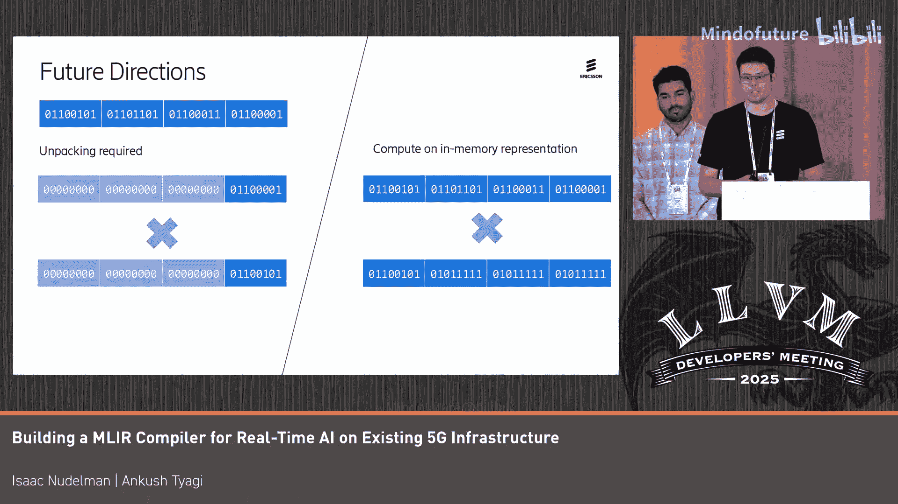

# LLVM开发者大会-US-｜-2025-Llvm-Developers-Meeting-p60-P59_在现有5G基础设施上构建实时AI的MLIR编译器--BV1ejr5BAEja_p60-

Hello， everyone。H， effective communication requires low latency。

 and the telcom industry has been pushing more and more towards low power consumption。

These two constraints alone have driven Erson to build its own custom SOC using Eson Manycore architecture or what we call it inhouse's MC。

 which uses hundreds of DSP and accelerators。So we have an existing clang L LVM tool chain with an upstream first approach。

80% of our developers have upstream contributions， this。

Particular approach allows us to gain significant performance improvements。

 so that that is why it was natural for us to adopt similar approach while we were looking at enabling ML on MCca using MLIR Now Isaac will dive deeper into our ML compiler approach。

This upstream first approach has given us a lot of development velocity， being able to reuse Lal and。

All the way down to the LVMIR dialect allowed us to get a model running on real hardware in about two weeks。

And we also got a very nice integration story with our existing LVM based tool chainin。

We also gain free optimizations， so for say a CNN， we can try different convolutional optimizations。

Popular one is I toal。 For us， we found it wasn't profitable。 We don't。

 We're not targeting a at accerator here。 That's a normal core， and。

We don't benefit from the memory access patterns。However， Winnerad was beneficial for us。

 we got a nice performance improvement。However， Winnerad is also not numerically stable。

 and we kept running into issues with model collapse。 and when we tried doing quantization later。

 even more issues。 So unfortunately， this is something that we had to shelve。For us。

 for our hardware， our North star for performance gain is ILP， or instruction level parallelism。

A natural approach for this is trying to pick vectorization。We try we went with aline vectorization。

 rather than lineal vectorization。Because。We saw that Linuxard Reization didn't really support some of the models that we wanted to run。

And unfortunately， we did not see a performance gain with vectorization。 In fact。

 we saw a three times performance degradation。Which is not exactly what you want to see when we enable vectorization。

And when we were looking into this， one of the things we noticed is that。

The affline vectorizer will always pick the innermost loop。 And in the case of a CNN。

 that'll be your convolutional kernel。 and that'll be have a very low trip count。

 So you end up masking off every vector lane。After the third one in this case and。

This is already suboptimal， we for a convolution you want to vectorize over the image。

And this is something that， you know， we'll look into later。

 But that alone shouldn't give you a three times performance degradation。But。

When we look closely at kind of what happened in our back end。

We saw that our backend really was not intended。Didn't have any kind of story for mask Ve ops。

 but auto vectorizer and LVM shouldn't generate any。

 and you also shouldn't get any from traditional C code。

So the result is this wasn't really something that anyone looked at。

 and these mask vectorobs were getting fully unrolled into if statements。

 So your single mask vectorob might turn into 100 instructions。

And this was a very important lesson for us。That there's no kind of free lunch。 You have to。

 the optimization on its own is not going to give you performance。

 You need to make sure that it's applied in a manner that makes sense and that you have the requisite lowering machinery to get it in a good place。

However， this was a very good lesson for us in pushing ILP。We were able to see that actually。

 fusion was a better driver for ILP for us than trying to use something like vectorization。😊。

And we can work with our model developers to enable better ILP。 So， for example。

 we can swap to sable convolutions。Which enableslin element wise fusion to work much better because you can give now confused vertically instead of being trapped by that reduction iterator。

And we were able to see over 100 x performance improvement。From other otherwise equivalent model。

And we also see that for DSP cores， they're really optimized for fixed point computation rather than floating points。

 So we really， really， really want quantization。But the best quantization is really。

 you built that in from the model side。 You're aware of what data you're getting in。

 which is probably quantized in a。DSP focus system。

 And you're able to use quantization of our training techniques to maximize your accuracy and performance。

And together， we really were able to actually sidestep much of the compiler in terms of performance work just by driving some of these lessons and making these lessons available to our model developers。

And kind of next steps wise， we also see there's a big trend towards really small quantization。

 like in four or below。And these things really don't work well naively on our hardware。

 Unpacking is a very low ILP， so we end up seeing substantial performance regressions。

 and it's not a great experience， but we're looking into enabling automatic S。

 so just doing the computation without unpacking。

And。Yeah。So in addition to that， we're also looking at how do we enable our model developers to effectively leverage our Es and custom accelerators。

By using AI frameworks like JX。And then also other directions that we are sort of experimenting and prototyping is enabling observability across the entire MLIR stack。

 so IR snapshots， diagnostics， traceability in transformations while making sure that it integrates effectively with our existing tracing infrastructure。

 and we are also looking at you know hopefully very soon be able to flesh out these features upstream。

Thank you。