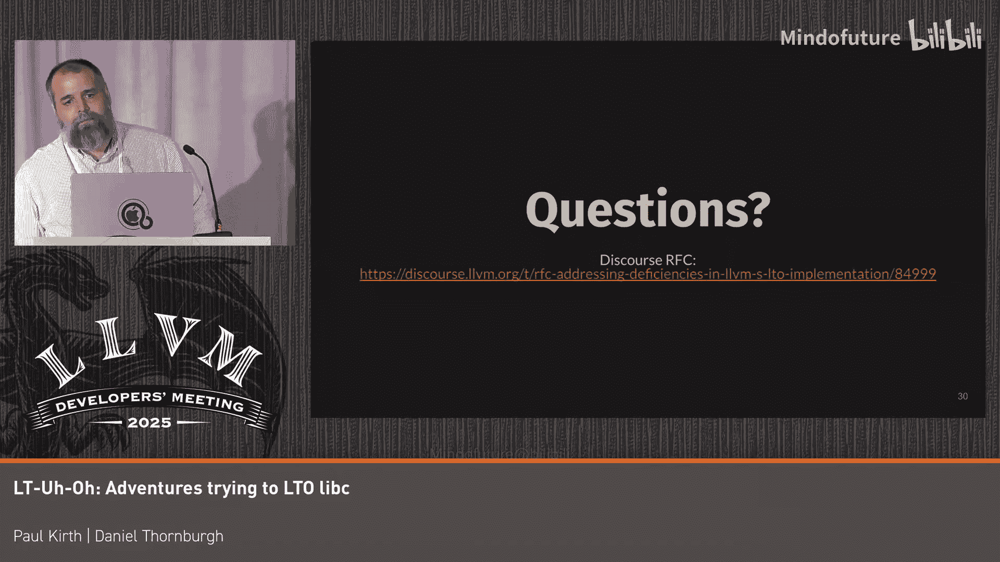

# LLVM开发者大会-US-｜-2025-Llvm-Developers-Meeting-p61-P60_LT-哦_使用libc进行链接时间优化的历险记--BV1ejr5BAEja_p61-

Hi everybody， I is small， I work at Google with Dan。

And we support we work on allivium for fuia and supporting a lot of the embedded systems at Google So today we're going to tell you。

Some of our experiences trying to use LTO with ellippsy as source。

So to give you like a brief overview and get everybody on the same page。

 I'm going to talk about the full LTO pipeline， like most projects at Google we are focused very much on smaller projects where size is probably the largest concern and full LTO still does much better in terms of size optimization than thin LTO so to start out you the linker gets set of LVMR perform some kind of symbol resolution and then passes control off to the LTO pipeline which starts to merge modules performs internalization and then you end up with sort of a monolithic chunk of LVMIR that's pretty much the whole program we on optimizations on it。

 do cogeneration and then regular elinking sort of resumes from that point and then you end up with your final output。

And sort of to motivate like why we want to do this in the first place。

 we are big believers in the power of the compiler and maximizing its opportunities to do the good things that it already does in a lot of ways LTO is about maximizing those opportunities in the first place right like we're merging modules together to sort of blur the boundaries that the compiler that we introduced by having separate translation units。

And so we want to have the compiler to give the compiler the opportunity to optimize interfaces。

 to remove as much code as it can。Really， that's like our main incentive is to maximize these opportunities。

So what happens if you actually try this， if you fire a plane， you pass FLTO to it， you pass it。

 your LipsC compiles this bit code， and lo and behold， it blows up in your face。I。

Here I have a undefined hidden symbol for Bcom， and that's pretty weird because Bcom is part of the source I compile。

 It's in by dot a。 So let's see what's going on。 I'm you know experienced compiler engineer。

 I know about save temp。😊，Let's do that and take a look at what's going on in the optimization pipeline。

So you might notice that I have a definition of becom。And you know。

 this kind of doesn't really make sense。Why am I having a problem with this undefined symbol when it is in fact here。

 so let's dig into this a little bit。So here's a simplified example that we're going to use as sort of a running team for the stock。

 I have some function food。It has a call it's a meM copy it's using that in a branch and then just's going to return somebody it's not really important what it's doing。

 so I have Men pump here that's available as an external symbol and I have Bcom。嗯。And so。

After global DCE runs， Ecomp is not referenced， and the compiler does what's generally a very good thing。

 it deletes it， it's Ed code， nobody's calling it， so it gets ready。

And that seems fine right now the code is good。诶。😊，But a little bit later， its combined runs。

 and part of its's combined is to simplifypl loophole。

And what this has done is it's changed the call from mecom to Bcom because I was using this as the condition in a branch。

Or。If that could be the same way。ゼロ？And I don't know if you notice， but like Bcomps also。

Back in my module as a definition as as just a declaration and not a definition。

 just some external reference that I now have。 And so when the link finishes。😊。

Everything blows up in my face。And this was sort of my table flip moment。

I just could not fathom how this was this was possible。So to summarize what happened。

You know all the lipse like APIs get marked as internal because this is just part of know LCO's normal start global DCE comes along。

 sees Bcom isn't used and deletes it， simplified Lib call know does me a big solid and optimizes it by reintroducing this call the BCO and linking breaks because。

You knowBCO is no longer around。And this is the point where like， I'm very sad。嗯。

So what's actually different about using。Elciolippsy。Cin has。

sortt of a large set of assumptions and most compilers in general about what Libpsy is and how it can be used and what these interfaces are sort of based on。

You knowC assumes things about Liy based on whether on the model that you're doing static or dynamic linking these interfaces are guaranteed to be sort of provided right it's an abstract interface from the point of view of the compiler and this is good because we want to be able to do high levelvel transformations to do things like pattern match against Mcopy to do this exact optimization that's sort of blown up in my face like changingMcomp to beComp and the way you control this when you're normally building your LiC and other stuff is through things like Fthnobuilins。

Theumb pilot also has sort of a set of low level transforms for things like lip calls and builtins that happen in the back end。

And there's no way to opt out of those， those are sort of just like part of like how itton probably is always going to work and those are handled special。

诶。So these runtime lit calls seem pretty attractive。 And this is sort of like， you know。

 how menm copy sort of。you know handles the situation so the first thing we thought of was like。

 all right， we'll just try that because these are treated differently by the optimization pipeline。

And they can't be removed。Because they're expected to provide a definition potentially externally。

They're also always extracted from like a bit code archive so it's going to be around for all the things to use。

 which is great and so like why not actually just use this use this mechanism。

So you think probably it works the way that we want。诶。So before I get to that。

I made this patch and Eli Friman very helpfully explained to me why this was a problem。

A lot of the previous slide is actually direct information from him about how the compiler treats these features and so what he sort of proposed was that we actually have a sort of conceptual split between a world where builtins are allowed to be used。

 things like mem copypy of Bcomp and you these lip funk。

 these things we define as lip funks and this is just the period of time where you can treat Lipsy as a completely abstract interface and the way like Elivviium uses this mechanism more generally is through like no builtins。

And so essentiallyly， we want to partse the compiler pipeline and two hacks。

 like one where it's just an abstract。Interface that the comp can always use and another one where you just have。

We enter a no built in world and you just have a superviR and the optimizer just treats it sort of as one big thing that it can just。

do whatever it thinks in the next。And so this is sort of。

You know what we started sketching out And so if you're thinking about how you would encode this and IR。

 sort of the most naive thing to do is to say like， all right， well。

 I can just slap the Nobiltons attribute on。Like all the functions in the module and picks some place in the pipeline where this is going to be safe and you know。

 let's see what happens。嗯。And so I built this pass， and it's a very naive pass。

 it literally just does what I said。I just put the attribute on everything。

The compileilr continues along and lo and behold this way。

Bcom can't be DCD because it's illegal to rewrite MeComp to Bcom because it's not available。

 and this never gets replaced during global optimization。Unfortunately。

 it really works because what I've done is actually slightly a lot right like when I slap no blitins on this。

 I actually changed a considerable amount of the compiler's behavior。😊。

Putting no built ends on all of these functions， no matter where you put it in the pipeline。

 it's going to affect a lot of what goodness you would ever get out of TLI in the backing and so something like this where you'd want to replace this call to square root finite and you'd normally get a single instruction on X86 replacing it can no longer happen。

And this is sort of throwing the baby out of the bathroom。Right。

And I'm going to hand the rest of the talk over to Dan。

 this is going to talk about how we're actually going to build a more proper built。Yeah so。

I was kind of in discussions with Paul on a lot of this stuff but kind of like taking a backseat and kind of the reason I was interested in this is because in my goofy side project。

 similarly， we had just decided， oh， well， LT all of the things we on the tiny embedded system like what could go wrong and for us nothing actually went wrong。

Which was very surprising， given like all of the stuff that we just talked about， you know。

 it a lot osively is wrong and one of the things that kind of led into what I'm about to talk about。

 like having， this kind of more sanitized notion of builtins and how we treat them especially postlink was that like。

It's almost right today， like you could think of a world in which builtins exist and operate normally as being everything that happens before you link IR together。

 But then once you link I together， then you know you can't necessarily do arbitrary transformations and Paul's patch。

 which he had tried， was like the simplest place to have this cut between。

 I know what builtins are and what they do and I don't know anything about them would be like at the link line like once you've decided what you're bringing into the link and what you're not。

 then you can justclaim all knowledge。 But you know， of course。

 we discovered that that turns off like a ton of things because you do actually want to know what functions do post link like this when you're generating code and LT that really。

 really need to know things。 So it wasn't quite as simple as just making the cut the link as much as that would be conceptually nice。

 We need to find a way to have stuff after the link have a more refined notion of what you can do with these symbols。

 So we spent some time thinking about it and some of this came from you realize some of this was just faculty envelope of stuff between me and Paul。

 what we came up with。し？A set of rules for how to safely use functions after the link is finished。

 So first rule， if something made it in。To your link and is in bit code。

 it's probably safe to add references to it。 like， you know， in this case。

 or we have B comp get pulled in for one reason or another。

 this memcomp can be turned into a call a B comp because we made it in。 like it's， it's in our link。

 it' be kind of silly to not allow transforms like this to happen。

 And so we want a world in which we can allow some of these transforms that are safe to happen。

 But for this to be safe。You know， sorry， as a check mark for this to be safe。

 we really need to know that if we do one of these transforms and we're going to allow ourselves to do these transforms absolutely at any time。

 Then what we're transforming to has to be sect。 It has to be treated as carefully and set apart in such a way as if it was basically something that you pulled in。

 And thankfully， LVM already has kind of a mechanism for this。 You mark it as used externally。

 You pretend that there's something out there in some code that you can't see that calls this as is。

 And thus you're not allowed to fu with it。 You're not allowed to delete it。 You're not allowed to。

 you know， we'll need arguments from it。 You're not allowed to change。 It's A V in any way。

 and actually just setting its linkage type to external and not letting it be internalized。

 does that。 So if you do that， then this thing。Get marked as not being able to deox with and this case that we had where you have it going away during DCE。

 that actually just can't happen。😡，So that actually takes care of about half of it。

The other thing that you can't do， which is something that wasn't in this example。

 but we've also been able to make examples that broke in similar ways is you can't allow people to add or sorry allow passes。

 the compilers not people allow passes to add references to things that didn't make it into the link like because you have finished blinking the set of Lipsy functions that made it in and didn't made it in。

 that's frozen like it's not going to be reasonable to halfway through the compilation process decide that you have some extra bit code that you want to run through all of the stuff that you did。

 including inlining and things that are like that way lies madness。 So you do the link。

 the stuff that made it in made it in the stuff that didn't make it in， didn't make it in。

 And so in this case， for this example， if B comp wasn't ended up actually needed for anything it's kind of not reasonable if you notice some code pattern after the link rather than before the link that now because an inliner or whatever you can discover that you can turn from MCcom to Bcom will。

 I'm sorry that's too bad。You didn't know that you needed Bcom。

 The link is already over like we consider it a reasonable tradeoff to disable cases like this where you're going to insert new references to functions that that are outside of the length。

 So we actually built a patch for this to do this。 And much to our surprise。

 It actually wasn't terrible。 It's like a couple hundred lines at this point。 it's pretty reasonable。

 it touches a lot， but the ways in which it touches everything are pretty small。

 So I'll kind of go through a little example of how what we built works。

 And and then we can talk about the details of this， like。

All of the stuff that is around this that we kind of want to move forward with upstream。

 so this is like a little brief summary of how it works， but I'll go in specific。

The very first thing that's going to need to happen to have a model of this is we need to。

 LLD needs to get knowledge about what are these functions？😡。

it needs to do this because it's going to have to collect information about whether or not these things are in bit code later。

😡，We actually do have prior arc for this in LLD。 there's a little function that is called get runtime Lib calls because similarly the runtime Lib calls are treated specially by the link and they need to summarily be brought in and so this was something that really annoyed me I used to call it the list thankfully someone killed the list and now it's an actual function call with good semantics but there used to actually just be a static list that was table gen of absolutely every string that was a runtime Lib call and it didn't actually have all of them in it so because of course it didn't and if any of them was wrong and they were in bit code then they wouldn't get brought in but like that has has been fixed and I'm very very happy about that so。

Similarly， we can add a what are all of the C library functions call and know that's a bit of data but that's not actually that bad。

 you can give a target triple to target library info， have it construct itself。

 all of that decision making is just based on the target triple and you can get a conservative list of what are all of these functions。

 what could they be and then in response to that in this case I have memMC B Comp FMMcopy dot dot dot all of the others。

😡，嗯。It's pretty easy in the linker to go through the simple table。

 see what all of these symbols resolve to， which of them actually are available or not and for the ones that are available。

 maybe some some mismatch or whatever you wish these actually are in bit code the ones that are in bit code or the only ones that we might have some problem bringing in late if things aren't in bit code then totally fine so in this case between these two we can say that mem copy is a hand coded assembly implementation and if you have an actual object file that backs one of these then well there's nothing more you need to do with this So one of the nice properties that this gives this approach is that it's a complete noop unless you're actually trying to LT and your Libpsacy which is one of those things that might have us have a prayer of actually like having the screenable So the only actual overhead for full LTO would be that you would query LTO and construct an array with a bunch of strings in it。

 which is it's a thing but it's not that big of a thing and it's something that target library info already does a ton of times anyway so。

Once you have that list， though？You can。Go and ask now。 All right， we've got these。Lib calls。

 We know that all of them are in bit code， and we can actually scan through in the LTO side。

 all of the Ir that we received in full LTO and in thin LTO， we can go through the module summaries。

 and we can ask。Okay， which of these made it in， what is our set of allowable Lib C calls。

 like what is the Lib C that made it into our project by direct call by something being needed？😡。

And then we can freeze that list and this example I have MeComp and VComp， they made it in。

 printf didn't make it in。And finally， the LTO process that is going to invoke code generation and optimization when it itself is the thing that's responsible for constructing this target library info object that says what parts of Lib here are available And during that construction。

 you can actually go through take this list of things and for anything that has。You know。

 it didn't make it into the link， the things that were crossed out in that previous slide。

 you can disable them so that they're not allowed to be called and then the ones that did make it in。

 the ones that were on the previous list but not crossed out， you can say， okay。

 these are the ones we're allowed to call so we're going to treat them as sacrosannct。

 we're going to mark them as external and not allow any optimization paths to touch their API。Or。

So that does actually appear to work。 It passes through the LTO test suite with only a couple breakages that have to do with the tests literally assuming that you can do this unsc transform that we're trying to disable so we have a modicum of confidence that this is kind of an okay thing to do there's probably going to be a lot of quibbing about the spelling of all of this like I just lazily monkey patched things into interfaces in a way that could almost certainly be way more elegant。

 but we think that this is kind of a way that this problem could be solved that's it's like among the first principled approaches that we've had for this and like we mentioned。

 this builtins world that we have where we know what the builtins are is something that we might be able to exit and at some point in the late pipeline allow you to discharge this I'm going to keep them as external and sffphoancs notion and start allowing you to do optimizations on them like if we can find a point late enough that we're not going to do you renamings of symbols。

Just going fus with IR directly then we might be able to find a cut and get a little bit more good out of our optimization pipeline so yeah I think that's kind of the approach we have I'll pass it over to Paulford the rest so briefly like where are we going to go from here we saw have some more evaluation to do。

I was really hoping to get something more broadly like tested across Google。

 I don't think using the static Gpsy at Google Sc is quite ready yet。

 but we have several embedded projects that we're investigating this with right now。

 It seems to be working well they're getting some pretty good code size improvements we think there's still some tweaking we can do to make it work even better there's going to be a lot more discussion with our upstream partners you know everybody in this community is who we're talking about。

 we want your help， we want your advice， I wouldn't have got here without Eli's advice or the advice of lots of other people like I've been talking about this for a while there's other questions like do we need to do attributes for Lib C that would make this work even better Do we want to make changes to the past pipeline is encoding some of this stuff in the IR in a more like principled way the way that we want to go in the future that we want to also consider doing things like this for builtins maybe maybe not。

You know， this is all about unlocking the potential of the compiler and letting it make the decision of whether this is a good idea or not。

 it should work probably in practice， but whether we want to or not is sort of an orthogonal choice And I think the other thing that we actually want to hammer out is what are the exact semantics of LTO and all these cases。

 How does it differ from traditional linking model。

 Is that different between the different object file formats I it are we compliant。

 Are we doing something strange Are we being consistent and principled， And you know。

This is a big community， we don't think we'll get there alone。

 whatever other people in the community are thinking about or probably things we want to discuss and help move forward and with that let's open the floor for questions we have an old。

I RFU that discusses some of these issues with Elf， feel free to chime in there。

 we'll be posting updates and links to our patch in the coming days。

Provo guys， thanks for taking cracks at this super interesting stuff。

 I feel like you know the initial problem you described is like a phase ordering hazard essentially between global Decode elimination and Lib call simplified just assuming that these functions are always there always available and I think issues that I personally have with Lib call Simplify is like what version of LibC are we talking about they add more functions each C standard and I don't think Lib call Simplified does a great job of saying the user intends to target C99 versus C 11 versus C23。

And on language property， existing property。And I think the same thing applies to compilerRT and like what versions of these things are you using and you know。

 especially elegant Liacy being highly configurable。

 you know you could do a build of elegant Liacy that's literally just manpathpy and nothing else in it right if you wanted to So I guess our embedded targets aren using you know elegant Liacy。

 so we're able to leverage that a lot I'm looking forward to。Finding new opportunities there。

 So yeah， I guess some questions I had， does your marking of the Lipsy functions as external linkage true like fully pessimized。

Dead code elimination for Lipsy provided symbols that are are truly dead。I think we。

I think in part we're relying on Liage G but。And not I think if they're really dead at the end。

 there's something that runs quite late that will。Givenive them So one of the things that this buys us is we actually do get a little bit closer to the。

嗯。I guess it's the case that if you have Ts that have like。

 if you have the traditional Libacy model with one like TU per entry point。

 then there actually has to be a reason that one of these was brought in and。

The only case that you could end up with something dead because there will be a real call is if instant simplifyim。

 you know change that from a call that did make it into a different call that made it in。

 but admitted like so a bit niche， but that still could happen and you could end up with like something that was brought in and use a whole bunch like actually ends up dead。

 I do think one of the things that we could do and I'd like to do is to run a late global DCceE pass。

 like one of the things we talked about is we split the DC pass into do yeah。

 just another instance of it essentially like if you are willing to say， okay， past this point。

 it is a pass ordering problem。 If you're willing to say past this point。

 we will not rewrite you know， we will basically disclaim any knowledge and you can do that with TI。

 you can just put no Billins on every function essentially and disclaim any knowledge of what anything is。

 And if you do that， then it's safe to rewrite whatever because you know that you're never going to manipulate the I in such a way that a pass is going to depend open。

 And we actually do a good job of making sure that when we need to know。Something about a function。

 we ask TLI， whether we're allowed to know anything about that function so I think it'd be just a matter of manipulating the past pipeline a bit and that's one of those things we wanted to talk to people about is whether it's worth it to do this like what are the trade-offs and performance for people to care about this and don't care about this like how do we actually structure that they would just at the very beginning of thinking about I guess another part that I was curious about so I recognize the issues you described with having the list and the list getting stale as more library functions are added to the language or let's see being configurable or what version of compiler Rt are we talking about since targetrg Tri doesn't encode the versions of these things right。

Is there a way maybe someone can say like all the symbols provided by this to you being brought in through LT like this is the let see side channel So we don't have to go and annotate every function in the Li something This is some of the ideas where this is what we're sort of talking about like do we need an annotations let see other things we should mark up。

 Do we need a new mechanism I think this is going to be an ongoing discussion for a while。

 I think this gets us to。Maybe the first version where this is like not doing an explicitly like wrong thing and blowing up in your face。

 and it's not optimal and we're going to have a bunch of work to figure out all the ways to spell this and more sophisticated ways。

 unlock new optimizations。Teach some of the optimization passes that there's more。Sophisticated。

 invasive things I think I maybe try when we mark them up the right way to say like， hey， hey。

 we're your part？Nick Matt has a question。哎哎。Okay， so I posted a patch to add the boilerplate for the Ortime Li calls analysis。

 So I'm trying to get like I do not care target library info at all。

 Like that is not the thing that I care about is onetime Li calls because most of the。

CouldCall synthesized by the compiler are there。 and it's stupid that we have this split where they both do the same thing。

 but they're just like slightly different。 I want to get everything in there and then be able to modify the set of。

We can track both the versions and which functions are available in this analysis based on the link point。

 there's one I called that be amazing Thank you Like I'm very happy to support that work and。

You know， you'd make our lives easier， I think， so thank you。Any more questions？

All right we are out of time， so it goes get that warm amount of applause for Paul Greg。

