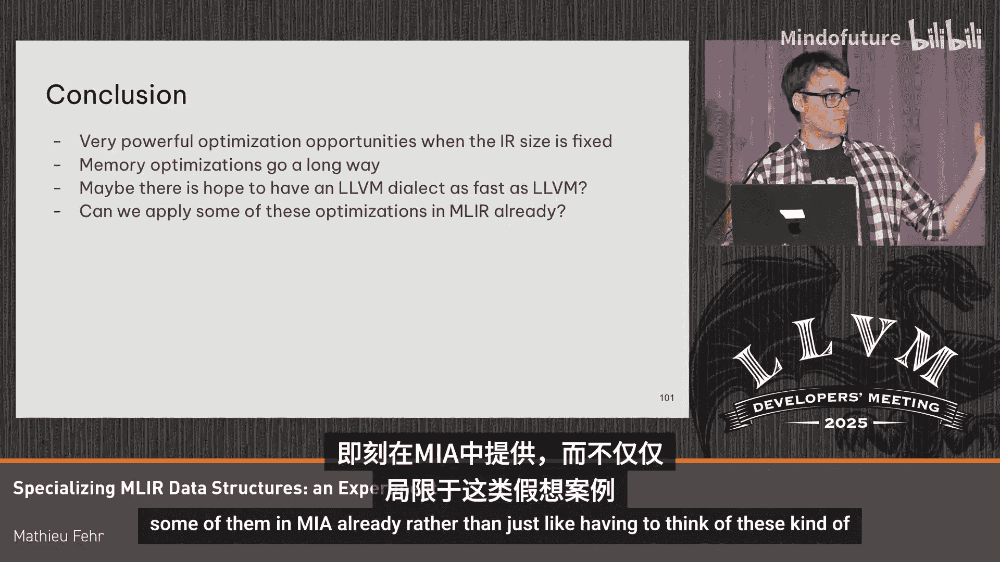

# LLVM开发者大会-US-｜-2025-Llvm-Developers-Meeting-p62-P61_MLIR数据结构的专业化实验--BV1ejr5BAEja_p62-

Hi， I'm Matthew， and I'm going to present you a bit of meker with the MII data structure note that there's an experiment in the title。

 it's because all of this is just a bunch of hacked to making this work in MRIIR and then we'll see later if this actually makes sense to be implementing in MRIR or not。

So I guess it's no surprise to everyone， that like compile time matters if you're ever like compiling MIR。

 you realize that it's better if it's one minute than if it's in one an hour。

So it leads to kind of faster development cycle of being able to actually compile fast。

 it leads to faster CI time， which equals money， it leads to happiness because if it's fast。

 youre less sad in your day。And there's a very cool presentation as we done a year and a half ago at U LBM I think 2 24。

 which is how slow MLII is。 And there's a very good like detail explanation on what's the kind of reason why MLII can be considered slow to something like L LBM。

😊，So MLI is kind of known to be slow and that may scare a bit of people like I don't know if maybe we should try to port a lot of LLVM into MLII because I don't know if this is going to result in。

 let's say， 20%， 30% performance loss and that's a problem because when you have programming language compilers like Ru or Mo using LLVM if all of a sudden we say if you up your LLVM version it's going to be 30% slower。

 they're not going to be very happy and you're not going to be very happy if you have to compile MLII anyway。

So there's older kind of programming languages compilers that also for them。

 LLVM is already like way too slow。 If you look as Webki or Luigitt， well。

 they want to be an order of magnitude faster than LLVM。

 So MLI is not even like considered in the first place to be used in those languages because they like kind of ultra fast Git that are made to be really。

 really fast。So why don't we just make MLI faster， right？ Why didn't we think of that， Well。

 MLI is kind of compiler time is a tradeoff。 It's not something you can just like make compile time faster。

 You have to trade something。 So the question is kind of what are you willing to pay to get faster compile time。

And there's like two trade off I kind of want to show in this presentation。

 and I want to kind of evaluate what do we do if we pay those trade off。

 So the first one is extensibility。 One of the major strength of MIR is being able to represent all of these kind of domains of compilers。

 You can have machine learning。 You can have hardware design， computer graphics。

 All of these can be represented to the same M IR。 And all of these kind of。

 they can all interact with each other。 And that's really， really nice。

 And that's one of the major strength of MR。But because it's built on kind of these extensible abstract and they want to represent all of these domain。

 you want to be able to have very， very， varied amount very very kind of style of I。

 you would have one that have multiple results， multiple operas， one that has a large amount of ops。

 you can have either using basic block to represent control flow or you can use regions and you can have all of that at the same time somehow。

 I hope no one writes an operation like the one at the bottom。

And you can also use interfaces so if you can have passes that don't even know the dialects that they're currently kind of processing you can have。

 like let's say the DCE pass can just operate on any dialect that has this member interface。

So all of this is kind of a cost， kind of like runtime cost。

 which is a compile time cost whenever you building your compiler with MLR。

 you have operation memory size that needs to be kind of a bit larger。

 probably because of this extensibility， you have the cost of checking if an operation as an interface or trade because you need to have some layer of indirection。

 You checking the operation output code is the one you want， can also have a bit of a cost。

 and you also pay a bit the cost of attribute dictionary whenever you want to try to do a bit too much extensibility in your compiler。

The second tradeoff that we can look at， which is the same one that actually LLVN has is kind of what I can call in some way usability is like you can have an entire program and you can just replace a single operation and it'd be quite fast because you can just do very fast replacement in general。

 you have a lot of asmptotics on the MLIR algorithms that are very fast like replacing an OpM replacing an operation inserting one moving operation。

 these kind of things， and this has also a runtime cost which is also a problem with compile time later on。

And all of this is represented the reason， I mean， you can have all of this algorithm is essentially everything is a pointer in MLA。

 is like pointers to everything。And this is just like a bunch of spaghetti of IR。

 which is like everything is linked together and keeping up all of these links correct at all time requires a lot of like bookkeeping。

 So just replacing an oprun is this amount of assembly。

 which is like looks quite large for something that you would think is just like setting something in memory one time。

So could we get kind of so this is kind of oh both tradeoff， we have one which is usability。

 one which is extensibility， Could we kind of have a project like MLIR where in one sense you can have all of its extensibility yet manage to have the performance of like an instantative compiler like LLPM。

 which has a fixed IR。And we could we have at same time accesses at all of these kind of asymptically good algorithms。

Yet at the same time， being able to make some passes really。

 really fast if you decided to do so and willing to pay the price of writing your compiler passes a bit differently。

So essentially the question I'm asking is what if the MLI data structures were an interface。

 what if you could just replace the definition of an operation for whatever is better for your current compiler and actually credit to credit is where credit is due。

 the Robbin project which is kind of reimpleation of MLI in rust already has this in like their data structure they can just like replace。

 I mean essentially the definition of an operation is not fixed， you can just add your one。

So in this talk right now， what I'm going to present is kind of what are the performance opportunities you could get from doing this kind of specialization before replacing the data structures with different one that have different trade offs。

So first of all， let's look at the first thing， extensibility。

 What if we could take all of the dialects we have， we select a few one。

 which is the one we care about in our compiler。Can we have something that is as fast as LLBM。

 essentially。So for those who haven't seen the presentation about how slow MLII is。

 MLIR data structures are roughly two to four times slower than LLVM。

So kind of the thing you would think you could do， or at least you wish you could do。

 maybe is you take your direct definition， I FSCF， you take all the trait interfaces definition you have。

You use tablegenin magic， which is a scary amount of tablegenin magic。

 and you generate Ii dot I I dot CPP do E。 just like you generate these kind of things。

 What kind of table genin magic you could do， I mean。What could you get from this。

 What kind of performance improvement you could get from this。

So this's things that you could make faster， like checking operation up code。

 you can have accessing traits and interfaces being faster because right now you need to essentially look at all the traits that your operation that your operation has and it's quite slow。

You can reduce memory footprint by removing some features of the operation and you can also try to。

 let's say， fix the up property size in order to get some performance。

 So that's the four things we're going to look at right now。So first of all， checking operation Up。

If you， instead of using the D cast cast mechanism。That that MLI I currently use。

 you could implement a similar one that essentially just every operation has an up code。

 which is a fixed number that you can more easily define and essentially use less memory to do this。

What you do when you do this is， of course， like extensibility， you can't have like。

 you can't just add your new dialects because it's like much， much more complex to do this。

So what would you get from this， So just iterating operation in like a vector of operation that's like0。

 31 nanosecond。If you just check currently with MLIR that an operation is， let's say， an ad。

 it takes like 0。51 nanoiseseds， and if you would check with the output， it would be 0。29 nanoisesed。

That looks a bit of an improvement。 So I a bit lying to you because that's exact。

 we're always checking into exact same operations。 everything is in the cache。

 If it's not in the cache， the improvement looks a bit less significant。

 You're just gaining still you're getting something about like 10% performance gain。So now。

 so this was for the output。 Let's look at accessing the interfaces。

The good thing is that the people that did so Me and Jeff that did this kind of benchmarking of MLI already have the enophone。

If you implemented interfaces with just a switch case rather than just iterating over all the traits and interfaces like right now。

 you could get technically a4ex speedup。There's probably also other ways you could do this this thing that would maybe lead to faster speed up。

 but's at least we could get at the speed of LLVM for these kind of things。

So now let's talk about memory footprint。 So this is kind of how no operation is defined。

 or at least the kind of inline structure of the operation is。

And we can maybe remove some of the features if you actually know the compile you're using。

You don't necessarily want to you don't necessarily have to keep the dictionary attribute because you can just say。

 I know my passes， I know the Dects I'm using， I'm using operation properties already。

 I may not have to use a dictionary attribute so you can gain like 64 bits for that。

You can maybe reduce the size of an operation name if you only have like a few operation。

 you can maybe fit them in like 16 bits，8 bits。But what we added it。

 can we also remove things like the order index， if you don't use， let's say。

 dominance for your passes or if you don't want to use verification。

 and we could as well remove location if we're doing something that's for release and you don't want for debu。

 So I tried to remove as much as I could to see what we could get from it。We could say like here。

 for instance， 24 bytes， if we just remove all of these and divide by two to the size of operation name。

So if we just create an operation the same one kind of over and over。

 we just insert a lot of operations， depending if you have0 and two operas you can get like it can be done in 44 nanosecond or 65 nano or 75 nanoseds。

 if you reduce a bit this memory footprint， we could go， we could gain a bit like 10%。

20% improvement so like。Small things， but it's still good to have。

If we do this kind of optimization pass where， I mean， not optimization pass。

 canonization pass where we put constant on the right， that's same。If we we can go from like seven。

 so if we match， if we have that on like a billion operation and we all of them are exactly in that format。

 we can go from 7。1 and a second to 6。1 and a second and if we don't match any。

 we gain still also around 10% or 20% speed up。So that's also places where we can gain some improvement。

So now another kind of fun thing is that if you know all of the ops you're dealing with。

 you know kind of the operation property size， so an operation properties which contain everything like in area。

 for instance， you would have the constant stored in it。

 it's like all the kind of inerrant attributes。So in operation。

 it's technically you have the class operation I showed before。

 then after it there's more thing that is put in the same allocation， like the opera storage。

 the operation properties， the list of successes， the list of region and the list of operation operas。

Well， operation have vastly different size of properties。 Some of them have almost nothing。

 Some of them are just a flag， and some of them can have like entire like large properties that you need to allocate every single time。

 you allocate them。So let's assume， you know， your dialects and you know。

 they don't use that me the operation properties。 They only use like， let's say， one or two bytes。

 you can think of， let's actually allocate these operation properties on every single of your operation and see what you can do with it。

So what can you kind of do with this So what we could do with it is whenever we replace an operation instead of creating a new allocation for your new app。

 initialize the new operation， replacing the results。

 which is quite costly because you need to check for every single user。

Erasing the old operas and then they allocating the old operation。

 what you could do is reuse the same allocation in certain cases。

 in the case where you already have operas， that's one of the con。

 you can just change the name field， erase the old opera and then initialize the new operation by here。

 for instance， setting the new constant。And this， technically。

 you cannot do this in MLIR because there's like some constraints on the reason you could or could not do this。

 One of them is like operation properties being the same。

This in like a simple constant folding benchmark， we can go from so iterating in the intermediate representation is like 3。

6 nanoseds per operation。Doing this kind of replacement of constant folding is like 1 hundred and14 nanosecond per operation。

 And doing this replacement where you just reuse the same location is just twice is the cost of interact I。

 So here we essentially have a 15 x speed up on that benchmark， but just reusing the same allocation。

And all of these can only be done because we know the operation property size。

 and now we know that we can do these kind of things。

So kind of a takeaway of these first micro benchmarkchs is that we can get a few improvement from memory footprint。

 we can get like these 10， 20%， and on the interfaces straights heavy passes， we can get even more。

 but there's a huge potential from reusing allocation and in general from not allocating or not delocating certain and operations and there's like things that maybe actually could be useful in MLI proper if we actually figure out a way to expose this。

So that's why it's kind of in a safe in the kind of the extensibility tradeoff。

 not there's also this kind of other tradeoff， which is what if we would restrict some of MLIF features。

 what if now let's say we cannot access the death use chain。

 what if we can not in certain an operation in constant time。

 but instead you would have like a vector of operation that you need to replace all of them at once。

 which is kind of the tricks that Webki is using to be like time faster than LVM。

So the three tricks I'm going to look at is first removing kind of the death use train。

 which is how to get the uses from an operation result。

 kind of looking at the linked list walks a bit because it's like something that's still a bit costly and more again。

 memory optimization。So currently the set opera example I showed earlier。

 which when we have the depth use change look like this and if we remove all the pointed to the users。

 it would look like this。 So essentially we would gain like quite a lot of performance by kind of removing it。

 of course， which has a lot of cost。If we go just creating operation with zeros or like seven operas before removing the defute chain。

 we would have kind of a large difference going for 45 nanosed to 77 nanoseconds。

 removing the diute chain can of reduce a lot of the cost of adding like a lot of operas。

 which can matter a lot in like some benchmark like if you look at the circuit project has a lot of this operation that has a lot of operas。

So this is kind of one 42 times of speed up。So if we look at the example we had before。

 where we're just putting the constant on the right。

 So reducing memory gave us between 10 to 20% improvement removing the use Dev chain gave us a bit more whenever we do we actually matches these things whenever we actually do this replacement。

 We get around again， like a 1。5 x speed up。So if we do the same example we had before where we had essentially to constant folding that was much faster。

 if we remove the Dev huge chain， we can even make it faster by having by again。

 removing the deffus chain， meaning less work to do again。

 the only reason you can actually do this is because you can replace an operation by just reusing the allocation in general。

 you can't just replace an operation with another one if you don't have the deffusge chain or you need to use like more complex algorithm to keep track of these of the users。

And just like an additional kind of benchmark， I just try to see what if instead of just putting them in the linked list that we have in MLR。

 we would have like a vector essentially， and we would gain again a bit of performance。

 but this would have a major， major cost because that would mean that you can't just replace an operation anywhere in the IR。

 you would need to rewrite kind of the entireIR。So as a last kind of optimization opportunity I want to show and one that actually might benefit MLIR already。

 depending on how you would implement this is kind of having an arena allocation for operations。

 So right now， whenever you have multiple operation。

 they all have their own allocation given by let's say， a Maoc。

And this is a bit costly because each operation requires a new allocation。

 which is kind of costly as we saw before， and also each pointer has to be 64 bits if you want a 64 bit machine。

But what if instead we would pre allocatelocate in a mallau array that we would allow the allocation of like the competence on that？

And then we would just use essentially an index in this array to have pointers instead of having just the pointers directly。

In the experiments I'm doing all operation have the same size。

 which makes the allocationloc of an operation very easy because I can just have a list of valid places in that way。

So if we take again this example of like just constant folding， what happens is that in MLIR。

 creating the IR would take 75 nanoiseseds per up and rewriting it 14 nanosecond per up with having an array location with let's say we say that all operation will always allocate for 7 opera we would have around the4 to five time5 x speed up on creating the IR and around I forgot it's probably like 50% of like。

Speed up in rewriting the IR for like the constant folding。

 And for in if we said we had at most three operas。

 we would have actually a5 x speed up in creating the IR and a2 x speed up into re it。

So this is something that could be quite beneficial and that would be quite nice if you could actually have this kind of array allocation mechanism in the MaA rather than what we currently have。

So in conclusion， I kind of tinkered a bit with the ML data structures and kind of want to see what's going to happen。

And I found some quite very powerful optimization opportunities。

 If you kind of constrain the set of the things you can do in M IR。 And when the I size is fixed。

 there's a lot of things you could do。😊，They also memory optimization go a long way。

 This is like one of the bottleneck in a lot of microbeching。

 things might be a bit differently into like real like benchmark。

 real code that's actually used in production。And maybe it is one day I hope that we can have an LLVM dialect that an NLVM passes as fast as LLVM inside MLIR。

And also， maybe we can look at this optimization and think that we could expose some of them in MI already rather than just like having to think of these kind of athetical examples。

So thanks a lot。Thanks Matthew， time for a few questions。YeahGreat stuff Matthew。 Thank you。

 I have a question a comment。 The question is more generally。

 like MLL and C++ and C++ has this philosophy of zero cost abstractions and some of those are like what you do is shifting the cost from let's say IR creation to Ar manipulation So for example。

 linked lists are great to insert stuff into when you need arbitrary insertion but are not great when you need to do like consecutive insertion So can we maybe have like a pay as you go So you have a linked list。

 then you remove it or you don't have it then you construct it same for use depth chains like can we move towards that instead somehow。

Oh， so that's like data structure interview， I feel is like。

 can you have something as fast as a linked list when you want it and otherwise Yeah。

 it's more like can we construct those linked lists when we need them。Yeah， I don't know。

 and I don't know what would be the cost also of allowing the shift。

 I think in so in how slow is MLI presentation， there was the idea that if you want to iterate over your IR multiple times。

 you would you would do the opposite。 you would construct these vectors。

To just essentially store all the pointers。 and it's going to be faster。For the linked list， yeah。

 I don't know。That's the。Any more question？Okay， let's thank the speaker again。

