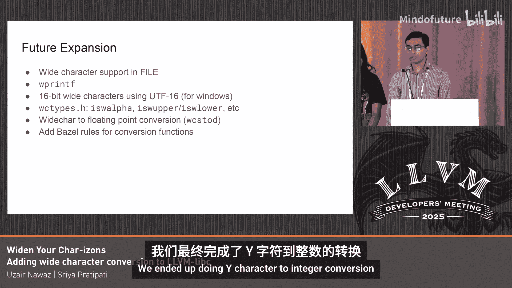

# LLVM开发者大会-US-｜-2025-Llvm-Developers-Meeting-p63-P62_项目Widen-Your-Char-izons_在LLVM-libc中添加wchar支持--BV1ejr5BAEja_p63-

Hello， everyone。 Today， we're going be talking about the project we worked on over this summer。

 titled wide in Your Cha Rons。 And my name is U。 and I'm a rising junior at U T。😊，sorry。

 current junior at U T。 My name is Sya， and I'm a junior at the University of Southern California。

 And so we're gonna be talking about our project where we added wide character conversion to L L V M Lipsy。

😊，So first to start off， we should probably talk a little bit more about how strings are represented in memory。

So in C， we usually represent strings as just an array of chas。 chas being a one byte data type。

This is super convenient for like1 byte characters。

 But when you start getting into when you start getting into characters that are large enoughbyte。

 like emojis or other alphabet systems， this system does not。

 This system becomes a little bit more complex。 So that over there is an example of how we represent the during L of V M in memory。

 where each bytes just each character is just a single by long。😊，Alright。

 so that's where multibyte and Y characters come in。

 So they're both just ways of representing these characters that are past ASI。

 So multibyte characters strings are typically represented by UTF 8 encodings and can vary in size between one to4 bytes。

 So the length of a string in bytes is not necessarily the length of the string in characters。

 So it's also reference to by a cha pointer。 So it's possible to stop parsing when you're in the middle of a character。

 Y character strings， on the other hand， are typically represented by a UTF 32 encoding。

 So it's always a consistent number of bytes， which makes it easy to calculate the length of a string and you can't stop in the middle of a character。

😊，So here's an example of the string clown sigma in a multip representation and the Y character representation。

Okay， so now let's talk a little bit about the actual conversion process so on the screen allows the table to convert between code points。

 which are the UTF 32 representation of characters and their equivalent UTF 8 forms。

 The main thing to take away from this table though， is that if you look at that very first byte。

 the first couple of bits will tell you information about how long that character is going to be represented in UTF 8。

So using that information， let's start by working through an actual example of converting fer multibyte string to a y he string。

So we're going to try to convert the string a sigma to from a multi byte string to a wide character。

 and off to the side here， we have this partial state。

 which is just going to represent where we are in this conversion process。So first。

 we're going to read a single byte from the input string and sew into our partial state。 Now。

 remember how I said the very first。The very first bite will contain information about how long that character is。

In this case， the letter A， we can determine is just a single byte。

 So our partial state contains a full character。 At this point。

 we can just write it to our output wide character string。 like so。

 And then we're gonna continue the process。 So next。

 we're gonna read another character from the input multi byte string。

 But this time that first byte told us that this character is gonna take two byte to represent。

 So we continue reading from the input string。😊，And after we do another read。

 we now see that our partial contains a full character。

 and we can go ahead and write it to our output wide character strength。😊。

And then the conversion process is completed。Al right。

 so now we're going to go through an example of using this interface。

 so here's the function MBBR to WC。 we're taking an input of the clown emoji represented in a multibyte string and our output variable is the Y character string。

And initially， we're passing it with one by to read。 But since the clown emoji is 4 B。

 it returns a value of negative2。So now we're passing it with a value of three bytes to read。

 since we now have read four bytes total， it has successfully read the Clown emoji and it returns three。

 which is the number of successful bytes it read， as well as puts the wide character in the output string。

So you may have noticed that it also took an MB state parameter。

 this is because MBR to WC is a restable version of this function。

 which means that it takes that MB state， the user has a little more control over it and can restart the function whenever non-restarable functions have their own internal MB state that's maintained globally。

 which means that it can pick up midconversion， but you can't force it to restart。Okay。

 so now let's talk a little about our design。 So one thing is we kept mentioning this M state。

 which represents that partial state as we're doing the conversion。

 and this is an opaquestruct defined by Lipsy itself。 So as LVM Lipsy developers。

 we can decide exactly what we want to include in thisstruct。

And what we ended up settling on is we wanted to store the partial character in UTF 32 form。

 the number of bytes that we have stored to this partial state and the number of total bytes that this character is expected to be。

 So this makes it really easy to check if our M state contains a full character or not。

 because we can just check if the number of bytes on our partial state is equal to the number of total bytes。

So then we design the character converter class， which is the internal interface that we're using to interact with our MB state。

 So we have push and pop functions as well as other things such as clear is empty and is full and is valid state。

 So when we're converting between a multibyte to a wide character。

 we push one byte at a time and we pop the entire wide character。

 most of the conversion here happens during push and then when we're converting between a wide character to a multibyte。

 we push the entire wide character and we pop one byte at a time here most of the conversion happens during P。

😊，Okay， and then now that we can successfully convert between different character encodings。

 we want to take this a step further。We want to be able to convert between different strings。

 so to do that we designed a string converter class which basically takes in an input source string of some encoding type。

 and then the interface allows us to continuously pop off characters either a single byte or a full wide character until the entire source string is converted。

 so this just makes the whole process of converting strings a little bit easier。All right。

 and finally， we have our internal reable functions which are equivalent to the reable public functions which have the most parameters。

 so our two internal character functions have the two character conversion functions calling them and then we've also got our two internal string functions that have all three of the string conversion functions calling them as well as MBR lens。

 which calculates the length of a multibyte string。

So now we're going to talk about some of our design decisions。

 Our first design decision was the size of M state and what to store。 So as Uzer said earlier。

 our final decision was 6 bys， which has the four bys to hold partial conversion。

 as well as one by each for the number of total bytes and bytes stored。

 Our first alternative was just to have four bytes to hold the partial conversion。

 but this would have been a little tricky because each time you wanted to。😊，Get the state。

 You would have to deduce the total bytes and conversion status。

 So then our second alternative aimed to amend this because we were going to take advantage of the fact that a Y character only uses 21 Bs。

 so we would。Use the rest of the bits to have the total invites and the number of bits processed and a couple that were unused。

 the only issue with this was if wide characters ever expand past 21 bits。

 we would have to change the system。Okay， and then the next big design decision was designing the string converter class。

 so initially we didn't plan on having this class at all。

 We plan on just creating this character convert class that would allow us to convert between different characters and just use that for all of our functions But over time we realized that using these character convert class for the string conversion public functions made their implementations a little bit more complex and harder to reason about and we also wanted to keep in mind that we wanted to scale this we wanted to eventually add UTF 16。

 So it's important to have like an easy to use interface to convert between different strings string formats So what we ended up doing was designing this class to allow for that flexibility。

😊，Oh， and then so we accomplished a lot in terms of adding why care just support Eleipy。

 but there's still a lot of room to grow。Right now， we don't have Y character support and file。

 nor do we actually have the ability to print Y characters。

 And another thing is that like during this project， we focus specifically on 32 bit y characters。

 but some platforms like Windows actually expect Y characters to to only be 16 bits。

 So we would also need to add support for that。 Another thing that's useful is that would be useful is implementing the WC type header。

 which is basically the y character equivalent of the C type header。

 which has functions like is alpha is numeric or is uppercase。

 just Y character versions of those functions。 And lastly。

 it would be nice to implement Y character to floating point conversion。

 we ended up doing y character to integer conversion。

 but the floating point conversion logic was a little bit more complex。

 So we just didn't end up getting to it。 and it would be useful to have。😊。

Thank you。