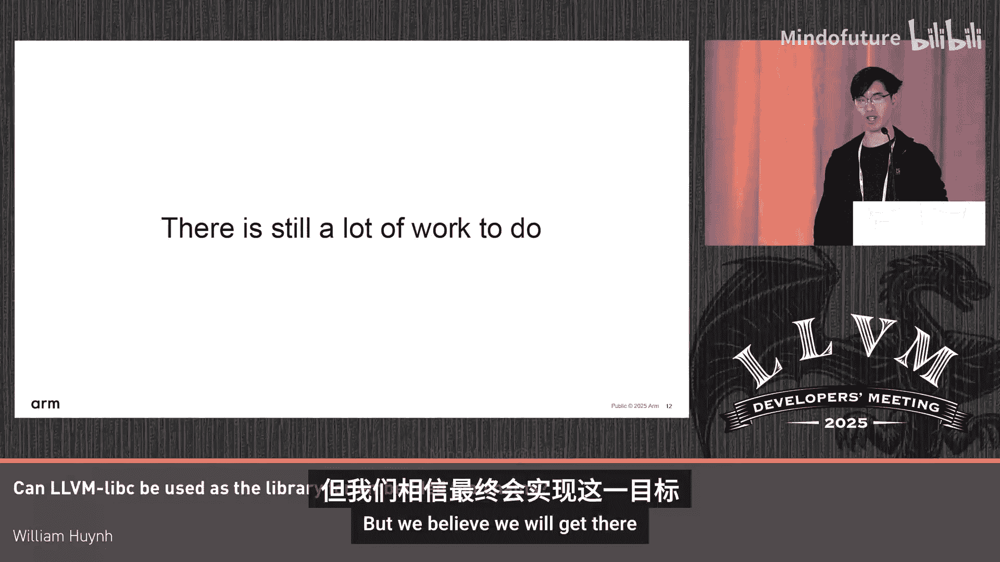

# LLVM开发者大会-US-｜-2025-Llvm-Developers-Meeting-p64-P63_如何在嵌入式应用中测试和评估LLVM-libc--BV1ejr5BAEja_p64-

Hello， okay， so my name is William and today I'll be answering the question。

 can LVM Lipsy be used as the library formed by the toolchas？

So I'm going to start with a bit of background about who I am。

 so I'm part of a team that develops embedded tool chains for embedded arm platforms。

Which is a combination of a compiler and some standard library implementations。Currently。

 our tool chain setup looks something like this。Notice that we have a third party dependency here。

 beipy。 And in an ideal world， we'd like to get rid of it by replacing it with L VM Lipsy。

 which allows us to do a build from inside the tree。But before that。We have to answer this question。

I。Is Alveiumlepsy， correct。And perform。So downstream in our repository called Ar tool chain。

 we've created a setup that looks something like this。

It's quite similar to what you'd have normally when you run tests locally。

 except when we have to use an emulator to an out test Quimu。

We also need to link in some bare metal specific files。 I've highlighted those in yellow。

And when we run these tests， most of the tests pass。

There are a few floating point tests that fail at the moment。

 but we are currently trying to fix those。So now we know that it's mostly correct。

We need to make sure it is performant。So we've created a setup that looks something like this。

Notice I've highlighted the sea library in grey， which means we can swap them out from Picolypsy to L VMlepsy。

 And we run， when we run the comparisons， we get。😊，Improvements in selected benchmarks。However。

 we also see some regressions and when we look at code size。

 which is very important in an embedded applications。We get， we are seeing about a 70% increase。

And this is due to f theft。And currently there are efforts by some people at Google to try and optimize code size。

But to answer the original question， can we use LVM Lipsy as the live？ The answer is， no， not yet。

As there's still a lot of work to do， but we believe you'll get there。

Thank you。