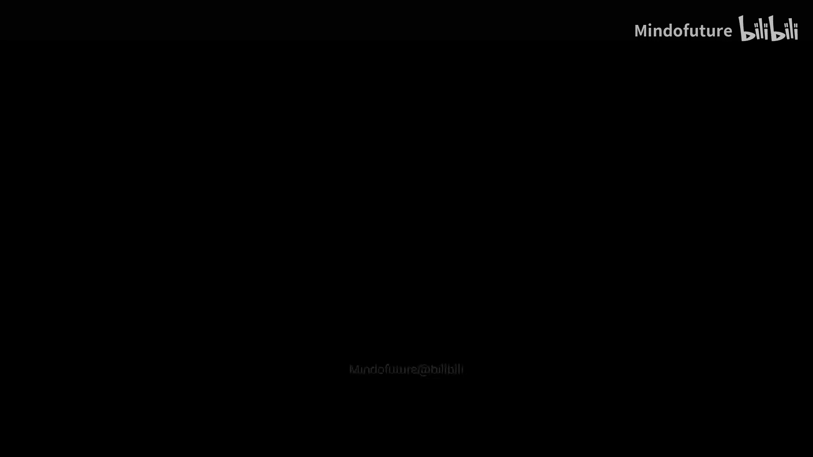
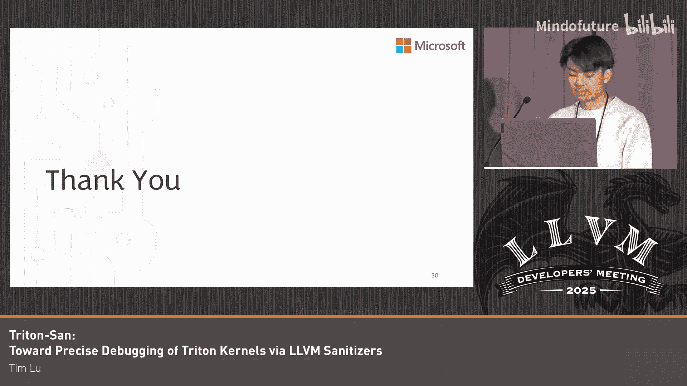

# LLVM开发者大会-US-｜-2025-Llvm-Developers-Meeting-p65-P64_Triton-San_迈向Triton内核的精确调试--BV1ejr5BAEja_p65-

Hey， everyone。 This is Tim。 This summer， I was an Internet Microsoft。 And today。

 I'll be talking about a project that I did during my time at Microsoft called Tritons。

 which is an application of L VM sanitizers to debug Triton kernels。Okay。

 so recently there's been a trend in Python based GPU programming languages in the HPC and AI space。

Triton is one of these languages and will be the focus of this talk。

These languages are known for having a gentle learning curve and their simplicity。

 yet also being expressive enough to define some pretty efficient kernels。However。

 like with any language， if you misuse the constructs provided to us。

 you may introduce some pretty nasty programming errors into your code。

 and some of these errors can be pretty difficult to detect。Currently。

 there are pretty few tools available to help programmers detect these elusive programming errors。

 which we will get into。So I've listed three of some challenging programming errors to detect in your code。

 and these are also the three classes of programming errors that our tool TritonS focuses on being able to detect。

They are buffer overflow， use of unialized memory and data races。

 And these issues are difficult to detect because they often exhibit silent or non interministic behaviors in your code。

For example， we can consider buffer overflows on a GPU so for GPUs and Python programs， allocation。

 memory allocation on a GPU is a bit strange in that sometimes your program gets allocated a lot more memory than it ever needs。

So if the buffer overflow occurs in your program and it occurs within the total memory allocated to your program。

 there's a chance that it doesn't get flagged and it appears like illegal access。

 which is why it can occur silently。This means that your code may have some unexpected or unintentional behaviors。

 and as you can see it will be very difficult to pinpoint where it's coming from。

So our work TritonSN aims to detect these elusive issues。 TritonSN stands for Triton sanitizer。

 where sanitizer is a dynamic analysis tool that pinpoints such elusive programming errors。

 and dynamic analysis meaning that the sanitizer does so during runtime。

Tritan San's main idea is to leverage these existing LVM sanitizers。

 And the reason we do this is because we know they work and they're reliable and they're consistently being maintained。

However， in order to leverage these sanizers， we need to offload the kernel execution to the CPU。

 and this is because these sanizers are built to be executed on the CPU only。 However。

 this does provide us with some advantages such as being able to leverage the built in MLIR and LLVM passes that come in with CPU compilation。

And are more mature and robust。 And we also are able to leverage existing L O VM runtime like Open MP to help parallelize our programs that run on the CPU。

 which will be important later。😊，But first， some background into Triton。

Traton Triton uses just in time compilation。To go over this a bit。Basically。

 the Python program executes line by line。Until it hits a GPU kernel call。

 in which case that kernel gets compiled then and there。

This happens through a series of compiler passes， So it goes through Tri frontend MLIR passes。

 and finally， a GP specific backend to get compiled to an executable that runs on a GP PU that we are targeting。

So to go through a code snippet with。Line by line， we have a Python program。

 and it starts as a Python program that executes line by line through the Python interpreter。

Notably here we have we define a grid， which is basically a three two pool of integers。

 defining the number of threads of execution or what Triton calls program instances that run in parallel on the GPU。

 and this is a fairly standard thing for GPU kernels。Eventually the kernel call is hit。

 the kernel is basically a Python function annotated with an annotation Triton dot。

 and this is how Triton tells when to trigger JIT compilation and also when to offload the execution of the function to the GPU。

So a JIT compilation happens and the body of the kernels offloaded to the GPU where it executes in SPMD fashion。

 So what this means is that each program instance runs the same code in parallel， however。

 each of them are given different PIDs to distinguish between what work each of them does。And yet。

 just to note here， the user defines the number of program instances at the beginning and passes it into the kernel when it's called。

Finally， when the kernel finishes execution， control returns back to the Python interpreter and the Python program executes as normal。

So now you may be wondering what does a programming era look like in a trained program The program we looked at the previous slide actually contained a data race。

 so what's happening here is that we are defining a tensor of size 256 and also 128 program instances that are writing to this tensor simultaneously。

The first instance write to index is 0 on 1， second to 2 and 3， and so on。 However。

 the programmer here accidentally set the block start on line 7 to 0。

And what this means is that all of them are trying to write to indexes 0 and1 simultaneously。

 which is a data race。 The data race itself occurs on line 14。

 which is the right statement to the tensor。Here's another example。

 both with buffer overflow here we're defining a tensor of size 3 and two program instances that are writing to that Tensor。

 The first one writes to index is 011， second to2 and 3， However。

 index 3 does not exist in this case， you can see where that is going。

 The error here is that the programmer set the mask to always true on line 9。

 and what this means is that each program thinks that its access is always within range。

 even though it might not be。And the buffer overflow itself occurs on line 14， which， again， is the。

Right steaming into the tensor。So these two programs that we went over are examples of what we call micro benchmarkchs。

 and a micro benchmarkch is a very small minimal Trident program written by yours truly that exhibits a specific type of bug。

And we use these two programs in conjunction with several others that we've written to evaluate the precision of our tool trained sand。

 but we'll get to that later。First， let's talk about how Trident sound works。

So here is an overview of Triton Sand's workflow。Currently。

 China supports a variety of hardware platforms for all floating。Including the video GPs， AMD GPUs。

 and general purpose CPUs。Try and sand is enabled as an optional feature into。

A CPU backend called Tri and Sha。 And again， the reason we do this is because we want to leverage the existing LVM sanitizers。

 which are built to run on the CPU。In order to enable Tritons in our CPU backend。

 we use the sanitizer flags， and what they do is they tell the compiler to instrument or inject some sanitizer checks in your code during compile time so that during runtime。

 both your compiled code and the sanitizer checks run。

 allowing these sanitizers to detect issues during runtime。So， here are。

Here's the workflow in more detail， the tri kernel gets ingested first by the Triton frontend。

 which converts it to Triton dialect， which is a high level dialect that is able to express the unique train constructs。

We then introduce a custom MLIR pass that introduces some line knowledge operations and lineage operations are operations like matrixtri multiplication and are found in both CPU and GPU compilers。

At this point， we leverage the existing LL VM。Built in L VM and ML L IR passes to lower this all the way down to L O VM IR。

At this point， we introduce the sanitizer flags and compile it to an object file。

 This object file is combined with a driver C++ script。

 This script is responsible for executing each iteration of the train grid。

 and all of this is combined into a single shared library which gets loaded and launched immediately on the CPU through a Python library called importportlet。

So here are some other things we had to do in order to make this tool work By default。

 the driver C++ script runs every iteration of the Triton grid in sequential fashion。

 so what this means is that no data races can occur and therefore go undetected。

So in order to fix this， we parallelized the kernel execution with openmp。 Or more specifically。

 we gave each iteration of the train grid its own worker thread。

 allowing them to execute in parallel and therefore exceed data races。

Note that this integration of thread sanitizer， which is our sanitizer used to detect Dataases and Open MP is nothing special as it's officially supported through an LVM extension called Archture。

Another problem we were running into was that the errors we were seeing that were being reported by Tri and sand did not seem very useful。

 If you got this error and you were the programmer of this kernel。

 you'd have no idea where this error is occurring。So， to， for。What we did to fix this。

 we added an MLI pass to add debug information into the I R in the form of these DI attributes。

And we made sure that they are persisted across all the subsequents。L O VM and MLlR passes。

Until our runtime， we are able to see more useful ear messages like this one。

 where we have the file name and line number as well。

Another thing we did was we make sure that the sanitizers are preloaded before the Trident program starts executing at all。

 and this gives the sanizers a chance to initialize and do stuff like allocate its own set of memory called shadow memory to track execution metadata。

 which can be stuff like memory allocations or accesses。

 and this is how it is able to flag issues during around time。

We also register hook callbacks to intercept OS level API。

 so these are important API calls like again， could be memory allocations or accesses。 and finally。

 we have suppression lists that tell the sanitizer which nontrident modules to ignore。

So let's talk about the suppressions for a bit。 In order to have suppressions。

 we use the LVM's sanitizers built in mechanisms for suppression。 So， for example。

 for thread sanitizer， this looks like this， we pass it a suppressions file during runtime and the suppressions file is basically a list of shared libraries that we want to ignore errors coming from。

 So why do we need this。When we were testing， we found that these third party libraries were giving us some unrelated。

 false positives。That were the detracting away from， you know。

 the important errors that were occurring from our train kernels。

 So we tried filtering these out by suppressing them And Triton。

 Sand was still able to flag and detect the issues in our kernels that we are the most interested in。

 so。And， and this was the case in all the micro benchmarkchs that we looked at。 So basically。

 this suppressions， these suppressions function as a form of。

 as a method to hone in on what's really important to the user as in。

A is happening inside the train kernels。So evaluating our tool Triton sand。

 we use two data sets primarily。 The first one is micro benchmarkchs， which we went over。

 The second is a set of more realistic cases with injected bugs。

 and these are kernels taken from the official Trident tutorial and also a repository called Triton benchch。

 which is。ASe of kernels typically used for benchmarking purposes and are somewhat more complex。

We use both of these dataset sets to evaluate the precision and performance of Trinocent。

 where precision。Is defined by whether we were able to detect the bugs of interest in our data sets and performance as in whether the memory and time overhead that we introduce into the runtime is reasonable。

All right， so talking about precision first， we found that TriSna was able to detect all of the issues that we were interested in in the microbechmark suite without giving us any false positives as an example。

 this is a snippet from our buffer overflow micro benchmarkchmark and again the error occurs on the right statement which is on line 25 in this case and the error reported during runtime is that it's a buffer overflow and it gives us the correct line number。

 which is what we expect。To put these results into context。

 we also evaluate the precision of another tool called compute sanitizer。

 and compute sanitizer is from the video and is actually Tritons。

Officially recommended solution to detect these elusive programmer issues for train kernels running on the video GPUs。

And like the LVM sanitizers， they come with a suite of tools each capable of detecting the friend。

Types of programmer errors。 And these are the three tools that we used because they correspond to the three issues that we were interested in。

So here are the results， we found improvements in both the precision of detecting both for overflow and data races for Tri andsN。

 however， for use of uninitialized memory， we still haven't integrated that corresponding LVM sanitizer that detects these issues into Tri andSN and would likely be a next step if we were to continue development。

So here are the performance numbers of our two sanitizers that we do support currently address and thread sanitizer。

These numbers we found to be quite similar to other applications of address and thread sanitizer。

We think this is a good sign towards the usability of our tool。

So for the remainder of this presentation， let's talk about some setup and usage instructions On the right here there is a QR code that links to the official ReadMe for TritonS So if you wanted to you could just scan that and follow the instructions on there。

However， we can still go over them briefly now。As mentioned previously。

 TriS has been integrated into a CPU backend trying and share it as an optional feature。

 so you'll need to clone Tri to share。 and in this repository。

 we have a built script readily available for you and what it does is that it installs compatible versions of LVM Tri and Tri to shared and also generates a script。

For easy invocation during run time。 So all you need to do is clone this repository and run the bill script to install train sand。

So say now that you have installed Tri in and wants to run it on a train program。

 what would you do So the first thing you need to do is add these two lines at the top of your file and what these do is that it tells train to use the CPU backend to compile your Tri code instead of like another backend like a GPU backend because again。

 we want to run our kernel on the CPU。Since we are running our kernel on the CPU。

 we don't want to offload our tensors to the GPU， so we need to change those as well， and finally。

 we would invoke the sanitizers using this driver script Tri and send。

What you do with this script is you specify the sanitizer type。

 so we only support two modes right now， which are AsN and TN to detect buffer overflows and data as respectively。

 and following that you just add the command you typically use to run your Tri to program。

 which would be Python program P。Okay。So in summary。There has recently been a new trend in GPU based。

In GPU。Programming languages。And Triton is one of them。

 And we found that debugging elusive programming bugs in Triton is quite difficult。

 And there are limited tools and resources available。

 The ones that are available like compute sanitizer have limited effectiveness。

So our tool's main idea， TriS was to combine the LVM sanitizers with Tri CPU backend to precisely detect these elusive programme errors。

As a result， we saw improvements making this tool a good addition to the debugging toolkit for Tri developers。

 and we also extended the LVM sanizers to be used on Python based languages。

 which we think is pretty cool。All right， thank you for listening。

Hi， thanks for the talk did you find any kernels that could only run on GPU so then you couldn't use your sanitizer with them。

嗯。That's a good question。Personally we did not， however。

 our tool does have a limitation in that these kernels need to be compileilable by our CPU backend right in order to know executeQ on CPU run the sanitizers and we did find that some kernels cannot be or we're not supported by the CPU backend。

I guess next steps would be to。Continued development into the CPU Va， I guess。

 which is an open source one。LED by Microsoft to continue， I guess。

 expanding the efficacy of this tool。Allright， so I have a related question， which is。

To my rather limited knowledge， at least some。LVM GPU backendons have some sanitizer support。

 Have you explored using that。So。We've looked at the Triton documentation and if you look at that page like the options are really quite limited for Tri specifically。

 I think we covered compute sanitizer as you the go to sanitizer solution for programs for Triton programs running on the Nvidia GPUs and we didn't find them to be all that useful。

 I believe there is one other solution mentioned in the official Trident documentation。

 but maybe I think it could be like AMD specific， I don't quite remember。Yeah， but unfortunately， we。

 we haven't looked into that yet。Can you back up to the slide that compares with compute sanitizer I didn't catch the differences。

 I just wanted to see that again and also can you comment sort of following up on the last question about like I think you're saying TritonS is an on CPUU tool only so contrast that with like say compute sanitizer or other GPU sanitizers for on GPU debug。

 are there any benefits there that you're not getting when you're running CPU only。

So that's an interesting question。I believe the logic for offloading to a CPU here is that we can leverage the LVM sanitizers right and if it's just for the purpose of analyzing your code to detect these programming bugs。

 there is really like not that much difference because we don't care as much about performance。

 for example， we just care about being able to detect these issues right，But this is。

 this is an interesting question。 And I'll I definitely have to take this back to the team and think about that。

 I believe you also wanted me to comment on this table a bit more。So。

I guess here's an example of why it could be good to execute。

These or to execute the bug detection on the CPU。 If you look at buffer overflows。

 we found that compute sanitizer was only able to detect large overflows and。

This goes back to what I said about memory allocation on the GPU and how it's typically much more than what a program needs。

And we think this is what is causing compute sanitizer to be missing these buffer overflows。Whereas。

Trying to sand since to execute on the CPU， it uses allocation methods like MalC。

 which I guess results in a better way to detect buffer overflows。For data races。

 compute sanitizer just does not support any data detection in。 sorry， Was it shared memory， yeah。嗯。

And Triton itself has its own constructs to support synchronization to shared memories。

 like the programmer does not touch that at all， which is why compute sanitizer was。

Is not able to detect them because they basically can't exist。However。

 data races and global memory still can， which is why Tritan San was able to detect them。Okay， hi。

Does Triton shared have its own CPU backend or is it reusing the CPU backend that's in the Triton Lang project。

 I'm aware of like there's a few different CPU backends I just was interested to know if it's its own brand new one。

So maybe I'm not the right person for this question， but I think it's a different one。

 I'm not too sure what it does differently specifically。

 this might be a question for someone else on the team。9。

So I think this question was already answered， but for the buffer overflow， for the example you ran。

 was there any other examples that you were able to find misses with detecting the large overflows in compute sanitizer。

So I think the large overflows were the main thing that compute sanitizer struggled with if you're asking for like other cases that compute sanitizer was unable to detect buffer overflows in。

 can't remember off top of my head， I don't think so。Thank you。

 I say you' are trying to like mimic the behavior of the GP with the CPU。And like。

 isn't there any like true negatives or like false positives in your sanitizer。Sorry。

 what was the question。So if you try to like mimic the behavior of the GP with the CPU。

Then it might be different like for the because architecture is different and you're trying to like execute a GPU program with a different hardware。

 So I wonder if still there's like some kind of like true negatives or like false positives in your're trying to understand might it might not been inaccurate because you're trying to mimic the GPU。

Yeah， I think what you're saying is reasonable。 We haven't really tested that with the GPU。

 so I can't give you like a great answer there， but I think it is reasonable that since we are like changing the back end where we're executing it。

 it would produce like different false positive like the behavior might be a bit different there。

Thanks for the talk。 It's recall cool。 I have a question I see when you're doing the PEf evaluation of the sanizer。

 you compare like turning the sanitizer on and off on the CPU。

 but I was wondering if you have done any perf test on like turning the compute sanitizer on on the GP versus turning the sanitizer on the CPU it's basically I wondering is there have you ever encounter any kernel that that's just too slow to run on CPU or in practice it usually fine。

 just it will it will run longer， but it will give you better like sanitizer results。

So we did test with like the more complex kernels， like I mentioned。

 and for those that were supported by the CPU backend， trying and share it。

 I don't think we found any performance issues， say。Does that answer your question Yeah。

 I guess it's just for you， it's not that slow that you can still afford to win s。Cool， thanks。

Any questions。Right， so thank you。

