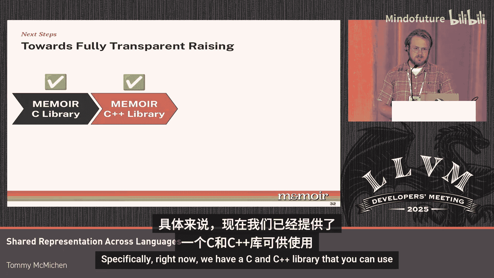

# LLVM开发者大会-US-｜-2025-Llvm-Developers-Meeting-p66-P65_跨语言的共享表示--BV1ejr5BAEja_p66-

And this talk Da， we talked about moving towards collection oriented compilation in LOVM。 Today。

 LVM is used as a shared representation for many programming languages， which have common features。

Among these features is data collections， which provide a logical representation for organizing groups of data and performing operations。

 manipulating that data and accessing their elements。😊。

Data collections have rich semantic information that could be used for analysis and optimization。

 for example， they provide a separation between the data that's stored inside the collection and the organization of that collection Additionally in some languages they provide additional type guarantees。

However， when we look at LOVM， they have a lower level view of collections。

 specifically they're lowered down to memory blocks and pointers into those memory blocks。

As a result of this， our data and organization must be lowered down in these memory blocks。

 so data and metadata that describes the organization of the collection are all meshed together。

As a result， if we look at a load or a store in the program。

 we can't really tell if we're looking at data or the metadata of the collection itself。

 which makes it really hard to analyze these programs。Additionally， for the most part。

 these types are essentially cast into the fire， there are no longer guarantees for us。

 we essentially just have a little bit of extra metadata on the side。

The lack of representation causes issues for us in analysis and optimization， like I said before。

 let's take this example right here where we have a reference to an unordered map in C++。

 we're going to insert the key value pairs 110， insert 220。

 and then we're going to print the value at Q1。Every year is's pretty smart。

 you know that print's always going to print the constant value 10。But。

The compilers that we're building are not that smart。

 no production compiler today is able to propagate 10 to that return to that print statement down there。

This is caused by the fact that we had the second insertion in between。

 which may cause a rehash of the collection。As a result。

 the logical element to key1 may be moved to a new memory location。

 and since our compiler only operates at the notion of memory locations。

 we lose all that information about the logical element and the fact that it and its value have not changed。

To remedy issues like this， we introduced Memoir， which provides an extension of the LLVMIR with data collections as a first class citizen in an SSA form。

Memoir takes code from C C++ or RuS， and generates memoir。

 which extends LLVN with additional types for these collections。

 as well as operators to access and update them。With memoir。

 we're able to perform collection centric optimizations。For example， let's take that code before。

 now translated in memoir， namely of the fact that it's SSA now。With memoir。

 we're able to perform static analysis that we required before on this code。

 It's both really easy to implement and really cheap because as far as data flow analysis。

Using the result of this analysis， we're able to perform the optimization that we wanted before。

 now just printing the constant 10 all the time。And we can also eliminate the now dead read that we had。

Beyond simple optimizations like this， we can enable a new paradigm of data transformations on these programs。

For example， we can perform dead field elimination safely。

 we can do cache locality optimizations like migrating cold fields out of hot objects。

 and in addition to that， we can specialize the memory layout of our collections based off of their use case in the program。

 such as using a bit set instead of a hashet。With memoir。

 we're able to provide significant performance gains。

In order to magnitude greater than what we achieved today with things like L ofV image GCC and ICC。

In addition to that， Memo is able to reduce the memory usage of our programs。

 a new capability that modern compilers aren't really capable of。Following optimization。

 we lower our memoir collections down to perform an implementation from the C++ standard library。

 Abse， or boost。This produces an LLVM program that we pass on to the generic pipeline that we have today。

Currently， we're working to making memoir easier to use。Specifically right now。

 we have a CNC+ library that you can use that exposes these collections to the compiler for optimization。

We're working to make this a drop in STL replacement so that it's even easier to use in your current code bases。

And in the future， we had plans to make this fully transparent with a clang front and plugin。However。

 for the time being， we have some ongoing work to make an AI porting tool that'll take your current SDL code and translate it to use memoir collections if you can't wait for that to happen。

So I'm really excited about memoir， I hope that y'all are too。

 I've included some links here for anybody who's interested in learning more or getting involved。

I have a poster set tomorrow's session of 315。And then in addition to that。

 I'll be around the conference。 I'd love to chat about memo with you。

 I'm also on the market right now looking for postdoc opportunities and industry opportunities。

 Thank you all。😊。