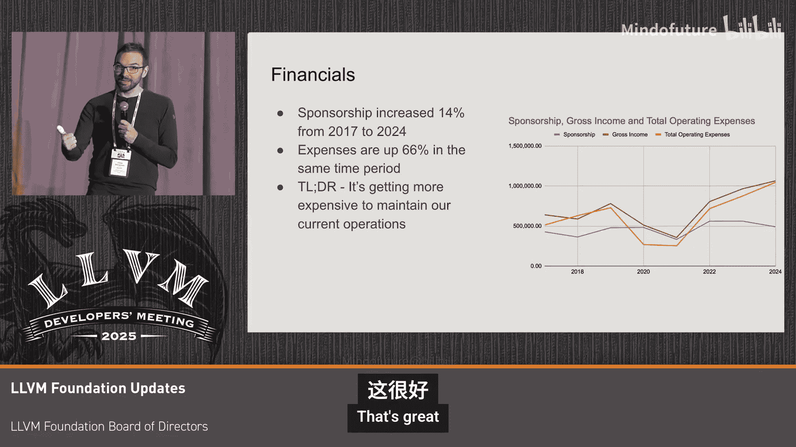

# LLVM开发者大会-US-｜-2025-Llvm-Developers-Meeting-p67-P66_接近LLVM_Foundation_Updates--BV1ejr5BAEja_p67-

My name is Tanya Latner， I'm the Ex director and president of Y Alm Foundation。

And welcome to our kind of an informal talk， we're going to talk about some updates to our programs and most importantly。

Answer any questions you have， so let's get started。For those of you that have not heard this before。

 we are a 501 C3 public charitable organization， we were founded in 2014。As a public charity。

 we serve the general public good。And we have an 11 person board that selected every two years。

 and currently there are two employees of the LM Foundation。I'm not going to read this for you。

 but this is our mission on the board here。Ultimately， this last paragraph。

 which I will read is the most important we feel。We support the E community by helping it grow。

 foster community interactions， work to keep eium development productive through infrastructure。

 and work to ensure the long term health of the E project。

We wanted to grow and thrive for many years to come。So how we do that well we have。

In the nonprofit world， we have these programs， and this is how we execute our mission。

The first is the educational outreach， and this includes educational materials and events like the EDevelop meetings。

Community。0 is our diversity and inclusion outreach program。We had scholarships and grants。

And the last program and most important， we support community health and growth。

 project infrastructure， legal issues， and other cross cutting efforts。

So I'd like to take this time now to do this to the Eant Foundation Board。

 and most of them will work here， and stand up on a time。Hi， my name is Chris Biman。

 I'm the treasurer for the board， as well as an engineer working at Microsoft if you vote probably see me around。

Everyone on Chris Laner， you probably know me for some things I do I'm mostly merit on board and so I try to help out and help give some advice or help resolve disputes。

They about the other world， So not not me。位置。Hi， I'm Mike Edwards。

 I've been a board member since 2018 and I used to do Treasury work before Chris does and so now I just kind of help out on the financeinance committee and wherever else。

你看。Hello， I'm Anna， I work at Apple， I've joined the board a year ago。

 but I've been with LVM community for over 18 years。

 I'm very excited about also helping new people and being on the board and serving the future generations。

 Thank you。Hi Crystal Bens， We' with Ar been on the board for a couple of years。I your stuff。😀。呵。

Yeah， I guess almost everyone doing stuff。 My name is An and I'm linked to a contributor and yeah。

 I'm also helping boards to do various things。You probably will know me for the Google Summerum of code。

In the public， besides some of the stuff。If folks on aren't you that that and like I am a new member of the board。

For year now， I've been involved in LBM since it was。d school project。我 down。诶。

a member of the community and I just love the way the community is built and the foundations helped on。

I'd like to carry that for。H Ra， I work on hardware security at the University of Cambridge and Linux support for obscure secure hardware architectures。

 I'm a new member to the board， but I have been on the board of about eight other open source foundations。

 so I've been helping out with some sort of historical knowledge and connections with other foundations and how they do things and I've also been helping to support the in area team and get resources for CI。

And two board members cannot be with us here today， Wei Wu， and also Ree Kchner。

 who is the Secretary of the board。So if you are interested in doing stuff， as many of them said。

 you can join us on the board， we are self lookinging board every two years and so our next round of elections will be in August 2026。

And we're looking for people with different skill sets to help us round out the board and achieve a lot of the things we're trying to do This includes skills such as nonprofit experience。

 legal experience。Accounting and finance， very important for us and prior board service or open source advocacy。

 community building， that sorts of things。And this is not a exhaustive list just a taste of it。

But what you must have is a passion to help Olivium thrive and grow。

We have an application process that involves an interview with the members of the board as we。

We may be revamping this process a little bit， but we'll be communicating that next few months about。

What it looks like and how you can be on the board if you are interested。

And you can talk to anyone on the board here if you want to learn more about what the day to day or month of month。

What does that work look like？All right， let's get to the program update。

And I'm going to primarily talk about educational outreach。

 so if you have questions about any of our other programs， say those for the end。

 but we're going to focus mostly on educational outreach today。

So we have had great success with this program as evident from this event。

 we consistently organized two dev meetings every year。

 we held our first event in the Asia region in June， we had it in Tokyo with 130 attendees。

We see consistent growth of our events and we're quite almost back to pre pandemic levels。

And all of the presentations are recorded and published， which is a key o knowledge base。However。

We are facing challenges as the costs are very high and keep going up。

So this chart here shows the E dev meeting attendance for Euro and US over the years。

 you can kind of ignore the 2020 to 2022。Gap because we did not host events。

Consistently through that time period during the pandemic， but as you can see on these shores。

 we're starting to get it close to where we were in 2019。And on the flip side。As we mentioned。

 costs are going up。 So you can see here from the 2018。To now 2024， 2025。

The costs for these events have。More than doubled。Which is a huge run。However。

 we still try to make our events successful as possible thanks to the generous donations of sponsor。

 individuals and corporate supporters。And we still are able to subsidize the ticket prices year over year。

This chart shows the dev meeting revenue and expenses per year， it's another way to view it。

You can see that we are not quite taking in as much and this is from ticket sales to what we're actually spending on the events。

And we can come back to these charts if you have questions。Cash kind of blowing throw them here。

If you're interested in where we spend our money beyond just the educational outreach or the events。

It is very true that the developer meetings account for the bulk of our expenses。

 and you can see that as the bright blue portion of this pie chart。 The second biggest is。Payroll。

And then the other programs where we have the scholarship and the grants， community。

o and infrastructure are the smaller pieces。And so these charts show our 2024 expenses and what we're projecting for 2025 because we haven't closed out the year yet。

Let's talk a little bit about financials。So our sponsorship has increased 14% from 2017 to 2024。

However， our expenses vary。66% in the same period。So in short。

 it's getting more expensive to maintain our curtain operations。Our sponsorship。

 we've had minimal changes in the last 10 years， and so the Board of Directors。

 given the rising costs in our events and the ability for us to achieve our mission。

 have created a specific subcommittee that is going to be focusing on revamping our sponsorship program to help us meet some of our financial goals。

So this is my pitch here。We are definitely looking for more sponsors to help us kind of bridge this gap between how much we're spending。

 what we're bringing in， and still continuing to make our events accessible。

So we're definitely interested in having more sponsors to help us keep achieving our mission。

So please reach out to myself or any board member if you're interested in sponsoring the Albion Foundation。

So with that said， I want to dive into your questions。

So I'm going to open the floor or open it to any board member who wants to contribute more to the financial discussion or。

Such as our treasure。But any questions we can start out with？Come up to the mics too。

 there's mic from here。Anyone have questions？Tony， if you roll back a couple slides to one thing I want to just point out this graph right here。

 what you're seeing here so that know the blue line is our sponsorship revenue and of course the red line is all of our income and the yellow line is all of our expenses we are today balancing our budget by basically increasing ticket prices and one of the things that this is something we've been talking about bunch is。

I don't know how many of you have been coming to these meetings for an extended period of time。

 but when I first started coming to meetings， the way that we set ticket prices was basically like。

We wanted him to be expensive enough that when you bought it， you felt like you should show up。

Not expensive enough to prevent people who wanted to come from coming and I think what we've kind of tipped into is the cost of these tickets at $1200。

 it is actually at a place where even employees of companies like companies are deciding send less people because it's quite expensive。

And so one of the things that we're talking about is like， okay， well。

 should we bring ticket prices back down and what would it take to do that and I think this graph really shows quite clearly that if we wanted to get ticket prices back down to say under $500。

 that means we actually almost have to double our sponsorship。

And so one of the things that we're going to be looking for is figuring out。

 you know part of it is going to be that you know if you're at a company。

 we're going to be looking and begging you all to go and figure out how to convince your management to give us more money。

 we're going to do everything we can to give you information and data support those arguments that you're going have to make with with your powers that be but I think one of the other things that we're going be looking at is figuring out like how do we bring more sponsors in and how do we diversify where we're bringing in revenue This is。

 I think probably the most important thing that the board's going to be focusing on over the next 12 months is like。

How do we bring more money in how do we move to a more sustainable basis One of the other things that isn't captured in these slides that is actually really important to note is so we have today some pretty good cash reserves in the board because we didn't host events in you know during the pandemic we built up some cash that's great one of the things that's tough to realize is that。

In order for us to do this event， we have to write about $300。

000 in checks before we collect a single dollar in ticket revenue。😡。

so we have hundreds of thousands of dollars that we have to get out for each of our events。

 just like before we even see any of the growing。😡，When we project that into the future？😡。

We have to maintain cash reserves that can cover all those prepays and where we are today。

 our cash reserves are fine。As the event costs increased， our cas might not be fine in five years。😡。

And so this is another aspect that we're thinking about how do we make sure that we have a sustainable base。

 that we have sustainable growth in revenue and can kind of be here to support the community for the future。

啊。あ。I believe in the past you have like a。Like a sailing to the number of attendees that could attend。

 is it， do we still have that？We always have a bit of a cap on attendees just based on pure space so logistics and then there's a little bit of a cap before because we're guaranteeing you're going to give the hotel X amount of money and we try to be very conservative and not overpay so Sure I any sense I was wondering if。

One way would be you know to increase the cap if you're consistently hitting it every year， then。

I don't know if I don't know if there's any little room to adjust it higher so this year we did not sell up Okay。

 we could host up to 550。Okay， very cool。RightSo yeah， yeah。

 and I think it's worth noting too is even though we didn't sell up this year， I think we had a。

Almost 13% increase in attendees year over year， so we had really big growth。

 we were really ambitious in trying to have more， but we actually did still have really great growth even though we didn't sell out。

Yeah。TheQuestion take you is the biggest。No， the biggest cost is food and beverage。

So if you count that it's not the venue rental。Have to B， as we say， the brownies， yes the brownies。

第一个。Well， one thing that may not be obvious if you're not a nonprofit or lawyer or IRS specialists。

Why does Eium what the way it does And so I glance off this the beginning where what's called a C3 nonprofit and so Elgium is in the same categories like a church which has a very strange religion around here around compilers said what the other ones do and so that was very intentional that's something time I talked about a long time ago and what that means is if you look at the charter where the charter is to make the community successful。

Now there are a lot of other nonprofit foundations， for example， Linux Foundation。

 there's many other of these things， they're a different category， they're a C6。

And so these like I think Ru is also C6 I remember and so there are a lot of things that are a C6 nonprofit。

 These things are categorized as corporate Sure these are if you forget the terminology member member base is especially and so the trade off on that is that suddenly it's pay for play you can air quotes by a award seat can you can do these things like you get rights by putting money into the foundation for various things and so then that leads to actually companies contributing more money for rust than they do at L ofamp。

Which doesn't make any sense to about。Buss' is not possible with that LVM and things like this right and so this is one of the things where it flows directly from that choice but what we chose to do is make sure that LVM is longterm sustainable and we have a fine set of elected people that are nominated in brought into the foundation board that are here to make sure that LVM is successful over time and not just getting dragged between corporate politics and things like this so but the flip side that comes to fund and so if we had made it let's see6 and it'll be much easier is money and so what we're dealing we're dealing with the flip side of this and so this is where we need help。

We need help with explaining the value to your own organizations。

 explaining and understanding because management， trust me can be challenging to work with， I know。

And so that justification piece in helping share the value and what it means and what you being here and what you see the value of the community bring。

 I think is very important。And I think we see that， and I think that many of us live that。

 but I think that communication piece is quite difficult and it's something that's quite important。

And you to。Hey， Chris。如果是。% tax。Mike， would you like wait we cannot provide accounting advice but here you go this is not financial advice。

 but not my thing one of the other like key pieces on a 5013 that makes it really。

 really advantageous to the sponsors that support us that donation。

 the sponsorship donation that you give us is completely taxductible。

So that's a really good selling point to go back to your bosses that if they write a bigger check。

 that means that they actually get a dollar for dollar。

 bigger tax deduction at the end of the year when it's time to five。This is。All up for that。

What is stopping them from？自分でま。All these fact means。That is very very much what are the challenges？

Actually， what is the this start？Yeah， so oh yeah， sorry。

 the question was sort of what's stopping our big corporate sponsors right now from donating more money？

Is there something that's blocking them or you know do we not have something structured the right way I have my own opinion on that which I'll share Chris you should share your opinion and Tom mutton you should as well I think honestly the key thing is we've never asked for more money I think we have been very fortunate in the fact that our sponsors year over year have been very gracious and just written the check and you know somebody 10 years ago got a check approved for a certain amount and it's been same amount every time because once you've got it in the you know payroll or the Payables pipeline you don't ever go back and ask to change that because that's hard right but I think what you were going to see from us in particular the finance committee here in the next year and our sponsorship committee is we are now going to go knock on some doors and very polite asked to help donate more because it just is getting more expensive to do all this and。

We have a little bit of a carton horse problem where we need to get some more money in the door so that we can expand the services that the foundation can offer to the project and we can start making things。

And I think what I would say real quick to add to what Michael saying is I think everything he says is spa。

 but like one of the things we need to do and this is on us as the board is to actually tell you what we're going to do with this money。

If some company comes and gives us check for a million dollars， we should be able to tell them， hey。

 this is what we're going to do with that money and this is how it's going to bring value to you and to your employees who are contributing to this project and to the whole ecosystem and we haven't articulated。

 I think that as well as we need to， but that is definitely something we're going to be doing this year and we're going to really get some good resources out so that it's all out there。

So。I came inly， you might have said this while I wasn't here。

 you're talking a lot about sponsorship and ticket revenue。😔。

There's other major sources of income for nonprofits in terms of grant writing and individual contributions individual fundraising。

Are you also looking at those or？We are not looking at grants right now and have not in the past doesn't mean。

We wouldn't change your mind， it depends on if there's any conditions that are associated with those grants。

We can't up。There's I'll just leave it us I guess yeah， and as far as individual donors。

 you can contribute， there's a button on the LDM page you can contribute directly that's been there for。

A year or two。 We also try to。 It's a small amount。

 that we try to drive some contributions through like incentives with merchandise and things like that。

 That's a very small amount of our revenue。 And as of this year， we are on Github sponsors。

 So you can sponsor us on Github。I'd like to expand a little bit。Individual。诶 something系。make。

Also will help you report it。Many of us have been in the work environment for a long time in our upper income。

 and I know many of you have already can。Con you allowed to sweat。Contributions to the community。

 but could do more。Since it is a 501 Z3。Contributions tend to be tax deductible。

 so they count as a charity contribution， but one thing that many might not know that if you give an appreciated asset such as stock。

Many of us might have stock in certain companies that we work for if you want to avoid capital gains。

Also get a tax deduction for a charitable contribution。

 you can actually give the stock to the foundation， they sell it。

 they don't have to pay capital gains， and you get the full value of the contribution。

So you get a double tax rate。Thanks to。Oh yes，s your company may also do corporate match。

And you should look into it and see if when you donate to the Elvin Foundation， if that's an option。

です。Just to build on the donating appreciative stock because this is very subtle。

 you get the donation amount is like three to four to five times what you it actually costs you out of pocket if you take advantage of donating appreciative appreciative assets。

If you get the then corporate match after that， it's like a six tag multiple。It's a very significant。

 like doesn't cost you that much and benefits the charity a lot。Thank you。

And I was always consult your accountant， I'm not a CPA。Dean told me I should donate this thing。

😀Yeah呵。😊，Yeses其就话 i thinkum。You've been saying a lot about like trying to get more more sponsorship dollars per sponsor have you all also like trying to like you know like。

Yeah more sponsors period like， you know， are the， are we seeing like， you know。

 more companies up and thing from LVM than you know。

 our current sponsors or have you like kind of hit the you know， cap as far as， you know。

 companies who are willing to you know， help out。I definitely don't think we hit the cap。

 There are many companies using ElM that are not currently sponsoring the Elman Foundation。

 I think that as a board we do need to improve our reach outreach to companies to make that ask。

 as we said we haven't asked enough and that could be a product of not having to for a long time。

 so as a board we are also focusing a lot on our connections。

 our outreach and like how we can reach more companies。And also， I mean。

 part of one of the things that we discussed in the board when we went and planned the event we had in Asia earlier this year was that expanding into new market would open more sponsorship opportunities。

I think those things take time to build， we have a lot of work to do to build up the sponsorship pipeline to build up the muscles to bring more sponsors in but you know。

There's an enormous number of companies that are using or building things on top of LVM and are not on our sponsor list。

 And so I think， there's a lot of places that we can go knocking outdoors and face down。I mean。

 I guess related。Like really all of are we seeing like you know involvement in LVM for more companies like。

 you know， as time goes on or has like it been， you know。

 somewhat constant with like with the same like say， for example。

 five or six companies doing the bulk of contributions。No， that's definitely growing。

 I know we said that we sponsorship has kind of remained a little bit fun。

 I mean we've seen companies come and go， I think but we definitely haven't increased the total number of sponsors just not necessarily in like the higher brackets。

 tends to be at the lower brackets。And in terms of contribution to the project。

 I think we do see new companies coming into the project every year。

 one of the things that's actually been really cool to see is like some of the guys that Google put together a dashboard to see some of the statistics and activity that's happening in the project。

The Oium project is growing wide， we have a lot of growth。I mean。

 I don't know how many of you in the room here were around in 10 years ago when we all read every email that came into the mailing lists。

 obviously like you can't read everything that happens in this community。

 we've gotten so big and it moves so fast and there's so much out there and that is like we'rere bringing more and more people from more places and I think we have to figure out how do we bring that also into sponsorship in the foundation。

What can we do to support data？We're out of time for our session I want to thank everyone for coming please come up and talk to any of the board members now or throughout the rest of the event。

 ask more questions or if there's a specific need that you want for the community please also come out to us we love to hear your ideas。

And after this session， now you can make your way to the poster session where there'll be some snacks and some caffeine。

 so thank you。