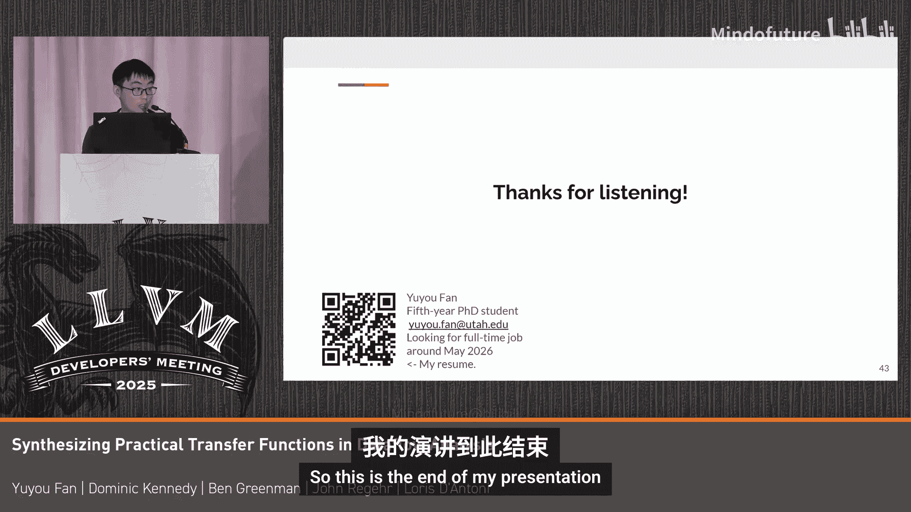

# LLVM开发者大会-US-｜-2025-Llvm-Developers-Meeting-p68-P67_数据流分析中实际传递函数的合成--BV1ejr5BAEja_p68-

So hi， everyone。 this to you。 Today， I want to introduce our most recent one。

 synthesizing factor function and catpi analysis。 And let's start。So first。

 let's do a quick recap on Wall data flow analysis。 So on on the right。

 I give a simple LVR example function， and data flow analysis tries to get information or properties that holds among all executions。

 So let's give a concrete example， known bit。 So known bit is a information grabbed by the data analysis。

 it tries to determine if a certain bit is always0 or one among all executions。 So for a known bit。

 it can have three possibilities。 If it's0， it means that certain bit in all execution are zeros。

 And if the one that means a bit is always one It unknown， it could be either。

So with that definition， we can have see here for the first operation and 3 iss a bit wide end operation with up 0。

 which we have no idea about。 And it's a constant 3。 So we know after this end operation。

 the first bids are zeros。 and last bits remains unknown。

 which means it contains four possible long time values，0，1，2 and 3。And similarly。

 for the next and one operation， the first three bit in non bits are zeros。 And the last is one。

 So we know it can contain two possible runtime values，0 and 1。 So this non bits。

And this is how LVN implemented information in numbers。Yes， this is how L VM implement known bits。

 So L VM implement non bits with two member variables， No zeros and known ones。

 So I attach a two example on the right。 If a bit is always 0， then the corresponding bit in non0。

 it said。 Otherwise， we can look at the example at the bottom。

 If it' one then corresponding bit at known1。 It said it is unknown， then non gi set。

So this is non misformation。Now， since we know the no mis information on N3 and N1。

 how do we infer non bit on the X result。 So in here。

 I attach the X choose table on known table on the right。 by applying the choose table。

 we can know the actual result in LvN， they implement the choose table by a transfer function。

 So here by passing the n3 and n1 non bit information to the function the implements the choose table by excluding the three lines of code and we can get the result information and attach to X。

 So in this example， the trans takes the non bit information on both open and excluding and return the non bit result。

So this is a trans function。And this is a simple transformation on Xor。

So L LVM also implemented trans for different operations on No bits domain。

 and some of them are really complicated。 So this is an example about addition。

 So here I attached the example about the compute for add carry is a U TL function used by addition and subtraction。

 You see it still receive two non bits operate and cost functions。

 get mean value get mix value and combination of bidwise operation and return result。 And well。

 at least iss not intuitive。So here in summary， so No bit is just one domain provided in LBM。

 and there are other domains like inter range or liveness information provided in L and MR and L women and MR implement different transformation functions for different operation defining specification on all domains。

So next Ill explain why we need as syntheizer。So first， let me start with what our syn can do。

 So in short， it read a specification。 The let's use the knownbe as example。

 The specification includes what is the knownbe domain and the operation to be applied。 for example。

 the X or add and the signature of the trans， such as it receives to known base information from both opera end。

And after the synthesizing， we can produce a result， We can give you some change functions。

 We can make sure its scrap。 It always gives you the right information and at least return reasonable result。

 You can use it to do some optimization to people organizationization， and it in class。

 which means you can directly include the result in your project and call it in your data flowness。😊。

So why do we need a synizer。 So The first we can get more transfer functions， of course。

So here I attach a table about different the platforms and the number of intrinsics implemented with transfer functions and the total number of intrinsic X 86 L VM。

 at least I found publicly， they only implement 30 intrinsics。

 compared to total number of 1714 intrinsics。 and for other platform is only 5 or 2。

So by using the single size we can get more。And here is an example in M IR。 So in Com。

 So Comde is a deck used in El circuit project。 It only contains seven trans functionss of operation compared to total number of 20 in operations。

 and there is no known info analysis for risk at all。

 So we believe other dashs can get a benefit from the synizer。

 such as the Web assembly emergency and index。 So we can get more trans functions。

And you might answer， so。 it's okay to don't have transform。 I can use those ones in AirBn。

So let me explain what the difficulties is in reusing existing ones。So first， Ill tell you， yes。

 they did。 So the example at the above is a longest trans they used in comp。

 So if the incoming operation is a constant operation。

 the comb direct correctly weuse the L VM long bid structure。

 it calls they make constant function in long and bracket return the result。

And the quick question is semantics might be different between two operations。

 So the first I attach an example at the bottom says the shifting operation income adapt。

 So it's totally okay。 if the shifting amount is larger or equal than the bid weight income。

 So in that scenario is 0。 So in this example， the shifting amount is 5 and the bid weight is 4。

However， it got problems in LM I I in in L I I， it defines the shifting amount must be less than a bandwidth weight in that result here returns poison。

So this is the first problem。 And the second problem is here in M IR。

 there is another analysis called integer range of analysis。

 It tries to determine if a certain variable always falls into a certain integer range by a up lower bound and upper bound。

 So there is a file that infer integer range。 It provides a set of U T functions and shared by two。

And that it' in a race and an index。So at the at the bottom example at the top。

 the otherwisewise and operation in a wish it directly calls the infer and function in that u file。

 This is good。 However， when it comes to index， it cause infer and first。

 then it calls to an adapter infer index operation to change the result to index domain。

 So which means programs not manually row those adapters and it might easy to get wrong。

 and it might contain button。So this is a change对。So the last benefit of our human is we can prove the correctness of transforms。

 So to define correctness， let's bring to concepts here。 The first is thumbness。

So sadness means the result not to cover all long time values。

 So here is an example about the wrong unnecessary result。 So if our unnecessary result。

 So this wrong necessary result shows the all the only possible runtime value is 0。 and， of course。

 it well leads to。R innovations。So here is explanation。

 Suppose the inner west circle is a set of all run time values。 We can include that set。

 it is sound if its smaller it subset or it only have a small intersection as unsound。

The other property here is precision。 So how many value that never occur at wrong time including by the advanced result。

 So the top result is 3 0， and last is unknown。 This is a maximum process result。

 So the second I attached， the second result here。 Of course， we can return for is unknown。

 It also includes all possible long time values。 but is not quite useful。 So in this example。

 we say the first result is more precise and second。So here' is a diagram。

 So suppose we have A and B。 A is a small subset at B， and both of them are sound。

 And in this example， we say A is more precise than B。So let's see how L again types the transforms。

 So this code how function in the first defines a Bw4。

And it exhaustively enumerates all possibilities of left hand side orbit bit and white orbit and actual parameters。

 And also， it enums all possible values in the first orbit bit and in the that orbit bit。

 So it takes a lot and is's not extendable to higher bandwidth weight。And this is our place work。

 So we can transfer。 So if we， the operation and transfer function are equipped with S MT management。

 we actually can turn it into S T query。 So here we transfer a long。😊。

And 3 and N1 into S and T expressions， And we call the lower to S And T。 And we can got a result S T。

 So similarly， we have preconditions that for all integer They are included by N3 for all run time1。

 they are included by N1， and we perform the S version of X or。

 And which if all run time Xor included by the non result X or。 That's how we prove sound using S4。

So it turns out we defined a transfer direct to for transfer。

 and it encodes basic of an AP P in the operation in S。 So for the top pass。

 we transfer we have in our transfer direct。 It can be lower to SM D direct and become a query to this three for0。

 at the bottom， it can be lower to C plus， and we can compute its precision at a low bandwidth。

 So I attach it to link below for ourquiword。So in summary， our goal is not to beat L transformation。

 I remember the first transformation in long bit was 2007 or 2008 in value checking the simple pass。

 And then later is split into a single longbe files。

 and people there spend almost 20 years to implement all kind of transformation to improve the precision。

 That's not our goal to be them。 Our goal is to provide sound and precise in simple pass。

 So you can only use it for new operations or new domain。So next。

 I'll introduce the design of our syntheizerizer。So here is a big picture of our synthesizer by reading the specification。

 We can generate a bunch of candidates， and we can evaluate the the candidates。

 We add those sound candidates into our solution set。 We keep pruning the solution set。

 and we generate the solution in super fast。 So this is a big picture。

So now let's look at a specification。So specification contains three components。

 The first is definition of the domain， for example。 It includes the domain members。

 such as for non bits。 It should include non0 and no ones。 The next is domain constrain。 For example。

 in non bits a bit cannot be 0 and one at the same time in any onetime value。

 The last is constructors。 So let's say the default contractoror of non bits is return or bits unknown。

 and the meat is given two non bit information。 It returns the intersection of two non bits。

 and it also includes the definition of the operation。

 Do assume the operation must equipped with S in previous example。

 we can lower x or addition to servers。 and the operation itself。

 it might contain some constraint such as or previous example， the shipping operation。

 shipping amount must less than the bid。And lastly， the transformation function signatures。

 plus say taking loan gates from left hand side， right hand side or。Other repreners。

So after having the specification， this we start with the function signature。

 We fill the function with random operations， and we keep mutation， the transs step by step。

So the reason we use random search is the search space is extremely large， and we use。

 we cannot all possibilities。 So here is a concrete example about what one step mutation。

 I took a code snippet from our syn size without。 You see here it contains autogen 9，1011。

 and there two possibilities。 The first is we take a random operation， we change the opera end。

 So in this example， in the top example， we replace the autogen bidwise and operation to a modification in the body example。

 we change the first opera end from autogen 6 to autogen 9。😊，So after finding possible candidates。

 so we should evaluate those candidates and we So this is our evaluation engine from the bottom pass give a candidate。

 we send you S& T server and to if it's sound， we can add into the solution that。

 otherwise we reject it。InThe other way is we can do aative testing course。At the low bit width。

 then we can get how precise or how good is this kind function。 If it's a sound。

 but it's with low precision， we still don't want that。So what candidates does the citizen keep。

 We say two kind of candidates。 Of course， the first one is it's sound。

 and it's also as a high precision。 We want it。 So we keep it。

The other is those candidates only sound conditionally， but still with high precision。

 So which means they only sound in a small area and must be caught with preconditions。

 So this is what happened in the this kind of candidates。So instead of synthesizing the body。

 we synthesizing if precondition， if the precondition is true the or the God is true。

 and the return the and we call the canid body and return the result。

So this is how we keep candidatess。And the next thing is。

By keep adding the candidates into our solution set and the solution that becomes larger。

 we want to remove those less effective ones。 So here is how we use a greedy strategy。

 supposeupp we start with old solution set and we evaluate the candidates based on the new solution set。

 Of course， the new solution set is empty first。 and we select the one with most contribution。

 If the contribution is large and0， and we take it added to solution set and repeat this process。

 And if the candidate with most contribution0， which means the left candidatess are useless。

 They made no contribution， then we stop this process。So finally。

 we will end with a solution set with a set of candidatess。 and we generate simple pass。

 So this is how we generate pass。 We merge all the result， and we call， or say， we call。

We merge the result from all candidates or partial solutions。 So this is an synized result from Xor。

 It contains two candidates or say two partial solutions。 I way meet the result。

Here is more context example for subjecttraction。 It contains 16 subsutions and must be emerge that an amount of times to return the result。

The reason why it works is for every we make sure candidates are sound。

 So by merge all the result together， it's still sound because it must include the run time values。

We finally heres our experiment result。So here is some partial reach within size of 39 operations on Nos domain on Transs。

 their test on random apis input。 So the table on the left is some。 We did a good job。

 for P operation and no xO， we have the same precision as LVMs。

 and for on mode operation actually will achieve better。 we have a 59 percentage compared to 53。

 And for the on shifting with the saturation。 we have797。 where LVM does not support this operation。

 and for multiplication， we have 60。 So the table on the right is some， we did a bad job。

 You can see here average flow， we only have less than 40% and for shifting absolute difference at the sub。

 we only have around 60% precision。 while LvM has nearly 100%。

So I would say the results are very sensitive to random factors。

 such as the initial program and literaturevariabil between grounds。

So this tests we kept on random A include， and we also did evaluation round back 2017 CPU。

 So here we not we did at least say not a bad job here。 look at Gcc。

 We compare the no funded by A VM and funded by ours。 we only have 1。78 precision loss。

 and we even achieve the same result as an MCf project。

 and among other project we have like 345% loss and we also did some bad job at X64 and we believe they may contain a lot of instructions that our potential did a bad job。

So。This a summary。 So our goal is not to get the L VM and generate correct and precise functions functions when it comes to a new data or new domain or new operations。

 So by reading the specification and the operation equipped with S semans。

This user can generate usable and some functions used in data flowizer。

So this is the end of my presentation。 Thanks for listening。

Re questions。Hey， thanks so much for the talking。 I was hoping that you could just answer a really quick question about about how long this synthesis process takes。

How， well， so we have different parameters about the synthesis。 So like I said， there is one sta。

 You can have the configuration about how many steps you take and how many steps you collect the Trans once。

 So in our experiment， a synthes size of transformation takes like one or two hours。

 So for 39 or40 operations it like takes the 80 hours or or even less。

And then also can you get some insight about the amount of time it would take a developer to write up the specification that's needed to perform the synthesis versus the amount of time that it would take to just write the transforms myself and then perform like some kind of exhaustive testing on it well I would say back to exhaustive testing。

 So only test on width4 So in reality， in our synthe tool we found a lot of cases that they are sound at the low be widths。

 like say4 or8， but actually they are unso on high bandwidth widths， 16 or32。

 So which means if you when it comes to those high widths。

 the might produce wrong result So that's a benefit we have So the other benefit is if you provide semantics that's back to our previous talk you can get other good tools and well apart from synthesizings。

 you can get free writing tools generating more lowerings that's refer to materials here today。

Talk and so we are trying to convince with some people starting running methods first。

 We can give you a lot of tools for free。Have you， you found a decent number of new transfer functions that don't exist in Alvium currently。

 Have you considered upstreaming them or have any luck with implementing them into the existing compile。

 Thanks for the question。 Yes， we can see that。 But then we realize the problem is because of the code as size auto generated luck。

 We can look at the example here。 I think we do have an example about render here， for example。

 this A P 9，11 they auto generator， you can see they fail with this。

They are not intuitive and not a human readable。 And I guess no one would maintain it。

 So I would say it depends if the community wants to wait the syn result。 Of course， we can say that。

 but I would say it depends。Are the generated transfer functions minimal in a sense。

 or are they usually like much longer than they need to be。

I would say it's much longer compared to human real ones because， because as you see here。

 here is an example about， for example， these subscriptionions， it includes 16 partial solutions。

 and each partial solution is like around 10 lines。 And we also have a mid functions。

 And in every implementationation is only like 20 or 30 lines。 So yeah。

Right thanks again to the speaker。