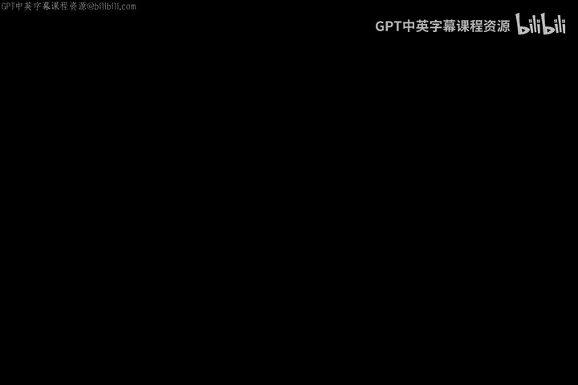

# 002：ChatGPT的横空出世 🚀

在本节课中，我们将要学习ChatGPT的定义、其技术原理、对现有监管框架的挑战，以及它对社会各领域产生的广泛影响。

大家好，欢迎收看。我是Nauonirel，我是鹿特丹伊拉斯姆斯大学的一名博士生，研究方向是公共安全领域的人工智能。今天，我邀请到了Ad Stmhaus教授和Klaus Haina教授，一起来探讨人工智能领域的一些新发展。

这是数字治理慕课课程的2023年更新，我们将在本视频中讨论的主题是ChatGPT。

在深入探讨ChatGPT之前，请先介绍一下你们自己，让我们从Klaus开始。

谢谢Nau邀请我们。我是Klaus Chinaina，我是法律与经济学教授，我对欧洲一体化问题有浓厚兴趣。近年来，我将这一兴趣与数字化研究相结合，关注数字化如何在制度和法律层面发挥作用。我也是数字治理卓越中心Gemoni的联合主任，该中心很荣幸制作了这门数字治理慕课。

谢谢。谢谢。Aver。

谢谢，也谢谢Nanu邀请我参与这次慕课更新的“P边对话”。我是David Thomas，正如你所说，我在伊拉斯姆斯大学法学院担任法律与创新方向的教席。我非常关注与数据、数字化、人工智能相关的各个方面，以及它们与法律的互动。我是Yemuni卓越中心的高级研究员，因此也参与了这门慕课的制作和更新。

非常感谢。正如我已经提到的，今天我们将在这段视频中讨论ChatGPT。也许我们可以从一个定义开始：ChatGPT究竟是什么？

是的，什么是ChatGPT？你有时会觉得不需要定义它，因为每个人都用过它，但这可能有些夸张。从更广泛的受众来看，它实际上是一个你可以与之互动的机器或在线平台。你可以提出任何类型的问题，输入后你会得到一个答案，这个答案以文本形式呈现。

在技术层面，其背后是一个使用人工智能的大型语言模型。它基于海量数据训练而成，这些数据包括多种语言的大量文本，例如也包括荷兰语。它能够利用语言模型来回应你的查询，尽可能给出与你的问题相匹配的答案。

实际上，它是一个聊天机器人，就像你打电话给航空公司或其他商业机构时遇到的聊天机器人一样。你以为电话那头是真人，但那只是一个由机器人生成的声音。其背景技术就是我们所说的GPT技术，这是生成式人工智能的一种形式。

谢谢。当然，到目前为止我们已经听到了很多关于ChatGPT的消息，预计它将改变许多工作任务。但也许我们首先应该看看监管环境，ChatGPT如何适应当前的立法，以及可能如何适应欧洲在人工智能立法方面的发展。我可以问你一个问题吗，Klaus？

这是一个非常及时且有趣的问题。在欧盟的《人工智能法案》中，风险分类是核心。某些人工智能应用不会引起麻烦，而另一方面，我们有一些像面部识别这样的应用，可以说具有最高的风险等级，最终可能被禁止。

而ChatGPT在某种程度上扰乱了这种分类，因为它是一种所谓的通用人工智能技术，可以用于各种目的。你可以问ChatGPT一些非常无害的问题，只是为了自娱自乐，但原则上你也可以要求ChatGPT做一些非常可怕的事情，例如，告诉我如何制造炸药，或者进行恐怖袭击的最佳方式是什么。

现在你会发现，《人工智能法案》主要建立在这些风险分类之上，而现在出现了一种横向跨越所有这些分类的技术。你如何将这样的技术纳入监管？从这一点出发，我的同事或许可以进一步阐述。

这是否有意义？是应该给出一个非常清晰的人工智能定义，还是最好不要有定义？我倾向于完全不使用“定义”这个词，而是在技术上保持开放，然后说，当我们看到它时再进行监管。

因此，就ChatGPT而言，它是监管的对象，但它确实对人工智能监管构成了挑战。我们在另一个视频中讨论的欧盟框架内的人工智能监管，因为正如Klaus所说，它表明，在法规完全通过之前，你所预期的可能就已经发生了变化。因此，需要保持最大的灵活性。

但另一方面，完全开放的描述——“我们看到时再监管”——从法律角度看，在宪法标准下，这并不非常民主。因为这会使行政权力或司法权力变得极其重要，而立法权力则不得不退让。找到其中的平衡点，是欧洲当局和机构试图实现的目标，即找到实现灵活性的方式。

其中一种可以说是欧洲最古老的方式，是在某项法案中给出一个非常宽泛的定义，然后将具体规范、分类或进一步细化的权力，委托给那些程序更快捷、不那么繁琐的机构来执行，以便在实际法律需要变更时能更快响应。

这仍然存在问题，因为通常这就不再需要议会的任何决策参与。因此，从宪法角度看仍是个问题，但从所需灵活性的角度来看，这可能是一个明智的做法。

观察全球的监管反应非常有趣。有些国家说我们需要彻底禁止它，但现在我们看到，这主要是像朝鲜和俄罗斯等威权政体的反应。中国则选择了对此类技术进行上市前评估。

同样，在欧洲内部也出现了不安。意大利曾对其实施了数周的禁令。法国最近开始，法国数据保护局最近已启动对该技术的调查，但这主要是由可能收集个人数据的问题所驱动。因为你提出的每个问题都会被存储，供技术背后的公司——实际上是OpenAI（一个微软旗下的品牌）使用。

我认为这是一个有趣的观点。这当然是一个数据保护问题，但它远不止于此。因为你正在语言模型中使用语言，并且它在生成文本，我们也会遇到与文本生成方面相关的特定问题。

确实，它造成了颠覆。可以说，颠覆始于那些以原创文本生产为核心的行业，比如文学、学校和大学的考试，以及我们学术界——我们的出版物是否需要披露使用了GPT来撰写科学论文？等等。所有这些领域的检查者都已开始理解这是一种颠覆。

那么，我们是否必须找到新的标准来管理我们真正想要实现的目标？实际上，对于图像也是如此，因为ChatGPT是文本生成机器，但我们也有像DALL-E这样的图像生成工具。你可以给这类工具下达的任务可以极具创造性。

但这样生成的内容是否仍然属于“原创生产”？而原创生产对于利用知识产权进行治理非常重要。是的，你提到了，想想看。

---

**本节课中我们一起学习了**：ChatGPT是一种基于大型语言模型的生成式人工智能聊天机器人。它能够根据用户输入生成文本回复，其技术核心是经过海量数据训练的GPT模型。我们探讨了它对现有欧盟《人工智能法案》基于风险分类的监管框架构成的挑战，因为它是一种横向的通用技术。此外，我们还讨论了它在数据保护、知识产权以及教育、出版等行业引发的广泛社会影响和监管难题。全球监管反应不一，从彻底禁止到上市前评估，体现了应对此类快速发展的通用人工智能技术的复杂性与挑战。