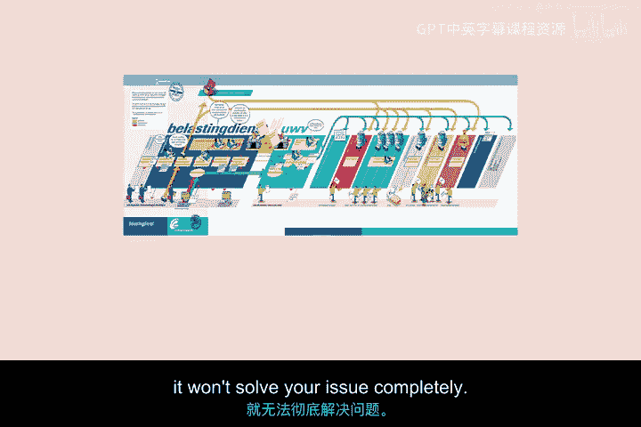
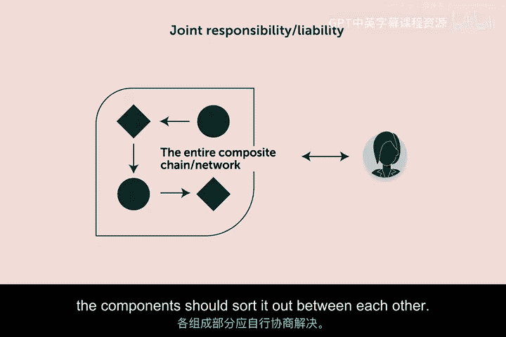

# 012：公共行政领域的数据处理网络

## 概述
在本节课中，我们将探讨公共行政领域日益普遍的一种现象：数据处理网络。我们将了解其定义、运作方式、带来的挑战以及潜在的解决方案。核心在于理解多个公共机构如何通过自动化网络共享数据和决策，以及这对法律、责任和公民权利产生的影响。

---

## 什么是数据处理网络？🤔
上一节我们介绍了课程主题，本节中我们来看看什么是数据处理网络。

公共机构越来越多地建立合作关系，我们称之为“链式网络”或“链式信息化”。在这种网络中，它们共享数据或决策，并利用这些信息来实现各自的目标。

以下是其两个关键定义要素：
*   **合作**：多个公共机构共同参与。
*   **自动化**：大量立法被转化为算法，这些算法通过处理个人数据为公共机构生成决策结果。许多传统上由公务员执行的任务已被算法接管。

---

## 网络合作的实例🔗
了解了基本概念后，我们来看看它在现实中的具体表现。

在荷兰公共行政中，已经存在非常详细的合作机制。例如，在税收和社会保障领域，存在复杂的合作网络。下图展示了一个看似简单、实则涉及众多环节的财务信息共享链。

这仅仅是税收领域的一个例子。在刑事执法等领域，也存在类似的数据共享机制。这些机制不仅在荷兰，在其他国家的行政体系中也朝着相同的方向发展。

---

## 网络化决策带来的挑战⚖️
上一节我们看到了网络合作的实例，本节中我们来看看这种模式带来的核心问题。

链式网络中的决策结果是相互依存的，一个决策建立在另一个决策的基础上。然而，在荷兰行政法中，行政决策被视为独立的个体。这种实践与法律认知的错位导致了摩擦。

以下是几个具体的挑战：
*   **责任空白**：公共机构在实践中相互依赖，但在出现问题时却倾向于推诿责任，将决策视为独立行为，不承担共同责任。
*   **救济困难**：个人可以就链条中的某一个决策提出上诉，但无法针对整个决策组合提出异议。因此，即使上诉成功，也无法确保链条中的错误得到彻底纠正。
*   **忽视个体情况**：自动化算法倾向于非黑即白的判断（是/否，1/0），难以充分考虑复杂的个人特殊情况。当数据在链条中传递时，这种“简化”效应会被层层叠加，使得个体境遇更易被忽视。
*   **系统性风险**：交易数量的增加通常伴随着安全风险的上升，包括错误和数据泄露等问题。

---

## 潜在的解决方案与局限💡
面对诸多挑战，是否存在解决方案呢？《通用数据保护条例》（GDPR）提供了一个有益的起点。

GDPR为参与同一处理活动的数据控制者和处理者规定了**连带责任**方案。这意味着，寻求损害赔偿的申请人无需找出链条中具体是哪个环节造成了损害，他可以要求其中任何一个责任方承担全部赔偿。该方赔偿后，可再向其他责任方追偿。这实际上是将网络视为一个整体来追责。

此外，欧盟在关于人工智能伦理的决议中也提出了类似的“单一接入点”理念，为受损个体提供了明确的追责入口。

然而，GDPR的方案也存在局限：
*   **侧重于赔偿，而非纠正**：个人的主要诉求往往是停止错误的持续影响并纠正错误（例如，停止不正确的行政罚款）。GDPR虽然规定了更正权，但这是针对单个控制者的，且如何在整个链条中强制执行更正尚不明确。
*   **适用范围有限**：GDPR主要保护个人数据。但链式错误可能源于法律错误解释、计算错误（如税款计算错误）等与个人数据无关的问题，此时GDPR无法提供保护。

---

## 技术方案与未来展望🔮
除了法律方案，技术能否提供帮助？数据共享模式正在从“传输数据本身”转向“提供数据访问权限”，即数据保留在原始控制方，仅对外提供访问接口。

结合**隐私增强技术**（如加密查询、命中/非命中系统），可以在不过度暴露数据的前提下实现信息利用。然而，目前尚未出现能自动“净化”整个链条、彻底纠正错误的技术方案。

关于监管是否会抑制创新，尚无定论。相反，如果法规要求进入决策网络的系统必须内置完善的救济机制，可能会通过**采购条件**等方式，反而刺激保障性技术的创新与发展。

---

## 总结
本节课中，我们一起学习了公共行政领域的数据处理网络。

我们了解到，这种通过自动化链条共享数据和决策的网络合作模式，在提升效率的同时，也带来了责任界定模糊、个体救济困难、忽视特殊情况等严峻挑战。GDPR的连带责任机制和“单一接入点”思想是重要的解决思路，但仍需针对错误纠正等具体问题完善法律框架。同时，隐私增强技术和数据访问控制模式是值得探索的技术方向。未来的研究需要深入结合法律与技术，以构建既高效又负责任、能够充分保障公民权利的数字化治理体系。