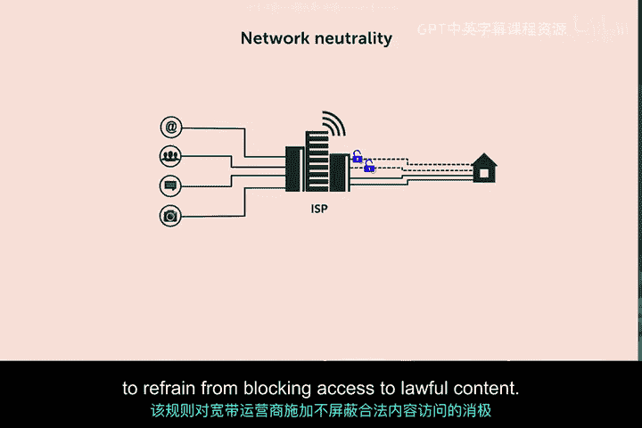

# 017：数字经济竞争与规制（上）

## 📚 课程概述

在本节课中，我们将要学习数字经济中的竞争与规制。我们将探讨数字市场的定义、竞争与规制的基本概念，以及为何这些机制对于确保市场为所有参与者（包括消费者和企业）提供最佳结果至关重要。

---

## 🏛️ 讲师介绍

我是帕纳克曼，利兹大学的法学教授。我的专业领域是竞争法，研究的重点之一是数字经济中的竞争。

---

## 🌐 数字经济的崛起与影响

你知道吗？一些分析人士预测，到2025年，数字经济可能占整个经济的近四分之一。在过去的几十年里，数字化几乎触及了我们生活的方方面面，改变了我们生活、学习、工作、贸易和交流的方式。

数字技术的影响遍及整个经济，包括农业、建筑和公用事业等传统行业。数字化带来了诸多好处，例如新的就业机会、更便捷的购物体验、更轻松的社会联系，以及为大小企业拓展国际市场创造了有利条件。

亚马逊、谷歌、脸书等在线平台是创造这些效益的主要参与者。

---

## ⚠️ 数字市场的潜在问题

尽管好处众多，但我们知道，当数字市场变得高度集中、由极少数参与者主导时，也会引发担忧。在集中化的市场中，如果竞争不再有效，消费者和其他企业的结果将不是最优的。

以下是两个主要问题：

*   **对消费者的影响**：由于缺乏竞争，消费者可能不得不支付更高的价格或忍受低质量的服务。
*   **对企业的影响**：竞争企业可能会发现，由于市场中不面临竞争威胁的现有企业所采取的做法，它们无法进入新市场为消费者提供创新的服务或产品。

---

## 🎯 本讲目标

本讲座由两个视频组成，旨在帮助你理解竞争和规制如何在数字市场中发挥作用，以确保这些市场为数字经济的所有参与者（包括你我这样的消费者和其他企业）带来最佳结果。

在本讲结束时，你将能够：
1.  识别数字市场中竞争与规制的基本概念。
2.  判断当局何时有必要干预此类市场以确保其保持竞争性。

此类干预可以通过**执行竞争法**或**制定法规**来实现，尤其是在竞争法执法可能无法解决特定市场问题的情况下。

---

## 🔍 什么是数字市场？

首先，让我们探讨一下“数字市场”的含义。

当我们提到数字市场时，通常指的是那些公司对现有业务开发和应用新技术的市场，或者公司利用数字能力创造新服务或产品的市场。

在一个真正的数字经济中，来自各个工业领域的企业都投资于数字能力，并最有效地利用这些能力。这意味着有一天，数字化可能会如此深入地渗透到我们的整个经济中，以至于我们的整个经济在某种程度上都是数字化的。

---

## ⚔️ 什么是竞争？

既然本讲的主题是数字市场中的竞争与规制，那么我们应该问的第二个问题是：竞争和规制分别指什么？

**竞争**通常指的是市场上企业为争取买家、实现销售和利润等而独立努力的一种状态。这样定义，我们可以将竞争视为一种**竞争关系**，即不同企业试图通过提供比竞争对手更低的价格、更高的质量和更多的选择来吸引顾客。

竞争过程提升了企业的**生产效率**，因为它迫使企业降低成本以降低价格，从而吸引顾客。竞争也提高了市场的**配置效率**，因为它使更有效率的企业能够进入市场，而效率较低的企业则退出市场。

当竞争促使企业变得更有效率并降低成本时，市场的产出（即生产数量）会增加，价格会下降，更多的顾客可以购买产品。这个过程也鼓励了**动态效率**，即企业投资并参与创新，从而促进技术变革和进步。

市场竞争的这些特点意味着，确保市场更具竞争性的政策将带来更快的经济增长。这就是为什么全球有130多个司法管辖区采用了竞争法，以享受自由市场经济的好处。

---

## 📜 什么是规制？

**规制**通常指政府设立的机构为解决特定市场中的具体问题而发布的一套规则。它涉及对市场参与者的指令，告诉他们应该做什么、不应该做什么，或者建议做什么（即使不一定是强制性的）。

以下是规制的几种形式：

*   **积极义务（必须做）**：例如，如果脸书想推出一种新的加密货币来促进支付，金融法规会对其施加一项积极义务，要求其必须为该活动获得许可证。
*   **消极义务（禁止做）**：例如，网络中立性规则对宽带运营商施加了一项消极义务，要求其不得屏蔽对合法内容的访问。
*   **助推或鼓励（引导做）**：还有一种规制只是助推或鼓励人们做或不做某事，而不强制他们。例如，在一些国家，人们默认被指定为器官捐献者，但可以选择退出。没有人强迫人们成为器官捐献者，但通过将其设为默认选择，政府可以让更多人成为器官捐献者，这对社会有益。

---

## 🔚 本节总结与下节预告

在本节中，我们一起学习了数字经济的崛起及其影响，探讨了数字市场、竞争与规制的基本概念。我们了解到，竞争通过促进效率、创新和增长来使市场受益，而规制则是通过明确的规则来引导或约束市场行为。

你可能想知道，为什么能源、电信或金融市场等比大多数其他市场受到更严格的监管。在下一节中，我们将更深入地探讨为什么有些市场可能需要规制，而另一些则不需要。