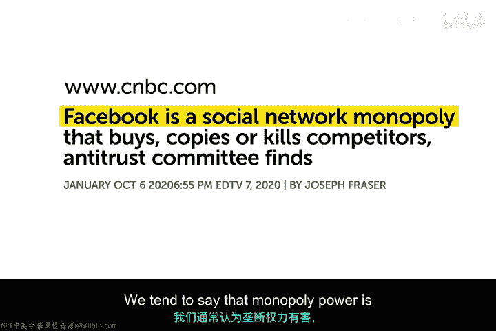
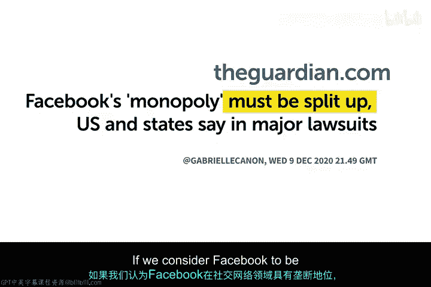
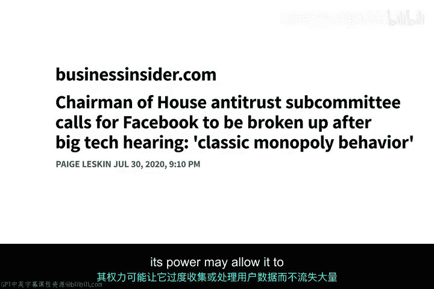

# 022：数字市场监管的必要性与逻辑起点 🎯

在本节课中，我们将探讨数字市场中竞争与监管如何相互作用。我们将了解政府为何以及何时需要对市场进行干预，特别是数字市场，并分析监管背后的经济与社会逻辑起点。

---

## 经济目标：提升市场效率

上一节我们提到了监管的总体目标，本节中我们来看看监管背后的具体经济动因。经济目标的核心是确保市场高效运行，当市场自身无法有效运作时，监管便成为必要手段。

以下是几种主要的经济性监管理由：

*   **应对市场力量与垄断**：当一家公司（如被许多人视为社交网络垄断者的Facebook）拥有过大的市场力量时，它可能做出损害竞争者或消费者的行为。如果这种力量持续存在且竞争无法有效制约，政府可能介入，以模拟竞争效果或创造竞争条件。
    *   **公式描述**：垄断力量可能导致 `价格 (P) > 边际成本 (MC)`，并产生 `社会净福利损失`。
*   **解决信息不对称**：当消费者缺乏做出知情选择所需的信息或理解能力时，市场可能失灵。例如，如果你不知道网速慢是YouTube服务器问题还是网络服务商（ISP）的限流所致，你就无法做出有效的消费决策。知晓内情的公司可能利用这一点损害你的利益。
    *   **代码描述**：`消费者决策质量 ∝ 可获得的信息透明度`
*   **处理外部性**：企业的经济活动可能产生其自身未承担的正向或负向溢出效应。例如，科技巨头收购所有有潜力的初创公司，虽激励了创业者，但长期可能扼杀未来的竞争者，损害可持续竞争与创新，对整个社会产生负面影响。这种趋势本身可能成为监管对象。

---

## 社会目标：促进社会福祉

除了经济效率，政府监管也致力于实现社会目标，关注社会整体福祉。这些规则可能以一定的经济效率为代价，以换取更重要的社会价值。

以下是几种主要的社会性监管理由：

*   **保障内容与观点多元性**：要求平台或媒体保持某种中立性或非歧视性的规则，旨在确保不同内容和观点都能被传播。尽管支持小众内容的成本效益可能较低，但社会认为让多元声音被听见比单纯追求利润更重要。
*   **保护基本权利与民主进程**：关于网络言论自由（如打击仇恨言论、网络欺凌）、数据保护与隐私的规则，旨在保护政治进程、个人隐私与自决权。剑桥分析公司丑闻凸显了数据滥用如何腐蚀民主进程，这加强了要求社交媒体公司更严格管理用户数据及过滤有害政治言论的监管呼声。

---

## 总结与展望

本节课中，我们一起学习了数字市场监管的主要逻辑起点。我们看到，监管是一个复杂的体系，其目标多样，从纠正因缺乏竞争导致的市场失灵，到维护长期的社会凝聚力与进步。

这些目标并不总是容易协调，何时以及如何进行干预也是一个难题。在下一个视频中，我们将迈出回答这个问题的第一步：即如何判断何时应依赖市场竞争力量，何时需要更具体的监管。