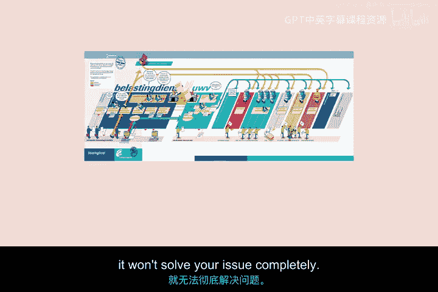
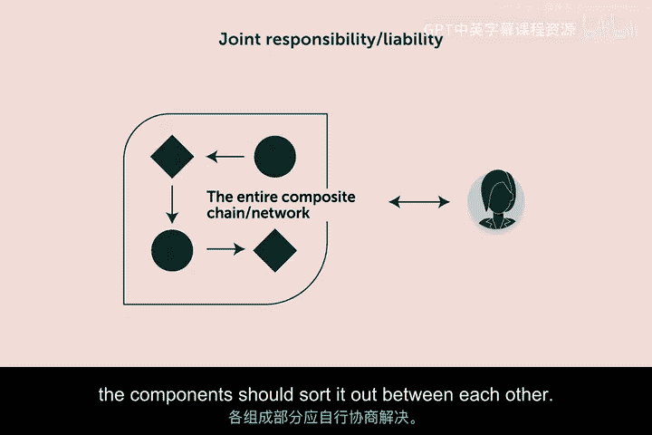

# 鹿特丹伊拉斯姆斯大学《数字治理｜Digital Governance》中英字幕 - P12：11_公共行政领域的数据处理网络.zh_en - GPT中英字幕课程资源 - BV1bNYtzbEiA

Welcome to Erasmus Studio。My name is David Stumhouse and I'm a senior fellow in the Xamonee Center of Excellence on Digital Governance。

And today I have a conversation with Anna， welcome。

 Anna Anna Coning is already a graduate in two master's programs and now she's a researcher that has a shared interest with me on the topic of today。

 which is changes and networks in public Administration。

And this is a special aspect of the digital digitalization of public administration。 Anna。

 what have you investigated， What do we see， Well， I think what we are seeing is that public bodies increasingly engage in partnerships together。

And we call this chain networks and what they do is they set up a network together in which they share data or decision with each other and they use this data or these administrative decisions for their own goals。

 and we call this chain networks or chain infoization。

And I would say there are some defining elements to this chain operation and one of the key defining elements is cooperation。

 as I mentioned， but the second very important element is also automation。

 so what we see is that a lot of legislation is transformed into a set of algorithms and these algorithms are then fed with the personal data and these algorithms generate outcomes for the public bodies。

 and so what we see is that a lot of the algorithms have taken over some of the tasks that the civil servants would do traditionally。

But yeah you already talk about， let's say the outcome of a chain of networks what I've seen myself is a very detailed cooperation mechanisms for example in public administration regarding taxes and Social security on the slide we show now an image of a very complex cooperation mechanisms inside salaries for ordinary people。

 but also relating to the sharing of those let's say financial information throughout a chain with a couple of partners。

 it looks well a couple of partners looks quite uncomplicated。

 but if you see in the image that you can see that it ends up on a numerous stations and it's rather complex。

 and this is just one example relating to tax and Social Security。

 but there is also a chain regarding let's say， criminal enforcement and those kinds of。

Sharing mechanism。 So not not just only the outcomes， but the sharing mechanisms are。

A already in place in the Dutch Public administration and we know that in other administrations。

 there are also developments in the same direction。

 exactlyact but you were talking about the outcomes。

 what are the specific issues regarding the outcomes then of such a chain cooperation or in network corporation。

 Well， I think what's interesting about the outcomes is that all the decisions build upon each other。

 So the outcomes are codependent of each other within the chain。

 and that's interesting for the public administration because in Dutch administrative law administrative decisions are viewed as independent So you can see that this can cause friction。

In the public administration。And is this just a temporary situation or will we move what will the direction be my idea is that this is just the beginning I would say it's the beginning of development because what we see now is that in Dutch administrative law for example chain decisions are still viewed as traditional。

 but I would say and I hope there will be a development where we can view these decisions as what they are in practice interconnected。

 highly automated so that responsibility and accountability is secured and the individuals who are the addresses of the decisions will be protected I'm sure we will come back to that later on but for the moment。

I also want to bring into this conversation that let's say the bottom line of the sharing is indeed also very much pushed forward on the national level as well as on the European level。

 we now talk about you open data spaces and sharing of data for public administration。

 so the whole idea is that you share， you give access that you multiple use multiple sorry that you introduce multiple uses of data yeah yeah yeah。

Even there， I could see， let's say not so much on the level of the decision making yet。

 but on the level of the data that feeds into the decision making chains。

 there is already huge push forward right now to more sharing more common use etc and it's considered to be at least in the European discourse considered to be beneficial to innovation to to economic well-being to growth and at least one thing extra should be mentioned here is that if in the European context。

 artificial intelligence needs to be developed further we need this pooling or sharing of data because usually the databases themselves are too small to really work for learning algorithms so this is also a push in way of。

Moving towards more deployment of artificial intelligence。

As a result of which we see data being shared more and more across public administrations。

 public bodies， but also between public bodies and private actors like industries。Yeah。

 and I do wonder how these trends of shareability and open data spaces， for instance。

 connect to some of the GDPR principles like purpose limitations。

 so to the legal and ethical of this what do you see here here in terms of the。

Legal worries or problems that you that you expect。

 Some of my concerns relate to gaps in responsibility。

 So what I have seen from my research is the attitude of public。

Bodies acting like they are independent but in practice they co-depend on each other because they act within the chain。

 but the problem is that they do not take shared responsibility and what's happening is that public bodies will point fingers at each other when it comes to taking the responsibility so I would say the concern is gaps in responsibility。

And I think the legal system does not create sufficient incentives now to kind of solve this issue because of this idea that public decisions are independent indeed。

The individual does not really have the tools to fight the fight。

 I would say he can appeal to one decision of the chain。

 but he cannot appeal to the combinationul of decisions。

 so you're never sure if the error in the chain will be fixed by that one outlet decision。

So what you're basically saying is there is a huge mismatch between， let's say。

 the legal arrangements and what is the practice on the ground， which is really worrisome。

 particularly for public administration， if I may add， because in public administration。

 let's say responsibility does not only have the feature of being accountable for wrongdoings。

 but also being accountable to democratically elected councils or parliaments on the national or the local level。

 and also to the wider public， so if you say that it is for the individual harder to find out where the wrong has actually been done and who is responsible for it。

 that's even more worrisome in the public domain where you expect that there is transparency towards democratically elected bodies。

 but also towards the wider public。嗯。And of course， in public administration。

 we expect and that's sort of let's say a legal ethical duty of public administrators that there is the opportunity for individuals to have their individual circumstances being taken into account and well automation in itself is already。

 let's say a reduction because you know， algorithm think in black and white。

 in yes and no in ones and zeros so even the less advanced algorithms that are now in practice。

 we see that individual circumstances are rather hard to find a place into these mechanisms as a result of which the individual that wants to appeal to remedy against the specific decision needs to bring them up themselves exactly and if he doesn't know who to talk to and who to appeal to to do and what to do that that's quite worrisome is and this is already true。

For one decision maker that has an automated decision system。

 but it's even more worrisome for the phenomenon that we focus on today。

 which is the chain or network because if you have this reduction already let's say at node a if the data travel more or less metaphorically。

 if the data travel throughout a chain towards node B or N。

 then the combination of reductions is even worse and we already know from research of others that hardship clause social specific taking into account specific individual circumstances and social security are quite a problem in automated systems Of course we know let's say what machines are good at at the moment is calculations with numbers。

 so numerical decisions like income tax for individuals or let's say speeding tickets where on the。

Moway you've speeded a certain number of kilometers above the limit， in that sense。

 you say automated decisions， at least in the Dutch jurisdiction。

 are fairly well accepted because this is what machines are good at。And the the， the。

 the appeal rate is well， rather low。 No， no， no。 But， but if， if it's not numerical， Well。

 some say that artificial intelligence， learning algorithms will solve that problem。 But for me。

 that's still up in the air and。Let's say those reductions in the combination of nodes that add to a certain reduction already their own reduction。

 that would be a serious worry with regard to taking into account personal circumstances。Yeah。

 and then well。If it's true what you say， then it's even harder to remedy against the system。

Then that's worry number three so if you do not know who to appeal to or who is really responsible for wrongdoing not even able to。

 maybe you can appeal to one outlet decision but that won't affect the other decisions so this is what we really need to understand。

 so there is this outlet。Which is usually， let's say the point of entry for a remedy。

 but you don't know whether this outlets is responsible and it's sufficient to solve the issue。

 but because you can imagine if a certain error flows through a chain。

 it can cause problems at multiple nodes， but if you can only appeal to the outlet node。

It won't solve your issue completely so that's the main issue I would say and this is let's say on the individual level and we know that in systematic thinking。

 they call this the outliers and they say yeah you don't need to focus on the outliers but for us as lawyers this is let's say totally irrelevant qualification because this is what the law is all about。

 this is to provide compensation for individual wrongs as a counterbalance against this kind of systematization of decision making processes and it's even towards an individual。

 it's even an outrageous qualification if someone says yeah yeah you'll have a problem but you are an outliers important it's very interesting by the way you often see responsible politicians defend these kinds of situations in the media。

We often say this indirectly by saying yeah but a lot is going very well exactly a lot is efficient and cheap and customer friendly。

 but the outliers are kind of ignored and just the way you could say and the security also on the systematic level the security is also an issue because we know from research regarding security or quite old research is that the number of transactions is directly relating correlate to the number of security risks or a security risk in the terms of mistakes but also in the terms of data leaks and all those kinds of issues。

 we will not pay attention to that in this conversation but there is also this security issue that comes up。

It's an additional problem， but are there， is this all， let's say， worry， worry， worry。

 or are there some solutions？Yeah， there are solutions， I would say。

 and I think the GDPR has made a good start with finding the solution and thinking about liability。

 responsibility in different terms than the public administration is doing now。

And the GDPR basically provides a joint liability scheme for controllers and processors that engage in the same processing activities and this is very good for the applicant trying to claim damages because he does not have to find out which one of the actors in a chain for instance。

 has ultimately caused the damages so one of the actors gets pointed out he has to pay the full amount of damages and then he can take after that he can take redress at his own actors so yeah because interestingly this might be a solution because where there you see this sort of the chain or the network as a whole because well interestingly the。

The point is that。Actors， as bodies usually talk about synergetic effects。 we。

 we cooperate and then we create synergy 1 plus  one equals 3， and everyone is happy。

 It sounds great。 Yeah， but for the individual， it's usually inverted synergy。

 So the other way around where you can see that one plus one equals。😊。

One at a maximum and maybe even approaches one plus one equals zero for the individual and what you now describe as。

Sort of viewing in the legal arrangement the network as a whole exactly towards the individual that might be a resolution I think so and what's great about this scheme is that even if actors decide to internally allocate responsibilities。

 this arrangement cannot be held against the applicant so that's some extra protection he will get that this arrangement I recognize because this is also what we now see in the European Parliament resolution of October this year 2020 where this idea of let's say one point of entry for the people have who have suffered harm exactly is' also introduced for ethical deployment of AI and robotics and you see that there is the same basic arrangement of let's say for the internal composition。

of a network or of a complex system cannot be held against an individual has suffered harm and he or she is offered a single point of entry。

 we have given an image of that which will show how it works how this will work where you see that the single point of entry is given to this specific individual or a corporation or a person and then inside the network the components should sort of sort it out between each other fix it how they will redress their。

But this is then let's say the solution to the problem No are there some drawbacks Yeah。

 there are some drawbacks I would say because claiming damages can be great。

 but it's not always the main interest of applicants because as we spoke about errors can cause ongoing issues for future decisions for example and if you do not correct。

These errors， future decisions can be contaminated by these errors if you， for example。

 if you will get ongoing administrative fines that are incorrect I think you will go crazy at one moment and you just want them to stop So your main interest will be to kind of heal the chain from this error but a joint correction scheme is not offered by the GDPR。

 there is a right to correction， but this is aimed at the individual controller and it's also not quite certain how this is enforceable。

 at the moment now two situations come to my mind we have a famous case in the Dutch situation of identity exactly where someone had to go at。

Terrible length in order to have years and years of proceeding against the government authorities in order to get in all corners in all nooks and crannies of assist the correction that he was entitled to actually and the second instance that comes to my mind is the situation where let's say decision making change are combined with fraud surveillance technology。

 because we know that fraud surveillance technology can sort of identify on the basis of data combinations in a model。

 can identify fraud risks。But if the fraud risk is allocated to a specific person and then fed back into the decision making chain。

 you have a sort of a poisonous mix exactly of when there is this mistake。

And then the decision making chain has already， let's say proceeded these， let's say。

 wrong information into certain decisions。And then of course it's even harder to find out where the correction needs to be taken and how it can be taken and how you can be sure that you are indeed。

 let's say relabeled as not a fraud but an ordinary citizen because the whole chain is contaminated already by this information you're not sure which decision will be influenced by it we have seen these outrageous examples here in the Dutch jurisdiction that I would say our warning to all other jurisdictions that if you combine this let's say a risk approach in fraud detection with a sort of a security approach in decision making change then the risk dominates and it can be really detrimental to the individual who is then unjustly dealt with by the public administration I would say a second problem is that the GDPR is limited because it's great for protecting personal。

Data， but chain errors do not have to。B personal data issues it can be caused by different issues as well if a certain law is incorrectly implemented。

 for example， an individual won't be able to rely on GDPR so that's a second issue I would say and I usually learn also that when I talk you to computer specialists that they say yeah yeah but you have a focus on this more serious risk but do not forget typing errors typing errors just simple simple mistakes and the interpretation also plays a part where individual corporations or individual persons have to give their data to the system where they may not understand the questions because taxable income is a legal concept which is clear to our colleagues from the fiscal department exactly but not to everyone not to everyone no no no and do we have an example of cases like that where。

Let me think， yeah， I think with tax incomes as you say that something in the calculation goes wrong。

 so it's just a calculation error， it's nothing it has nothing to do with personal data it's just the sum of money is incorrect。

 for example and then gets fed into another public body and then the public body says well you do not have the right to a student loan for example。

 so even affecting these okay。So this issue of automated decision is also related to student loans and exactly yeah it's all kind of concrete things I would say so students that watch this video also need to watch out Okay good good。

So。A lot is you going on。嗯。First of all， I think we can come to the conclusion that we need to study we lawyers。

 we need to study these reality and improve the legal arrangements more specifically for situations like this and also be a critical follower。

 a critical observer of those practices that's clear do we have all the topics for research that we want to that we need to focus on Yeah I think the technical solutions they would be very interesting and I was wondering what you thought about the opportunities for technical solutions in relation to research well what I see in the sharing practices let's say。

Rather underdeveloped in the public administration， but also in healthcare and in industry that。

Fed from a totally different source that is from data sovereignty as a source。

 there is a growing awareness of the risks of let's say。

 sharing so data traveling from one to another。 so what you now see is a switch from sharing data so providing datas to other users to providing access of the user to your data so the data remain with inside your area of control and access is then provided and。

At least what I learned for the moment is that it's obviously more easy to come to these technical solutions for the problem of to widely sharing or sharing the wrong data the data does not really flow through a chain No。

 it's just access that flows through the chain and this is then combined with what is called privacy enhancing technologies of which there are some experiments also in Dutch public administration。

 in order to find out that you do not have to give access to your full database， but first of all。

 you say you ask totally encrypted。Query to the database and there comes a hit no hit outcome and only in the cases of the hits the days data then are shared encrypted。

 et cea。 So the combination of technologies， encryption。

 privacy enhancing technologies hit no hit systems lead then to at least the reduction of sharing too many data etc ce。

 but still a technical solution to the contamination that you talk about I haven't seen yet of course I would be interested in it like something that could positively infect the whole system to kind of resolve the error I think that's something to look for but but what would you expect if we promote this as we're going to argue that the regulation so the public policy solution should be this is the target that you have to meet would then stifle innovation or would it。

I would I'm not sure I wouldn't go there， I'm not sure if that would be the case if that stifles innovation。

 I think it could also maybe stimulate innovation we're not sure I think I think we should do some research first to conclude do have conclusions on that exactly I think that's an interesting topic as well how does innovation relate to regulation we know of course there are a lot of let's say commonalities that are shared even in academic papers exactly and my experience so far is if you dig deeper there is not so much empirical basis for either position either the stimulation or because there are examples of the both either stimulation and stifling effects but in this specific example it might be interesting to promote at the regulation should require。

If you want to proceed decisions。In consortia of chain or network like structures。

 you need to have a remedy mechanism in place for the entire not just providing compensation for harm。

 but also to remedy any mistakes。Then it may help stimulate innovation。

 may help public authorities to say， oh， we're going to buy only systems that has this safeguard as well。

 and then for example， by way of this procurement conditions。

 you could stimulate the development of that so maybe we could sell it like that like in a positive sense okay well。

 thanks very much for your interesting Thank you Yes， thank you as well。

