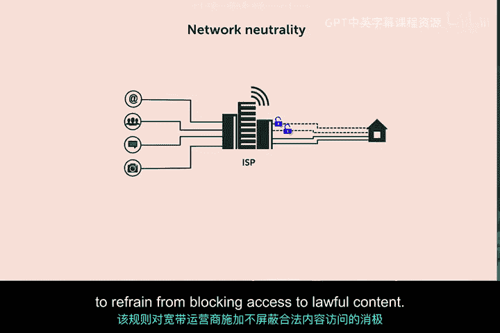

# 鹿特丹伊拉斯姆斯大学《数字治理｜Digital Governance》中英字幕 - P17：16_数字经济竞争与规制（上）.zh_en - GPT中英字幕课程资源 - BV1bNYtzbEiA

Hello， my name is Panakman， I'm a professor of law at the University of Leeds。😊。

I specialize in competition law， and a particular focus of my research is competition in the digital economy。

Did you know that some analysts predict that the digital economy could represent almost a quarter of the entire economy by 2025？

Over the last few decades， digitalization has touched practically all aspects of our lives and transformed the way we live。

 learn， work， trade， communicate， and much more。The impact of digital technologies can be felt across the economy。

 including in traditional industries， such as agriculture， Con and utilities。

 Digitalitization has generated numerous benefits， such as new employment opportunities。

 greater convenience and shopping。Easier social connections。

And accommodating conditions for small and large businesses to expand internationally。

 A major player in the creation of these benefits has been online platforms such as Amazon， Google。

 Facebook and others。😊，Yet despite numerous benefits。

 we know that digital markets can also raise concerns where they become concentrated with very few players。

There is a risk that in concentrated markets， if competition no longer works。

 Outcomes for consumers and other businesses will be suboptimal。For example。

 consumers may have to pay higher prices or put up with low quality services as a result of lack of competition。

Similarly， competing businesses may find that they cannot enter new markets to provide innovative services or products to consumers because of the practices of incumbents in concentrated markets。

 which do not face the threat of competition。In this lecture， which comprises two videos。

You will develop an understanding of how competition and regulation in digital markets have a role to play in ensuring that these markets deliver the best outcomes for all participants in the digital economy。

 including consumers like UN and me and other businesses。At the end of this lecture。

 you will be able to identify the basic concepts of competition and regulation in digital markets。

And when it may be necessary for authorities to intervene in such markets。

To ensure that they remain competitive。Such interventions can take place through enforcement of competition laws。

Or through enacting regulations。Where competition law enforcement may not be able to resolve the issues with a given market。

 First off， let's explore what we mean when we talk about digital markets。

When we refer to digital markets， we usually have in mind those markets in which companies develop and apply new technologies to existing businesses。

Or where companies create new services or products， using digital capabilities。😊。

In a truly digital economy， businesses from across the industrial spectrum invest western digital capabilities and make the most productive use of such digital capabilities。

This means that one day， digitalization may permeate our entire economy to such a degree that our entire economy may be。

 to some extent， digital。As the subject matter of this lecture concerns。

 competition and regulation in digital markets。The second question that we should ask is what we mean by competition and regulation competition generally refers to a situation on a market where businesses independently strive for the custom of buyers in order to make sales。

 achieve profits and so on。Defined in this way， we can think of competition as rivalry。

 where different businesses try to attract customers to their business by offering customers lower prices higher quality and more choice than their competitors。

 This process of competition， enhances the productive efficiency of firms。

 because it forces them to lower their costs in order to lower prices， which will attract customers。

 competition also enhances allocative efficiency on a market because it enables more efficient firms to enter the market and less efficient firms to lead the market。

Where competition leads the businesses becoming more efficient。And reducing their costs。

 the output of the market， namely the quantity produced， goes up。Price goes down。

 and more customers can purchase the product。This process of competition also encourages dynamic efficiency。

 which means that firms invest and engage with innovation。

 which fosters technological change and progress。 These features of market competition mean that policies ensuring that markets operate more competitively will generate faster economic growth。

This is why over 130 jurisdictions around the world have adopted competition laws to reap the benefits of a free market economy。

 So what about regulation。Regulation usually means a set of rules issued by authorities set up by governments to deal with specific problems in a specific market。

It involves commands directed market players telling them what to do or what not to do or what is desirable to do。

 even though it may not be strictly mandatory。For example。

If Facebook wants to introduce a new cryptocurrency for facilitating payments。

Financial regulations impose a positive obligation on Facebook to get a license for that activity。

 Another example relates to rules such as network neutrality。

Which imposes a negative obligation on broadband operators to refrain from blocking access to lawful content。

 Then again， there is the kind of regulation that simply nudges or encourages people to do or not to do something without obliging them。

For example， in some countries， people are designated as organ donors by default and they can opt out。

 Nobody forces people to be organ donors， but by making it the default choice。

 Governments can get a lot more people to become organ donors， which is good for society。

 have wondered why some markets such as energy， telecommunications or financial markets are much more heavily regulated than most other markets。

 you can tune into the second part of this lecture to find out as we take a closer look at why some markets may require regulation when others may not。

