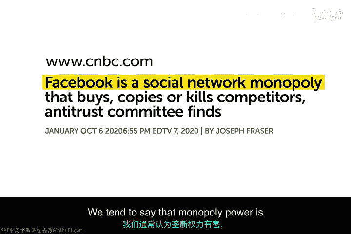
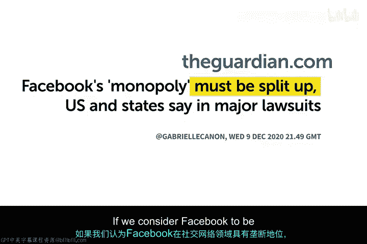
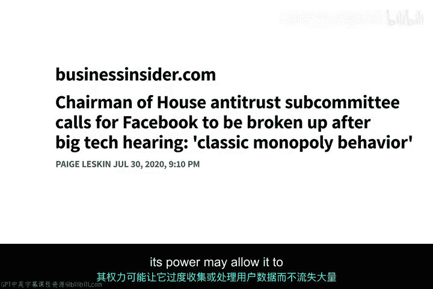
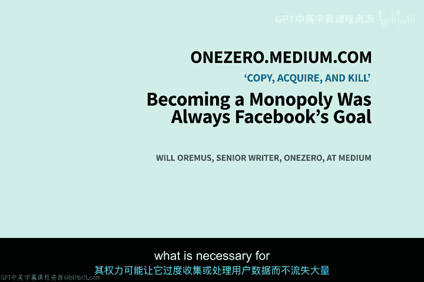
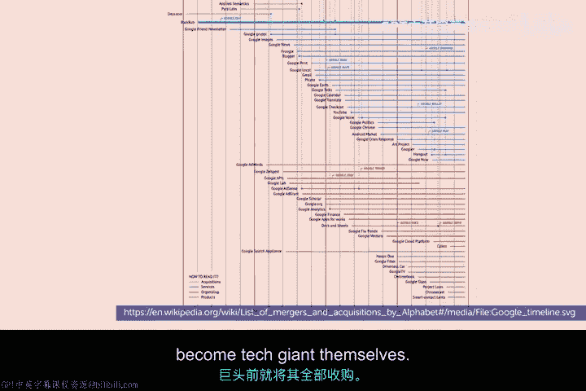
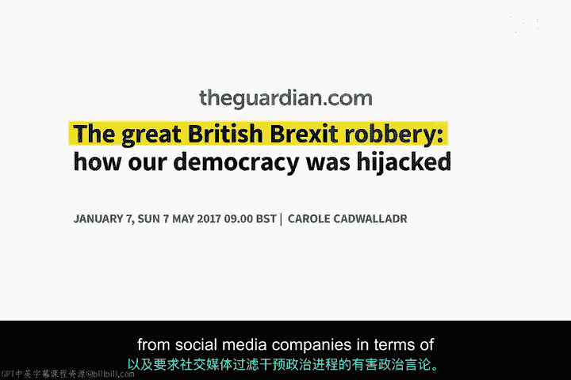

# 鹿特丹伊拉斯姆斯大学《数字治理｜Digital Governance》中英字幕 - P22：21_数字市场监管的必要性与逻辑起点.zh_en - GPT中英字幕课程资源 - BV1bNYtzbEiA

Hello and welcome to the next part of the competition and Regulation in Digital Market module。

My name is Constantino Stiano， and together we will consider how competition and regulation interact with each other in the market。

As Professor Akman mentioned in her introductory video。

 most economies recognize people's freedom to engage in the economic activity of their choice and on the terms of their choice。

I am free to sell mobile phones instead of say potatoes。

 and I'm also free to sell only noia phones and on iPhones， if so I wish。Of course。

 this freedom is not boundless。 Thouands of laws， regulations and restrictions control how markets work。

 and we will all agree that some boundaries are indeed necessary。

 But when our starting point is freedom of economic activity。

 any restrictions we decide to impose need to come with an explanation。

 a justification of why they are necessary and appropriate。

This tells us that the government or a regulator has a legitimate reason and that they are not acting arbitrarily。

In this video， you will gain a good overview of the most common reasons why we regulate markets and in particular。

 why we regulate digital markets。Often， markets work well on their own。

 simply following the laws of supply and demand and free competition。But sometimes。

 this is not enough。And more specific rules need to be adopted。

The goal in this video is to take you for a look behind the scenes of rulemaking to understand the fundamental problems they are trying to solve。

This would allow you to critically think about the necessity of laws and regulations。

But also about whether they are fit for purpose。In other words。

 how do we know whether the rules we enact solve the problem we face Broadly speaking。

 governments regulate to achieve either economic or social goals。

Economic goals are primarily concerned with the efficient operation of the markets。

 whereas social goals focus more on the wellbeing of society。

Let's delve into the main rationales in each category。We begin with the economic ones。 And for that。

 think of Facebook， for example。Just by reading the news。

 you must have seen that many people refer to Facebook as a monopolist in the social networks market。

We tend to say that monopoly power is bad because it allows firms to act at the expense of their competitors or consumers。

If we consider Facebook to be a monopoly in social networking。

Its power may allow it to collect or process user data beyond what is necessary for its operation without losing any significant number of users。

Without any pushback from competitors or consumers。

Monopoly firms may start to act to the detriment of the market。

If this power persists and competition from other companies seem seems to not have any effect in curbing the monopolists bad conduct。

 Governments may may decide to intervene。They will do so to artificially constrain the monopolist the same way competition would if it could emerge or to create the conditions for competition to actually emerge。

Another common economic reason to regulate is when we notice that consumers do not have the necessary information to make informed choices。

Or that they do not have the capacity to understand it。We call that information asymmetry。

Access to information is important。 If consumers do not know what choices are available and what each choice means。

 then they cannot act freely in and according to their preferences。Imagine， for example。

 that you start noticing that YouTube loads videos much more slowly than Netflix。

If you don't know whether this is because YouTube servers are very busy。

Or because your Internet access provider intentionally slows down YouTube。

Then you cannot decide if you need to change Internet access provider or just blame YouTube。However。

 YouTube and your Internet service provider know what is going on。

 and they may use that information to their advantage and at your expense。

Since you may not know whether turning to a competitor would solve the problem。

 competition again might underperform。One more key economic rationale for regulation is to account for positive or negative effects that a firm's economic activity generates。

 but that it does not capture itself。We call that externalities。Imagine， for example。

 that tech giants like Google， Apple， Microsoft and Facebook buy out all successful startups before they have a chance to become tech giants themselves。

On the one hand， this may be seen as a good thing because it creates incentives for entrepreneurs who can hope that their successful startup will be brought out for billions。

On the other hand， though， this tendency may prevent any such startup from becoming an actual long term competitor to the established tech giant。

 thereby undermining sustainable competition。Each individual startup acquisition may not be bad。

 but the trend as a whole may create negative effects to competition and innovation that are not immediately observable and that will spill over to the whole society。

 not just the companies involved。This could be something that we may want to regulate。

These are all important reasons to regulate， but governments are not only concerned with economic efficiency。

They also care about social goals and policy， and many rules are adopted in that direction， too。

This is regulation underpinned by social rationales。For example。

 rules that impose some sort of neutrality or nondic on platforms or media can be aimed at ensuring the plurality of content and opinions。

It may be costly and inefficient to allow minority content or opinions to be distributed on equal terms as more popular content and opinions。

 but we have decided as a society that it is more important that small voices are heard too。

 than just only voices that make money。This improves inclusion。

 social cohesion and social solidarity， which we think may be worth more than just making money。

 Take other examples。Rules on online freedom of speech。Such as hate speech or cyber bullying。

 or rules on data protection and privacy also aim at advancing important social goals。

Like the protection of the political process and people's sense of privacy and self determination。

The Cambridge Analyical scandal exemplified well how data abuse can corrupt the democratic process and manipulate social media profiling。

In doing so， the Cambridge Analyica incident strengthened the case for more stringent rules on what social media companies can do with user data。

 but also on what is expected from social media companies in terms of filtering out pernicious political speech that meddles with a political process。

As you can see， regulation is a complex apparatus。Its objectives are diverse。

 ranging from correcting obvious market failures due to lack of competition to maintaining long term social cohesion and progress。

These goals are not always easy to reconcile。And it is also not easy to decide when and how to intervene。

In our next video， we will take the first step in answering this last question。

 namely how do we know when to rely on the market's competitive forces and when or more specific regulation。

