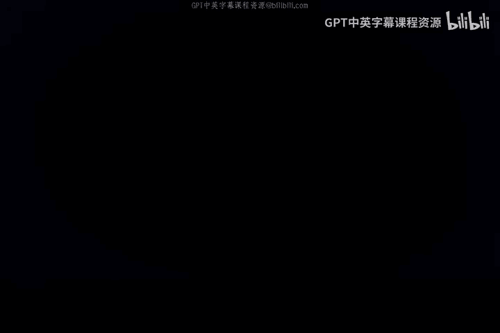

# 鹿特丹伊拉斯姆斯大学《数字治理｜Digital Governance》中英字幕 - P26：25_数据确权：产权制度、交易与激励机制（下）.zh_en - GPT中英字幕课程资源 - BV1bNYtzbEiA

After this module， you will be able to explain the welfare enhancing role of property rights in society。

And you will be able to describe the different effects that property rights can have on social welfare。

If we zoom in into the analysis of property rights。

 one important insight is that property rights are not a moral category。

At least not in the first instance。They are an instrument by human design to reach specific social goals。

As for example， getting prices of consumer goods down by the help of competition。

Giving entrepreneurs incentives for innovation or protecting the environment。

Property rights allow the owner the full command over a resource。

 including to deny others the entry or use of it。Only if you have ownership。

 you are entitled to write a contract in which you state that someone else may make use of the resource。

And the other may have to compensate you in exchange。

That makes ownership the fundamental for trade and exchange。A patentant is a good example for it。

 Asume you are an inventor。The patentant gives you ownership of your invention and protects you against infringement by imitation。

But often， inventors are not able to exploit their invention because other patterns are lacking。

There's not enough capital， or you have no access to distribution systems。Therefore。

Inventors are often happy to sign a contract with a potent entrepreneur who pays you a royalty in exchange for the exclusive right to use your invention。

😊，Paetent law stipulates that after a couple of years， your patent is no longer protected。

 and others may use your idea for free。In other words。Your intellectual property becomes socialized。

Petent law gives you an incentive to work on your invention。

Capable entrepreneurs may contract with you in order to exploit the invention exclusively。

 And finally， all people may use the invention for free。😊。

The property right has obviously undergone a cycle from an exclusive private property to public ownership。

 whereby contracts helped to disseminate the implied welfare of the invention across society。

This example showcases that ownership is， in the first instance， not a moral category。

 but serve the function of maximizing society's welfare。

That means the deliberate legal design of property rights aims at making all people in society wealthy。

Thereby， it might be useful to grant exclusive ownership in order to incentivize people to become productive for society and to exchange their property rights by contracts。

This way， valuable property becomes created， which gets finally into its most valuable societal use。

😊，Under certain conditions， public ownership might also be the welfare maximizing solution。

You already heard and learned about that in the video about beaver hunting in Canada in the 19th century。

You also learned in that video that the optimal allocation of property rights may change over time。

From public property to private property。 But the other way around can also be true。

 as in the example of patent law。We will come back to that regarding ownership of data in the following lectures。

Now， we will have a closer look on what a property right entails。

It's more specific legal design features。You may compare that with the design features of cars for different purposes。

The principal design of a car is set。It has a chassis。Seats， a steering wheel， a motor， windows。

 headlights。Breaks。But those design features have different relevance for the usefulness of a car。

 depending on the specific purpose that the car has。

An off road vehicle needs specific tires and a specific gearbox。 Also。

 four wheels arrive as necessary。That is different for a Formula  One car。

 and a delivery van may not need four seats， but a specific platform for loading cargo。

The same applies to property rights。Property rights shall incentivize innovation productivity。

 keep the transaction costs of trade low and maximize social welfare。

 But depending on the specificities of a tangible or intangible good。

 the property right needs specific design features to perform optimally。Thus。

 it is the bundle of property rights associated with a product that determines the value of a good。

 for example。In France， there is the law that paintings of famous French painters must not be sold to other countries。

Now， assume you are a French collector considering buying the painting of a famous French painter。

You may laugh the painting that you would very likely not make a very high bid for it。Why。😡。

Because you are not entitled to sell the painting after a couple of years abroad。

 when its price may have increased。The restriction of the property right to sell the painting outside France obviously devalues the painting。

 Also， you may laugh the painting as such。Hence， it is a bundle of property rights specifications that gives value to a good。

😊，Already in Roman law， the generic specifications of property rights were identified。

Those specifications may apply all at once， separately or in combination to a good。Use us。

The right to make use of a good。For example， renting a holiday apartment。U just fructus。

The right to receive the benefits and the obligation to balance the losses from using a good。

For example， leasing a delivery van and doing business with the delivery。Abuers。

The right to make changes to a good。For example， building a house on a rented piece of land。Use aee。

The right to sell the good or parts of it， and to keep the profit。For example。

 selling the copyright of a novel。A good has a higher value。

 the more complete the bundle of associated property rights is。

The painting of a famous French painter is more valuable if it can be sold outside France。However。

 from the specification of property rights does not follow automatically that only a full bundle of property rights is maximizing social value。

 There might be trade offs to be overcome。For example。

Society may like to protect nature and forbid that on a specific piece of land。

 coal mining takes place while other activities might be allowed。😊。

This example already hints to the category of so called external effects。

An external effect emerges if the use of a good has a negative or a positive effect on others without the possibility to exclude the others from the effect。

For example。CO2 emissions are not calculated with its true social costs in production processes。

The cost of environmental damage becomes externalized by by environmental and health damages。

 which the producer does not compensate。This is a negative externality。

Because of the two low calculated costs， it is produced too much of the good。

But there are also positive externalities。In those cases。

 one can enjoy the good without paying for it， because exclusion is not possible， for example。

A dike protects all beings behind it， Even though they may not have contributed to its building and maintenance。

If there is a free lunch， one can expect the problem of overcrowding and exhaustion。

No one is going to provide the resource because no one likes to bear the cost for others。As a result。

 there will be no dikes。 If building the diykes is purely left to private initiative without further specifications of property rights。

From the view of poverty rights theory， it depends on the smart design of the property rights regime to solve environmental problems。

 to set an incentive for building dis， to invest in new drugs against viruses or to maintain property rights for music composers。

Moreover， specific business models vary on smart regimes of property rights allocation locationss。

 As， for example， Airbnb， Uber， cloud services， leasing contracts or specific financial instruments。

In the next video， we will look more closely at digitalization and data ownership。

With what kind of goods we are dealing in the case of data。

 which data ownership regimes are around and which consequences have those data ownership regimes。

