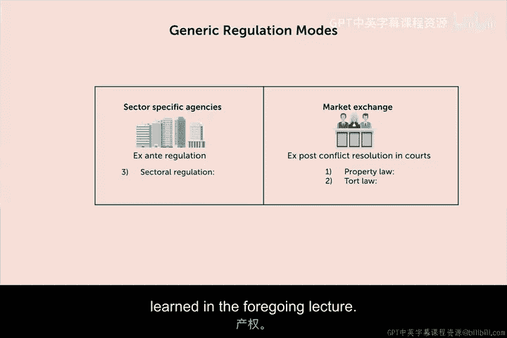
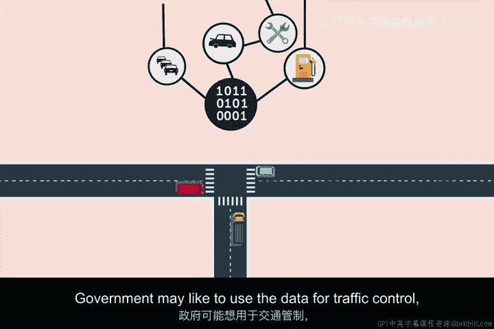
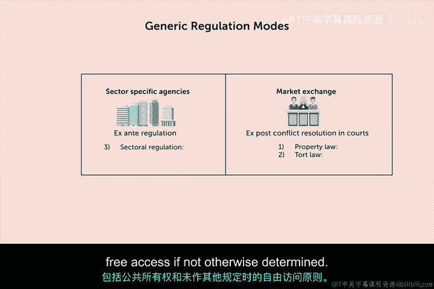

# 鹿特丹伊拉斯姆斯大学《数字治理｜Digital Governance》中英字幕 - P27：26_数字化进程与数据所有权问题.zh_en - GPT中英字幕课程资源 - BV1bNYtzbEiA

After this module， you will be able to demonstrate the interrelation between digitalization and data ownership。

The overview I will give you is not exhaustive。The topic is vast。

 and yet there is no consensus in the field。Hence， you shall become empowered to put forward your own opinion on the subject by means of scientific argumentation。

In the last lecture， you learned that the specification of property rights on goods is key to enable market exchange and to raise social welfare。

However。Private property is not always the first best specification of ownership to enhance social welfare。

Public property and mixes of private and public property are also possible specifications， thus。

The first question we must deal with is what kind of good data are。What attributes have data。

 only if we have an answer to that question， we can specify property rights on data in a reasonable way。

Whether data and information are a good at all。 and under what circumstances data qualify as a specific good is not a trivial question。

From the answer， it depends what kind of legal concept you employ for building the data governance that shall enhance social welfare。

Here I can give you only a flavor of the intricacies which are around。At the very beginning。

 rests the questions if data are a kind of physical good。 At first glance。

 you might believe it is an intangible good， but that is not so clear。

 It has been argued that data are always bound to a physical medium。 For example， a hard disk drive。

Taking that as departure， you may argue that data may be treated like land property to which you can deny access if you do not contract otherwise。

But you may also start from the assumption that data are fluent。

 They do not fulfill the quality of a property that can be simply fenced in。

This was already a big question when the court of the German Empire was confronted in 1899 with the question。

 whether electricity is a good， comparable to regular goods。Is electricity a wave or a particle。

And only if it would be a particle， it could be stolen， like any other good。Obviously。

 there is no good answer to this question。 and therefore， a new criminal offence was created。

 The stealing of electricity。😊，This quick reflection gives us already some guidance to which legal tools we may refer to assign property rights in data。

Property law。Data become assigned to a legal person that has the right of injunction。

 if there are data infringements。Like trespasses on a piece of land。Contracting can be refused。

Taught law。Data are assigned to a legal person。In case there is an infringement。

 an injunction is not possible。 Instead， a compensation must be paid for the infringement。

Contracting cannot be refused。Sectoral regulation。The specificities of data ownership become conditionally regulated with regard to a specific purpose that shall be fulfilled。

European database law is an example for this approach in which it is described。

 what a database is and which specific rights and obligations are implied with the database。

Property law and tort law belong to private law and shall facilitate market exchange。

Disputes will be decided in courts， exposed。Sector regulations prescribe X anti the peri in which contracts are possible。

 It belongs to public law。Within private and public law。

 it is possible to specify the property rights， according to the four generic specifications of property rights。

 which you learned in the foregoing lecture。

Going a step further， one can distinguish different substantive data categories that are determined by the context in which they occur。

A first category coming to one's mind， are personal data。

These are data that give account about an identifiable data subject。Typically。

 personal data are associated with a single individual， and the question of privacy pops up。

According to a famous definition， privacy means generally the right to be let alone。 And in addition。

 the right to be forgotten on the Internet。You may rerase that as。

How strong is your property right in data about yourself。

It is apparent that the three different approaches give different answers to that question。

According to property law， an individual would have a strong title against any use of her or his data by others if the use has not been formally contracted。

 including a compensation。The problem with this approach has been since the very beginning of the privacy debate in the late 19th century to enforce one's right to be let alone。

Or nowadays， how can you enforce in the Internet that private information about you becomes fully removed。

For the background of the enforcement problem， the second approach became prominent。In principle。

 a violation of the exclusivity of your personal data is seen as a damage to your property。

Your property becomes abused without having given contractual consent。As a consequence。

 a compensation has to be paid。This approach is more feasible than making the attempt to enforce a property right by an injunction。

Howeverever。With this approach， the problem is to determine what is a privacy violation。

 How severe is it or what is a fair compensation。Vaake standards and interpretations are the permanent companions of the to law approach。

Thus， if you wonder why privacy cases are often not easy to be determined and have sometimes unexpected outcomes。

 then this has to do with the to law approach as a means of resolution。

A second category is non personal data， or industrial data。

These are data that do not contain any personal data。

 but are a result of machine to machine or business to business interaction。

Those data are created in financial transactions in manufacturing。

 transport or the Internet of things。Having ownership about industrial data can be very crucial for business。

 Think， for example， about the sensor data from truck driving。

Data are collected about the fuel consumption related to traffic congestion， driving behavior。

 the landscape and etca， also。Data before an accident are collected and may help to improve the construction of trucks。

One can imagine that many parties can put forward good reasons why they should get access to those data。

Government may like to use the data for traffic control。

 Engineering companies would like to invent new combustion machines。

 The car manufacturer may like to connect vehicles for self drive cars and insurance companies would also like to know。

But who is the owner of the data， Who decides of the access to it， Is the owner。

 Is it the owner of the car， or is the car manufacturer who has invented the assembly of all the car sentences。

 The owner， whatever the answer to this question is。

 one may also have good reasons to give insurance companies access to those data to better calculate insurance premiums。

 and the Government may use the data for better urban planning。Hence。

 it would be possible to allocate an exclusive property right on data to the car owner。

 And if another party would like to make use of the data。

 it would have to pay a compensation to the car owner。In the case of cars。

 it has been indeed proposed to give the car owner a strong property ride against other parties。

 which are interested in the data。That means property law provides the guiding doctoral principles to deal with car data。

However， yet theres barely any guidance by the law who is the owner of industrial data and which party should get access in which sectors under which conditions。

This is a clear lack of data governance that becomes even more crucial when the Internet of things takes off。

The laws and regulations regarding ownership of data are， if there are any at all。

 fragmented and can differ a lot between jurisdiction sections。For example。In the US。

 a Supreme Court decision spelled out the protection of databases in a judicial reflection about the applicability of copyright law。

 While in the E U， the database directive protects collections of data when there had been a substantial investment meant in the collection。

Other countries have chosen for other concepts of defining data property。

 including public ownership and free access， if not otherwise determined。

Today。Data ownership is not well def not a well defined category。However。

 it is possible to make distinctions between different subcategories of data。

 as personalized data and industrial data。 It is also possible to employ generic doctorctrinal approaches to determine the property right in data。

The chosen approach determines then largely the more fine grainined aspects of the data governance。

What we have left open in this lecture is the question about what data governance regime and which allocation of property rights in data would be the socially beneficial one。

Doctrinal law cannot give the answer。We will turn to this question in the next lecture。

