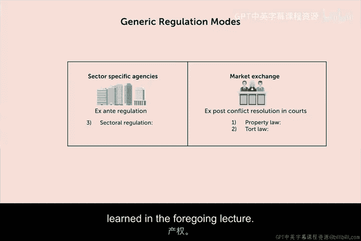
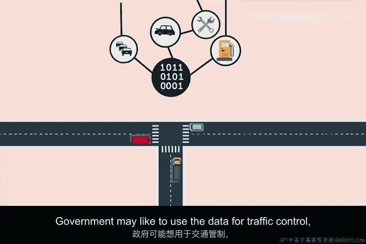
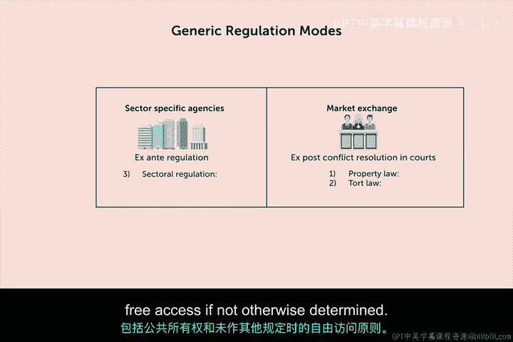

# 数字治理：P27：数字化进程与数据所有权问题 📊

在本节课中，我们将探讨数字化与数据所有权之间的相互关系。我们将分析数据的本质属性，并学习如何运用不同的法律工具来界定数据的所有权。课程将涵盖个人数据与工业数据的区别，以及财产法、侵权法和行业法规在数据治理中的应用。

---

在上一讲中，我们了解到明确商品上的财产权是促进市场交换和提高社会福利的关键。

然而，私有财产权并非总是提升社会福利的最佳所有权界定方式。公有财产权以及公私混合的所有权形式也是可能的选项。

因此，我们首先要处理的问题是：数据属于何种商品？数据具有哪些属性？只有回答了这个问题，我们才能以合理的方式界定数据上的财产权。

数据（或信息）是否构成商品，以及在何种情况下数据有资格成为特定商品，并非一个简单的问题。答案将决定你采用何种法律概念来构建旨在提升社会福利的数据治理体系。

这里，我们只能初步了解其中涉及的复杂性。最根本的问题是：数据是否是一种有形商品？乍一看，你可能会认为它是一种无形商品，但这并不明确。有观点认为，数据总是依附于物理载体，例如硬盘。

以此为出发点，你可能会主张数据可以像土地财产一样对待，如果你没有签订其他合同，就可以拒绝他人访问。但你也可能从另一个假设出发：数据是流动的，不具备可以被简单地“圈起来”的财产特性。

早在1899年，德意志帝国法院就面临一个类似的大问题：电力是否是一种商品，可与常规商品相提并论？电是波还是粒子？只有它是粒子时，才能像其他商品一样被“盗窃”。显然，这个问题没有完美的答案。因此，一项新的刑事罪名被创立：盗窃电力。

这个快速的思考已经为我们提供了一些指引，告诉我们可参考哪些法律工具来分配数据中的财产权。

以下是三种主要的法律工具：

*   **财产法**：数据被分配给一个法人实体，该实体在数据受到侵害时（如同土地被非法侵入）拥有禁令权。可以拒绝签订合同。
*   **侵权法**：数据被分配给一个法人实体。如果发生侵权，无法申请禁令，但必须为侵权行为支付赔偿。不能拒绝签订合同。
*   **行业法规**：数据所有权的具体规定根据其旨在实现的特定目的而有条件地进行规范。欧盟数据库法律就是这种方法的一个例子，它规定了什么是数据库，以及与数据库相关的具体权利和义务。

财产法和侵权法属于私法范畴，旨在促进市场交换，争议将在法庭解决。行业法规则规定了合同可能存在的范围，属于公法范畴。在私法和公法内部，可以根据上一讲学到的四种通用财产权规范来具体界定财产权。

进一步而言，我们可以根据数据产生的背景来区分不同的实质性数据类别。

首先想到的一个类别是**个人数据**。这些数据记录了可识别的数据主体。通常，个人数据与单个个体相关联，隐私问题随之出现。根据一个著名的定义，隐私通常意味着“不受打扰的权利”，以及在互联网上“被遗忘的权利”。你可以将其理解为：你对关于自身的数据拥有多强的财产权？

显然，上述三种不同的法律工具对这个问题给出了不同的答案。

根据财产法，如果他人使用其数据未经过正式合同约定（包括补偿），个人将拥有强大的权利来反对任何此类使用。这种方法的问题自19世纪末隐私辩论开始以来就一直存在：如何执行“不受打扰的权利”？或者如今，如何在互联网上强制执行关于你的私人信息被完全删除？

由于执行问题的背景，第二种方法（侵权法）变得突出。原则上，侵犯你个人数据的排他性被视为对你的财产造成损害。你的财产在未经合同同意的情况下被滥用。因此，必须支付赔偿。这种方法比试图通过禁令来强制执行财产权更为可行。

然而，这种方法的问题在于确定什么是隐私侵犯、其严重程度如何，或者什么是公平的赔偿。模糊的标准和解释是侵权法方法永恒的伴侣。因此，如果你想知道为什么隐私案件往往不易判定，有时结果出人意料，这与将侵权法作为解决手段有关。

第二个类别是**非个人数据**或**工业数据**。这些数据不包含任何个人数据，而是机器对机器或企业对企业交互的结果。这些数据产生于金融交易、制造、运输或物联网中。拥有工业数据的所有权对企业可能至关重要。例如，想想卡车驾驶的传感器数据。

收集的数据涉及与交通拥堵、驾驶行为、地形等相关的燃油消耗。事故前的数据也被收集，可能有助于改进卡车的构造。可以想象，许多方都能提出充分的理由来说明他们为何应该访问这些数据。政府可能希望将数据用于交通控制，工程公司希望发明新的内燃机，汽车制造商可能希望连接车辆以实现自动驾驶，保险公司也想知道。

但是，谁是数据的所有者？谁决定访问权限？所有者是车主，还是发明了所有汽车传感器组装的汽车制造商？无论这个问题的答案是什么，人们也可能有充分的理由让保险公司访问这些数据以更好地计算保险费，政府也可能利用这些数据进行更好的城市规划。

因此，可以将数据的排他性财产权分配给车主。如果另一方希望使用数据，则必须向车主支付补偿。在汽车数据案例中，确实有人提议赋予车主强大的财产权，以对抗其他对数据感兴趣的各方。这意味着财产法为处理汽车数据提供了指导性原则。

然而，目前法律几乎没有任何指导来确定谁是工业数据的所有者，以及在哪些行业、何种条件下哪一方应获得访问权。这显然是数据治理的缺失，当物联网兴起时，这一点变得更加关键。关于数据所有权的法律法规（如果存在的话）是零散的，并且在不同的司法管辖区之间可能存在很大差异。

例如，在美国，最高法院的一项裁决在关于版权法适用性的司法思考中阐明了对数据库的保护。而在欧盟，数据库指令保护的是在收集中进行了实质性投资的数据集合。其他国家则选择了其他定义数据财产的概念，包括公有所有权和自由访问（除非另有规定）。

---

本节课中，我们一起学习了数据所有权并非一个定义明确的类别。然而，我们可以区分数据的不同子类别，如个人数据和工业数据。我们也可以运用通用的法律原则方法来确定数据中的财产权。所选择的方法在很大程度上决定了数据治理更精细的方面。

我们在本讲中尚未解答的问题是：何种数据治理制度以及何种数据财产权分配方式对社会是有益的？法律教义无法给出答案。我们将在下一讲中探讨这个问题。