# 鹿特丹伊拉斯姆斯大学《数字治理｜Digital Governance》中英字幕 - P28：27_数据治理体系设计.zh_en - GPT中英字幕课程资源 - BV1bNYtzbEiA

After this module， you will be able to apply the theoretical insights about data ownership that you have studied in the foregoing modules for choosing between alternative data governance designs。

😊，I will show you the art of engineering data governance designs by the help of a challenging example。

 If we are going to design legal rules， In our case， it is the governance of data rights。

 we must have an idea of what we like to achieve with the allocation of rights and obligations。

 This might be the maximization of wealth。😊，But it can also be other goals as strict privacy or keeping technological leadership。

What is important is that any law or regulation that drives decisions into one specific direction may create trade offs with other goals。

If individual privacy becomes total， then hardly any business model will flourish that builds upon big data of humans。

In addition， the imposed data governance must be accepted by the people who are affected by it。

 in other words。The laws and regulations must be regarded as legitimate。

Solving all trade offs and having full consent to a data governance regime are hard to achieve。

But it is possible to come up with smart designs that make the trade offs as small as possible and to attain a high degree of legitimacy。

By the help of what you have learned in the preceding lectures。

 you are able to substantiate your own ideas about how to allocate data ownership wisely。😊。

Property law， tot law， sector specific regulations。

 the market mechanism and different data categories are the building blocks for data governance。

Toward the end of this module on data ownership， I would like to challenge you with a specific data ownership model。

 It does yet not exist， but may become reality in the future。At the beginning of our discussion。

 we must remember that big data in conjunction with artificial intelligence is a game changer for law。

Similarly， as the invention of the limited liability company at the time of industrial revolution。

Or similarly， as enterprise liability did when mass production became possible。

Big data is the fuel for making artificial intelligence work and to create all kinds of smart applications。

Those applications may be business models， tools for better healthcare or a more targeted policy police profiling。

The applications can be very different， but the structural principle is always the same。An algorithm。

 the artificial intelligence。Is learning to solve problems by being fed with data。Thereby。

 the data are specific for the algorithm。That means the applicable data become necessarily from different data categories。

 which comply with different levels of privacy。For example。The data may be purely technical。

 drawn from a combustion machine， or they might be highly individual from a specific cancer treatment。

All kinds of legal problems may arise from the combination of big data and artificial intelligence。

But two are pervasive。How to deal with privacy and the other problem comprises competition issues。

The allocation of data ownership rights is key to a fresh proposal to solve both problems。

The combination of a fuel that unfolds its power through a machinery is as such not new。 However。

 the dangerous nature of the combination makes a difference for society and the applicable law。

An important example from the past is nuclear energy。

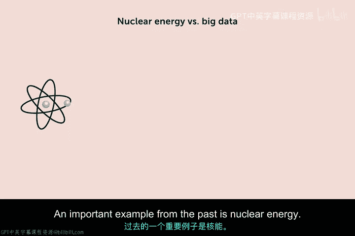

Nuclear energy is the combination of advanced nuclear physics with fission material， for example。

 enriched uranium。

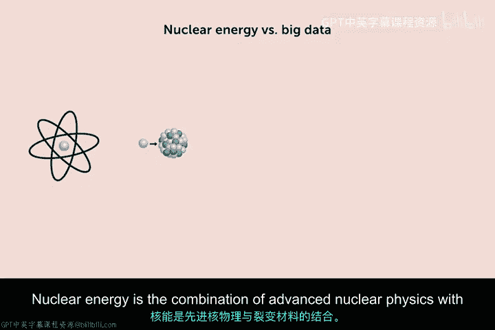

From this example， we derive a couple of important insights that have an analogy with big data and artificial intelligence。

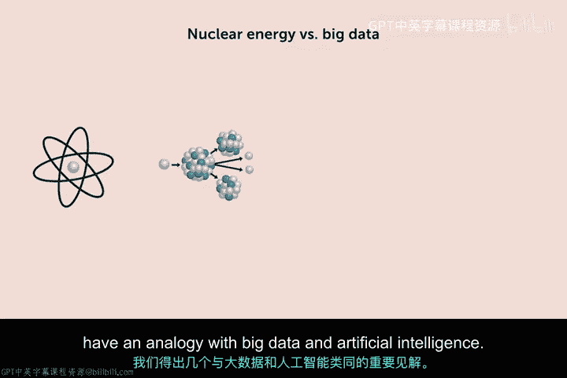

First。Nuclear energy needs huge investments。

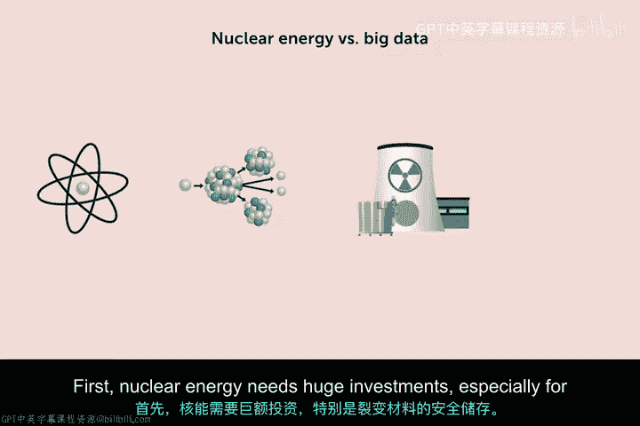

Especially for safe storage of fission material。As a consequence， on those markets。

 competition problems are pertinent。

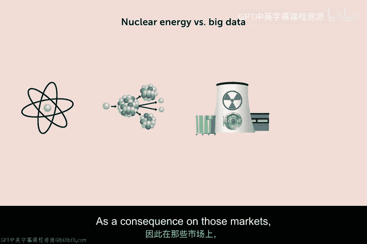

Huge sunk investments into specific nuclear technology。

 Let incumbents hinder newcomers to enter the market。

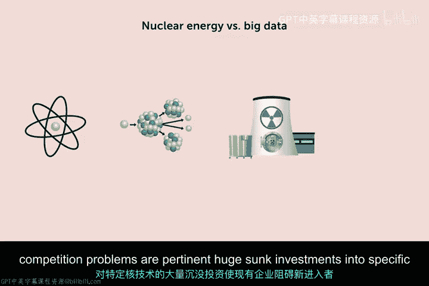

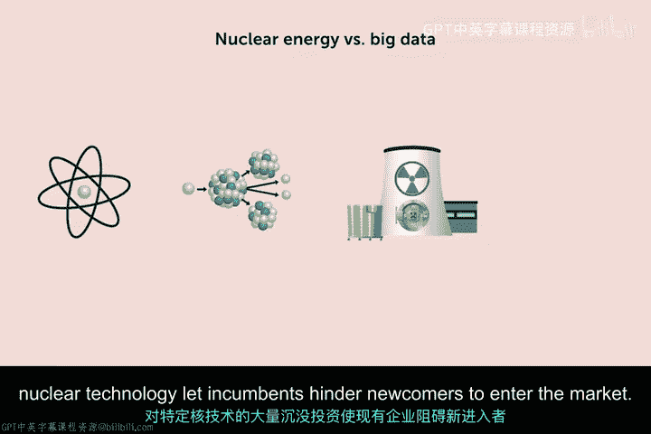

The same holds true for data， especially personalized and sensitive data。

Second。

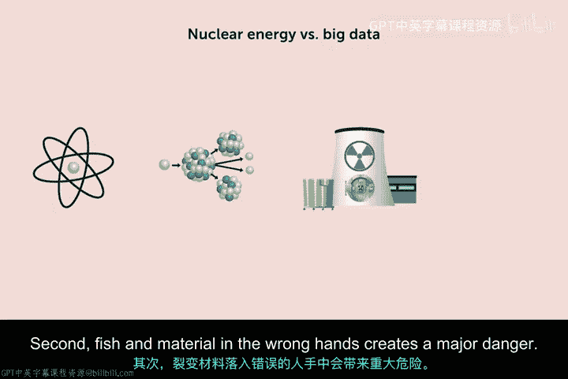

Fishing material in the wrong hands， creates a major danger。

The same is true for data。Third， it needs experts for the oversight and regulation of fis material。

 The same applies to data storage and the data collection。

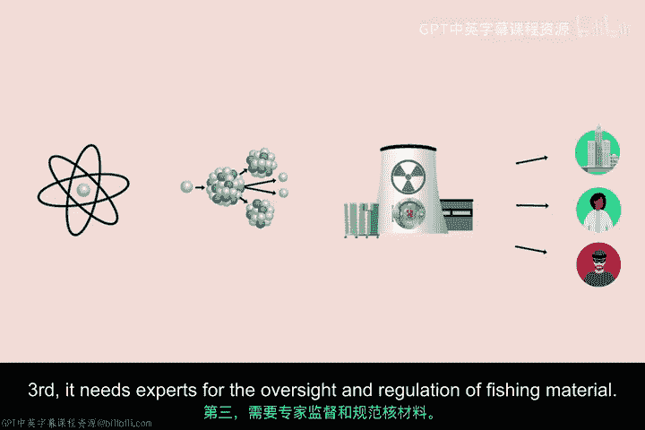

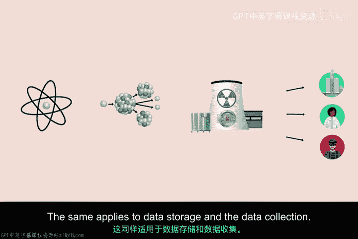

For that background， in the 1950s， all countries which were aiming at nuclear industry。

 opted for public ownership of fi material。In the European Union， it is Irato。

 an independent Eu agency。Like the European Central Bank that owns all fishing material in the European Union。

Nuclear material is only franchised to users， for example。

 to nuclear power plants under strict rules and certification。

This setup keeps the residual ownership right with the public。

The publicly controlled organization can withdraw the nuclear material from a user in case that safety standards are not obed or in case that severe competition problems would occur on the market。

For nuclear energy。At the same time， private companies can make full use of nuclear material for their business model。

 and society can reap the benefits of nuclear technology。

The ownership model of nuclear material can be applied to data， too。That means in the first instance。

 all data are public property and shall be used to the benefit of society。

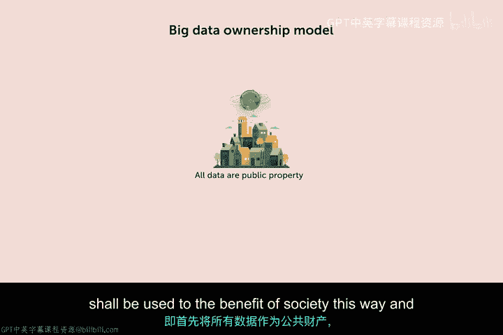

This way， a monopoization of data through powerful tech giants is not possible。

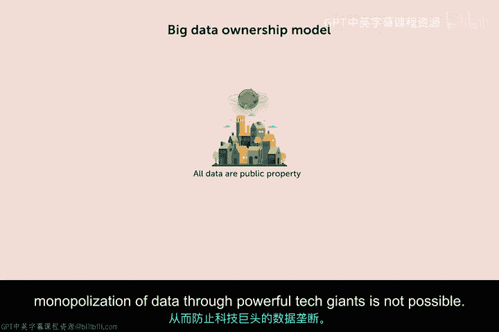

The public ownership of data is administered through an independent expert agency that is demo demoally legitimized through the Constitution and under the scrutiny of parliaments and courts。

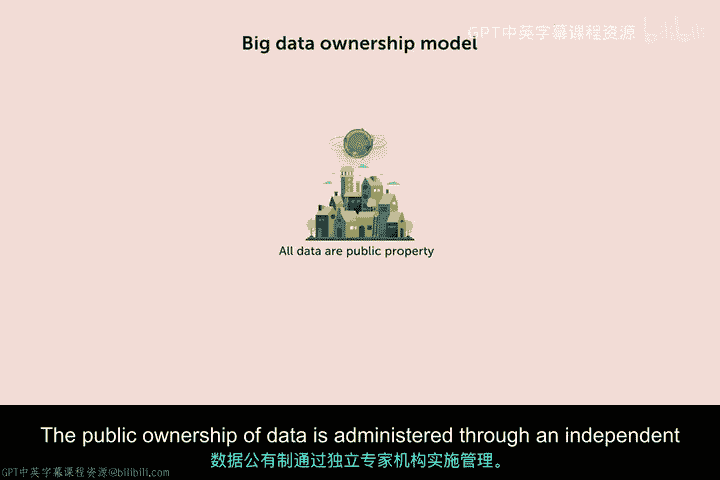

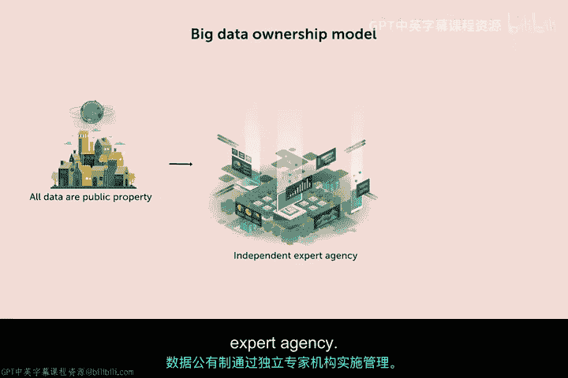

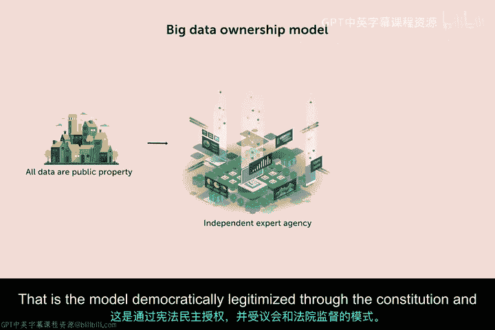

The independent agency must differentiate between different data categories。

 thereby enforcing adequate privacy standards。

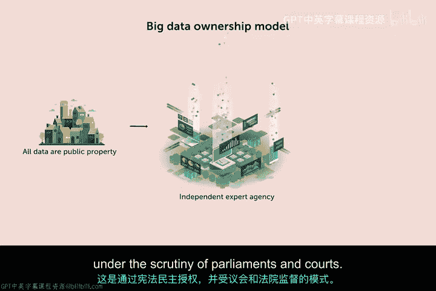

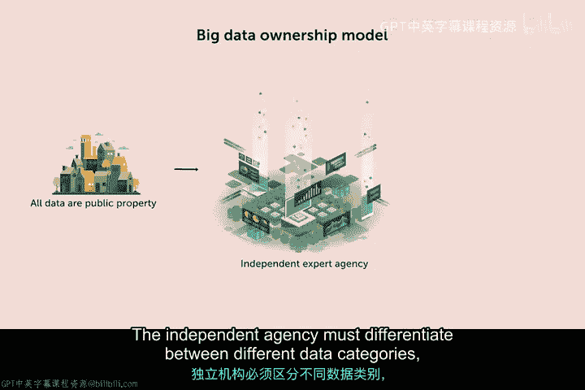

But the agency shall also facilitate business models and competition by granting access to data by franchising。

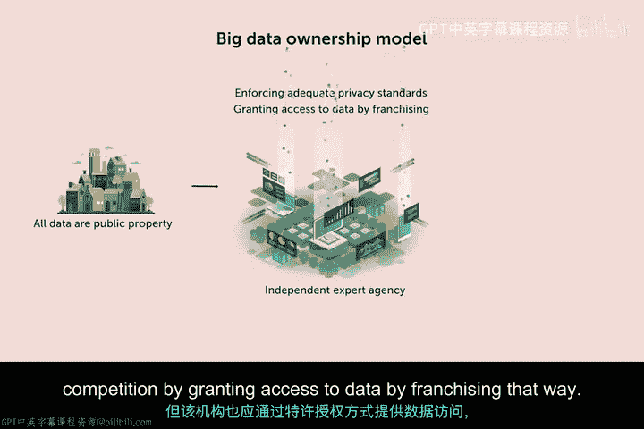

That way， also a high level of data quality can be assured， which is today a major problem。

The public ownership of data， in combination with a democratically legitimized and independent expert agency is an attractive institutional alternative for Western Democratic market systems。

 as well as planned economies。

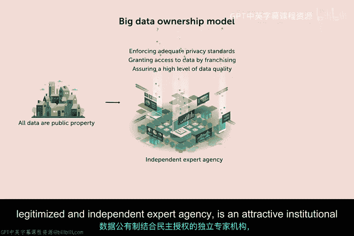

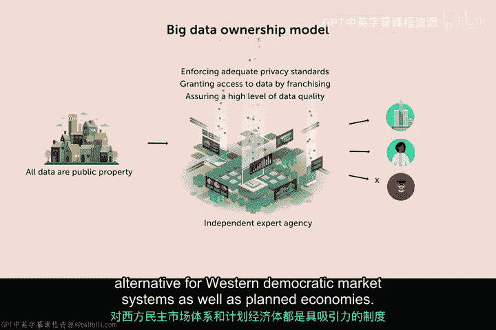

In the first case， traditional competition policy has major problems to deal with digital market challenges。

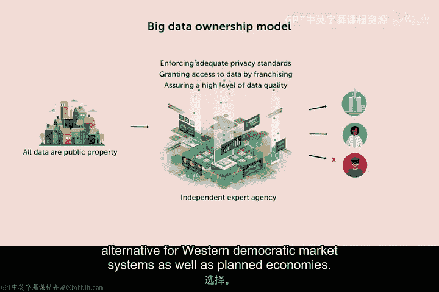

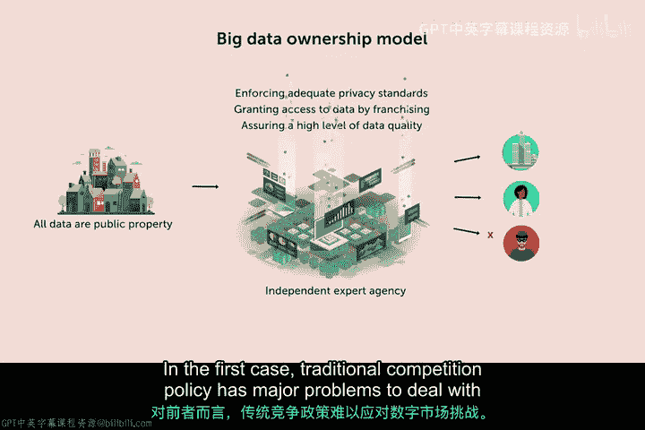

Market failures are pervasive。 And in the latter case， political failure makes citizens vulnerable。

 Vi V an all mighty government。In this video， it was shown that the toolbox of property rights theory can give meaningful hints for the design of a modern data ownership that respects business models。

 as well as public welfare。It is a strong analytical tool that can be used for the general design of data ownership。

Answering the question of public or private ownership。

But it can also be helpful to answer very specific questions of data ownership， as， for example。

 the ownership of individual health state。