# 数字治理：P28：数据治理体系设计

在本节课中，我们将学习如何运用之前模块中关于数据所有权的理论知识，在不同的数据治理设计方案中进行选择。我们将通过一个具有挑战性的例子，来探讨数据治理设计的艺术。

## 设计目标与权衡

上一节我们介绍了数据所有权的基本理论，本节中我们来看看设计数据治理规则时需要考虑的目标。

设计法律规则，即设计数据权利治理时，必须明确我们希望通过分配权利和义务来实现什么目标。这可能是**财富最大化**，也可能是其他目标，如**严格的隐私保护**或**保持技术领先地位**。

重要的是，任何推动决策向特定方向发展的法律或法规，都可能与其他目标产生权衡。如果个人隐私变得绝对化，那么任何基于人类大数据的商业模式都难以蓬勃发展。

此外，所实施的数据治理必须得到受影响人群的接受。换句话说，法律法规必须被视为**合法的**。

解决所有权衡问题并获得对数据治理体系的完全同意是很难实现的。但可以设计出巧妙的方案，使权衡尽可能小，并获得高度的合法性。

借助前面课程中学到的知识，你将能够阐述自己关于如何明智分配数据所有权的想法。

以下是数据治理的构建模块：
*   **财产法**
*   **侵权法**
*   **特定行业法规**
*   **市场机制**
*   **不同的数据类别**

## 大数据与人工智能：法律规则的改变者

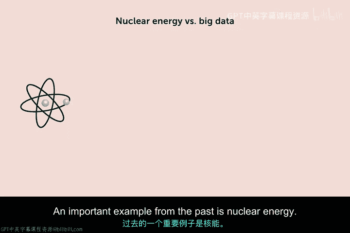

在关于数据所有权的模块即将结束时，我想用一个特定的数据所有权模型来挑战你。这个模型目前尚不存在，但未来可能成为现实。

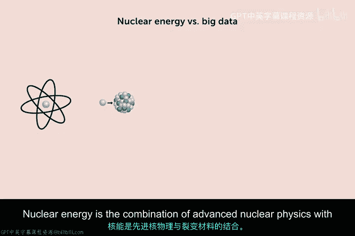

在开始讨论之前，我们必须记住，大数据与人工智能的结合是法律规则的改变者。这类似于工业革命时期有限责任公司的发明，也类似于大规模生产成为可能时企业责任的出现。

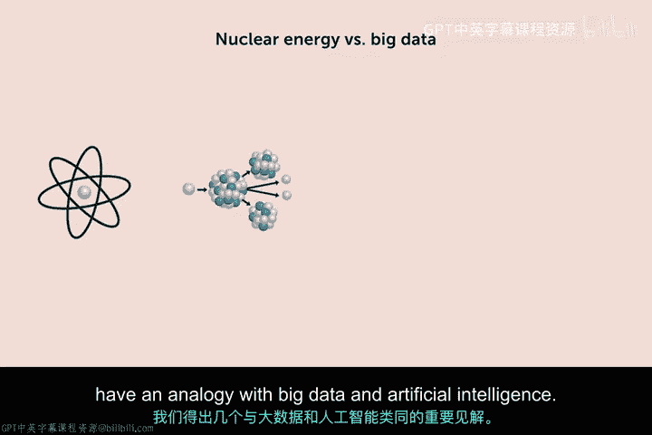

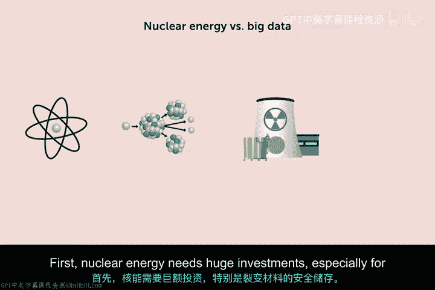

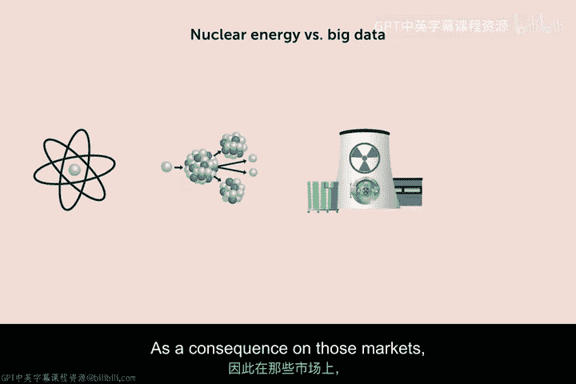

大数据是使人工智能工作并创造各种智能应用的燃料。这些应用可能是商业模式、改善医疗保健的工具，或是更精准的政策或警方侧写。应用可以千差万别，但结构原理始终相同：一个算法，即人工智能，通过被输入数据来学习解决问题。因此，数据对算法是特定的。这意味着所使用的数据必然来自不同的数据类别，这些类别对应着不同的隐私级别。例如，数据可能纯粹是技术性的，来自燃烧机器；也可能是高度个人化的，来自特定的癌症治疗。

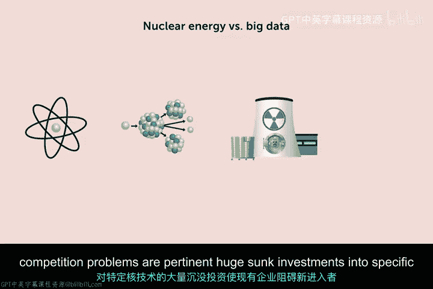

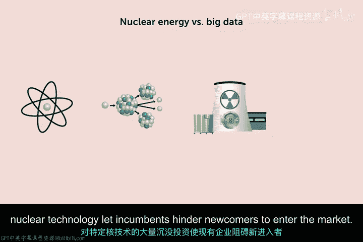

大数据和人工智能的结合可能引发各种法律问题，但有两个问题普遍存在：一是如何处理隐私，二是竞争问题。数据所有权权利的分配是解决这两个问题的新提案的关键。

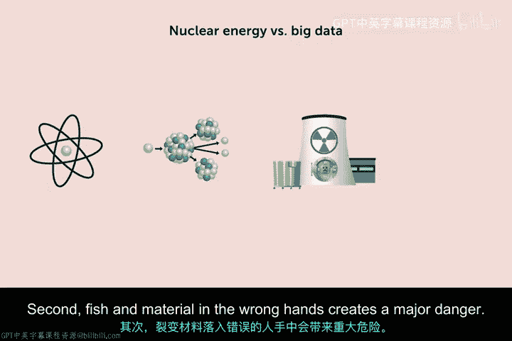

燃料通过机器释放能量的组合本身并不新鲜。然而，这种组合的危险性质对社会和适用的法律产生了不同的影响。过去的一个重要例子是**核能**。

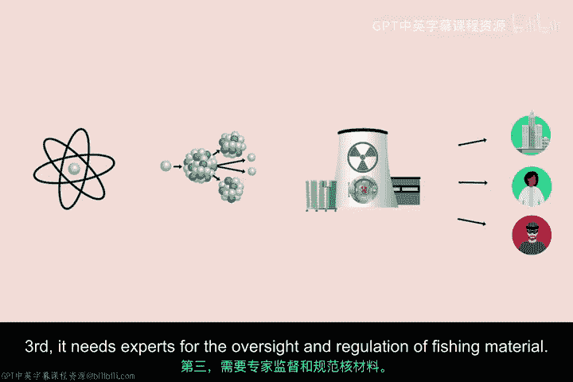

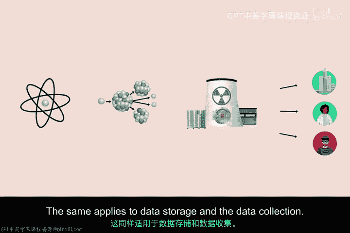

## 从核能治理中汲取经验

核能是先进核物理与裂变材料（例如浓缩铀）的结合。

从这个例子中，我们可以得出一些重要的见解，这些见解与大数据和人工智能有相似之处。

以下是核能治理带来的几点启示：
1.  **核能需要巨额投资**，特别是用于裂变材料的安全储存。因此，在这些市场上，竞争问题非常突出。对特定核技术的大量沉没投资，使得现有企业阻碍新进入者进入市场。**数据，尤其是个人化和敏感数据，情况也是如此**。
2.  **裂变材料落入错误之手会带来重大危险**。**数据也是如此**。
3.  **需要专家来监督和监管裂变材料**。**数据存储和数据收集同样适用**。

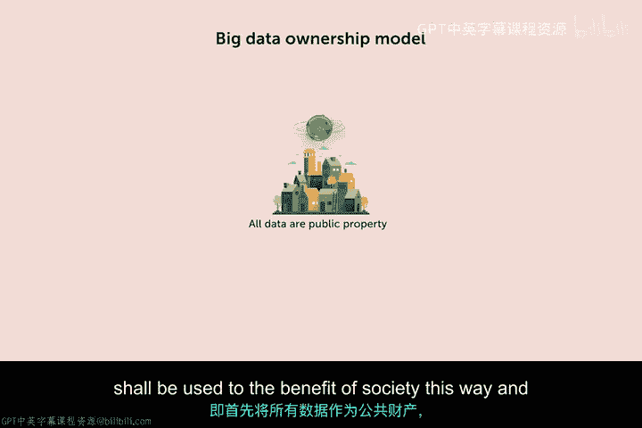

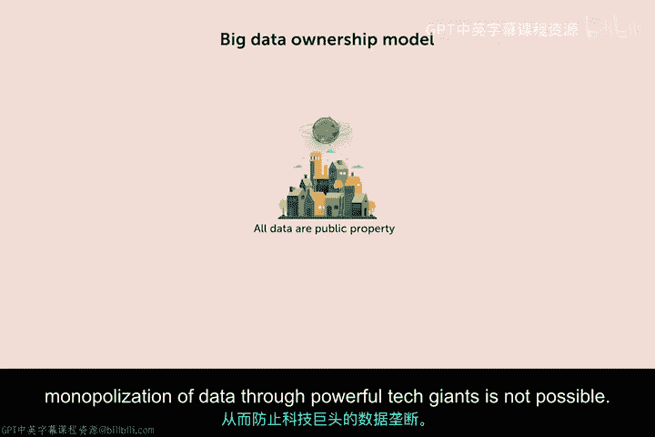

基于上述背景，在20世纪50年代，所有旨在发展核工业的国家都选择了裂变材料的**公有所有权**。在欧盟，是**欧洲原子能共同体**——一个独立的欧盟机构，类似于欧洲中央银行——拥有欧盟内所有的裂变材料。核材料只根据严格的规则和认证特许给用户使用，例如核电站。

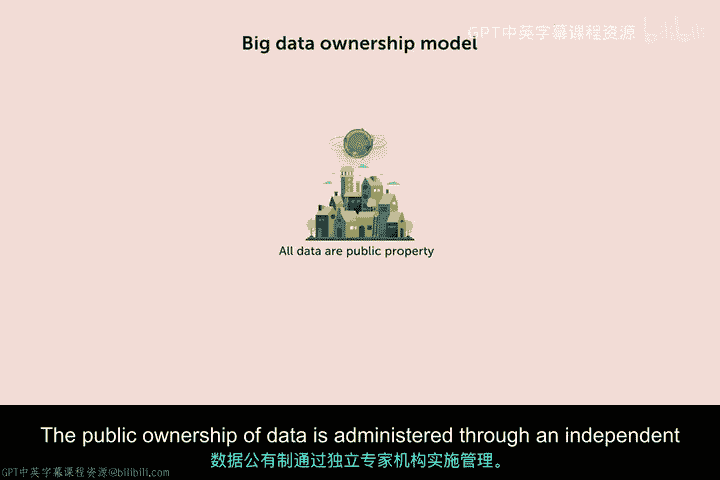

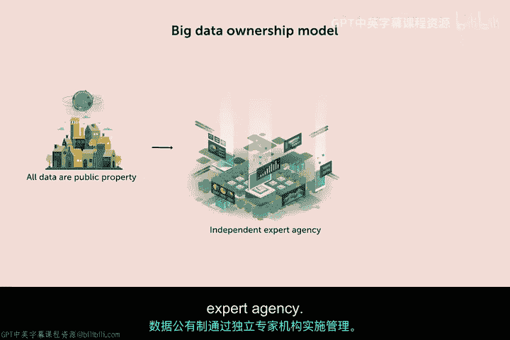

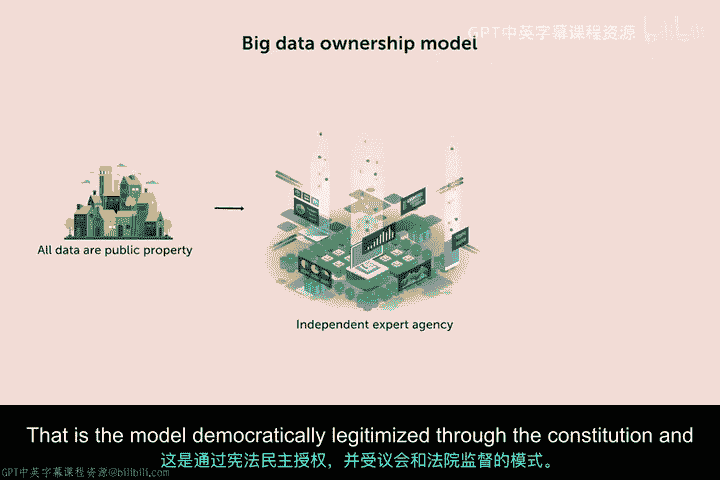

这种设置将剩余所有权保留在公众手中。如果用户不遵守安全标准，或者市场上出现严重的竞争问题，这个受公众控制的组织可以从用户手中收回核材料。对于核能，私营公司可以充分利用核材料发展其商业模式，同时社会也能收获核技术的好处。

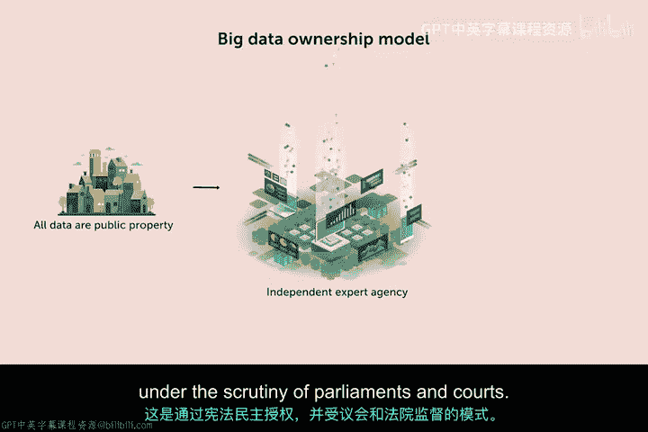

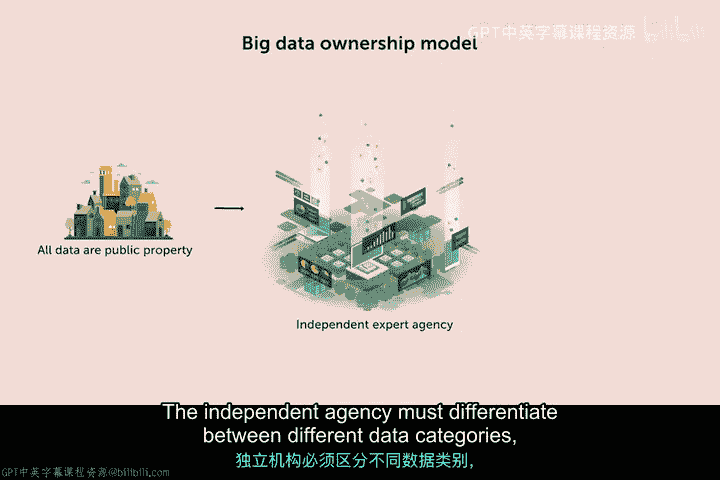

## 应用于数据的公共所有权模型

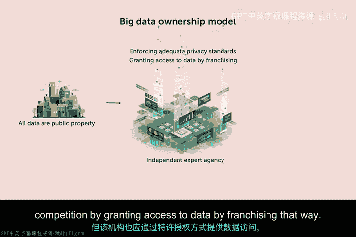

核材料的所有权模型也可以应用于数据。这意味着，**首先，所有数据都是公共财产，应用于造福社会**。这样，强大的科技巨头就不可能垄断数据。

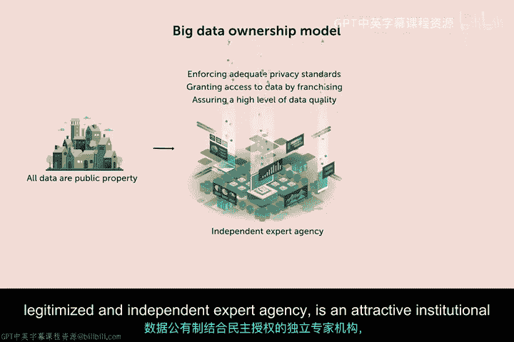

数据的公共所有权由一个独立的专家机构管理，该机构通过宪法获得民主合法性，并接受议会和法院的监督。这个独立机构必须区分不同的数据类别，从而执行适当的隐私标准。但同时，该机构也应通过特许授权数据访问，来促进商业模式和竞争。通过这种方式，也能确保高水平的数据质量，而数据质量是当今的一个主要问题。

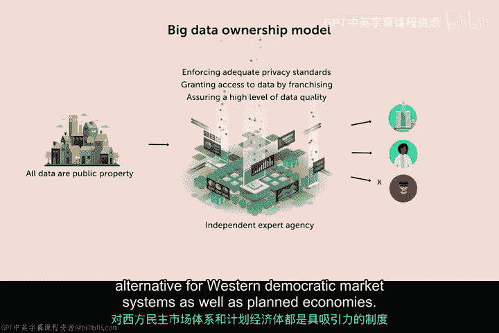

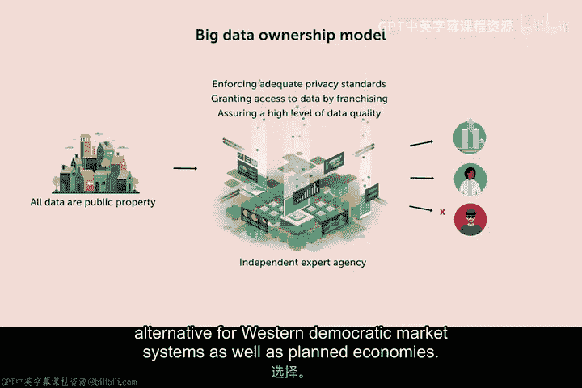

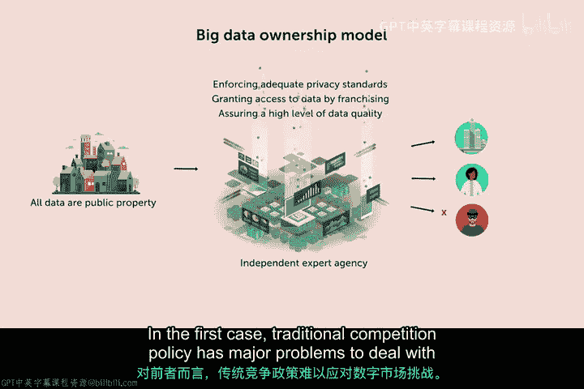

数据的公共所有权，结合一个民主合法且独立的专家机构，对于西方民主市场体系以及计划经济体而言，都是一个有吸引力的制度替代方案。在前者中，传统的竞争政策在处理数字市场挑战时存在重大问题，市场失灵普遍存在。而在后者中，政治失灵使公民在面对全能政府时变得脆弱。

## 总结

本节课中，我们一起学习了如何运用财产权理论工具箱来设计现代数据所有权。视频表明，财产权理论工具箱可以为设计一个既尊重商业模式又兼顾公共福利的现代数据所有权提供有意义的提示。它是一个强大的分析工具，可用于数据所有权的总体设计，回答公有还是私有的问题。同时，它也有助于回答非常具体的数据所有权问题，例如个人健康状态的所有权。