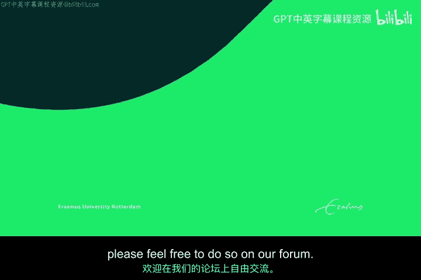

# 001：课程预期学习成果 🎯

在本节课中，我们将了解《严肃游戏》这门课程的整体框架、学习目标以及各周的核心内容。通过概述，你将明确课程方向，并能够根据个人兴趣选择学习路径。

---

当我提到“游戏”时，你会想到什么？或许你会回忆起童年时在户外玩耍的乐趣与放松。或者，是与家人一起玩棋盘游戏的愉悦。也可能是与朋友玩电子游戏时的兴奋与挫败感。游戏可以包含所有这些元素：有趣、放松、愉悦、兴奋或令人沮丧。

游戏不仅是为了愉快地消磨时间。游戏也能教会我们某些东西。例如，当你玩电子游戏时，你训练了手眼协调能力。国际象棋游戏帮助你发展战略能力。由于你感到有趣或受到挑战，你甚至可能不会注意到自己正处于学习的过程中。

有些游戏是特意为教育目的而设计的。例如，有些游戏旨在告知你环境问题，或让你面对开车时发短信的危险，或教你如何处理特定疾病，如糖尿病。我们称这类游戏为**严肃游戏**。

尽管通过玩游戏来学习是个好主意，但仍存在许多未解的问题。这些游戏究竟是什么？我们为什么喜欢玩它们？它们究竟如何影响我们的行为？越来越多的研究者正在分析严肃游戏，试图揭示它们具有哪些特征，以及人们如何及为何玩它们。他们也试图揭示严肃游戏的影响，这是一个复杂的问题。

在本课程中，你将深入学习严肃游戏的方方面面。首先需要明确，我们不会教你如何设计游戏，我们不是游戏设计师。但你会增进对严肃游戏底层机制的专业知识，并接触到一些最新的理论和研究，例如关于游戏乐趣、严肃游戏的说服特性以及影响评估等议题。

在接下来的几周里，你将在这一领域变得更加博学。如果你是一位对游戏可能性感兴趣的专业人士，或者想更多了解严肃游戏能产生的影响，这可能会对你有所帮助。也许你正考虑自己实施一个严肃游戏项目。如果你是一名学生，并且正在考虑研究像严肃游戏这样的媒体，这将是一门有趣的入门课程。无论如何，我们都很乐意与你分享我们的知识。

我们的课程分为六周。每周，我们通过简短的视频讲座为你提供关于严肃游戏的理论。你会在这些视频中看到我们，以及来自鹿特丹伊拉斯姆斯大学的一些同事，他们都在进行严肃游戏主题的研究，并各有专长。

每周结束时，我们还会提供额外的资源，如果你愿意，可以通过阅读相关文章和书籍来深化知识，但这当然是自愿的，你不会被测试这些知识。为了帮助你更好地理解课程内容，每周我们会展示一个应用了理论的实际案例研究。

我们为你准备了一些非常有趣的例子，包括一些国际游戏，以及由鹿特丹游戏开发者开发的一些游戏。当然，我们也会邀请你亲自玩一些严肃游戏。如果你有一些游玩经验，将更容易掌握我们讨论的概念，而且别忘了这也很有趣。

更严肃地说，我们将在几周内通过布置作业来测试你的知识。这是你检查是否掌握了最重要概念和理论的好方法。根据经验，我们知道这门课程中有许多不同类型的学习者。你们中的一些人会按部就班地完成整个课程和所有作业，就像游戏通关一样。我们认为这很棒。但这并非唯一方式。你们中的一些人可能是更随意的学习者。在这种情况下，你可以只挑选感兴趣的主题，例如说服力或影响评估，或者可能只想查看案例研究。那么，请将我们的课程视为一个菜单，供你选择。

现在，我们将向你展示贯穿整个课程讨论的最重要主题，以便你在从我们的“菜单”中选择特定主题时能更好地了解。

以下是各周核心内容概览：

*   **第一周：严肃游戏的定义与特征**。如果你对严肃游戏是什么、如何定义它们以及它们与娱乐媒体产品的区别感兴趣，请查看第一周。我们建议每个人都以这周作为起点，因为它为理解后续课程内容奠定了坚实的基础。本周还有一个有趣的案例研究，讨论一款你也可以轻松体验的严肃游戏。

*   **第二周：游戏与玩耍的心理学**。在入门周之后，我们将在第二周更深入地探讨游戏与玩耍的心理学。如果你对“我们为什么喜欢玩游戏”这个问题的答案感兴趣，请查看那一周。我们将从哲学和心理学的双重角度进行探讨。本周的案例研究是一款由鹿特丹游戏公司开发的游戏，旨在说服人们在通勤时将汽车留在家中。

*   **第三周：严肃游戏的类型与应用领域**。如你所想，严肃游戏有许多不同类型。你想了解该领域的多样性以及严肃游戏在不同领域提供的可能性吗？请看看我们的第三周。我们将解释存在许多不同类型的严肃游戏，从教育背景中非常简单的游戏元素，到专业培训中成熟的模拟训练。它们都对游戏开发者和玩家提出了不同的技能要求。为了说明这一点，我们不仅提供一个，而是提供三个案例研究。

*   **第四周：严肃游戏的说服力**。在前三周，本课程为你提供了关于严肃游戏是什么、其特征、一些游戏理论以及现有不同类型严肃游戏的基础知识。如果你想获得更深入的理解，不惧怕理论，并且对游戏如何实际说服我们改变想法或行为感兴趣，那么第四周就是为你准备的。我们将这一周专门用于探讨严肃游戏的说服力，并且同样在本周提供大量案例研究，以使理论更容易理解。

*   **第五周：严肃游戏的影响评估**。经过四周的课程，你可能想知道严肃游戏能产生什么影响。它们真的有效吗？它们真的能说服我们改变对某事的看法吗？我们如何实际研究这一点？这是本课程中较为复杂的主题之一，我们将在第五周进行探讨。为了帮助你理解研究者在研究影响时面临的困难，并向你展示我们实际对影响了解多少，我们邀请了从事游戏研究的同事来到演播室。在一个访谈节目式的场景中，他们将向你解释最紧迫的问题。

*   **第六周：回顾、总结与展望**。在最后一个模块，是时候回顾过去并展望未来了。我们将串联前几周的所有要点，并与你一起回顾所学到的经验教训。我们将通过向你介绍两种用于游戏的较新技术——**增强现实（AR）** 和**虚拟现实（VR）**，来窥探严肃游戏可能的未来，以此结束本课程。

---

以上就是我们的严肃游戏“菜单”。希望这个视频能给你足够的见解，以做出个人的选择，决定深入哪些周进行学习。祝你学习愉快！如果你有任何问题或想讨论的议题，请随时在我们的论坛上提出。