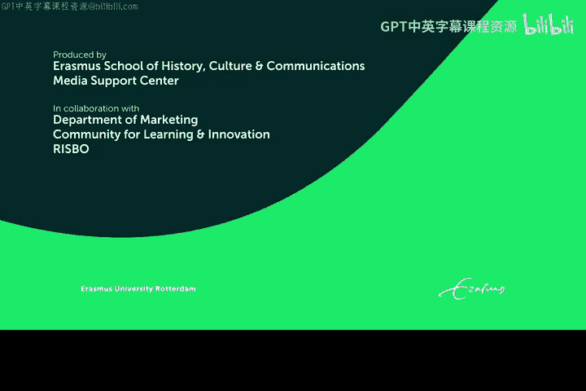

# 002：1_严谨定义的重要性

欢迎你。很高兴见到你。当你按下这个视频的播放键时，你就正式开始了我们的严肃游戏课程。

但是，你是如何来到这里的呢？当你找到这门课程时，你可能正在寻找一门关于游戏的课程。也许这门课程是基于你之前学习过的其他课程、你认识的人的推荐，或者你在Coursera网站或搜索引擎中输入了某个搜索词而被推荐给你的。

你是否特意搜索了“严肃游戏”这个词？也许没有。对于这类特定的游戏，还有其他词汇，例如“应用游戏”、“教育游戏”或“变革游戏”。因此，我们这门课程的第一个目标就是讨论严肃游戏的定义和特征。

明确我们讨论的内容很重要，这不仅在学术界如此。使用一个恰当的定义有助于形成对某个主题的共同理解，并将其与相关事物区分开来。

例如，一位好朋友告诉你他“fine”，与一位警官告诉你你有一张“fine”，含义完全不同。因此，考虑一个概念的背景和具体含义是有用的，这样我们就知道我们在谈论什么，并且我们谈论的是同一件事。

这正是我们在第一周课程中要做的事情。我们将从基础开始，但在下一个视频中揭示我们自己对严肃游戏的定义之前，我们想邀请你写下你自己对严肃游戏的定义，作为一种起始练习。

请用你自己的话，只用一句话。如果你愿意，可以在论坛上发布、比较和讨论这个定义。阅读本课程中其他学习者如何定义严肃游戏可能会很有趣。

那么，本周接下来的内容有什么安排呢？在下一个视频中，我们将从一些理论开始。我们将讨论严肃游戏的定义和特征，解释娱乐游戏与严肃游戏之间的区别，以及严肃游戏与教育视频或书籍等其他媒体产品的不同之处。

此外，我们将回答严肃游戏是否实际上也能具有娱乐性的问题。

理论部分之后，是时候将理论付诸实践了。在第三个视频中，我们将向你介绍一个案例研究，这是一个很好的严肃游戏示例，用以说明你所学到的理论。

当然，我们会提供链接，让你可以亲自体验这款游戏。

总而言之，本周我们将学习一些理论，以解释基础知识并让大家达成共识，同时也会分析一款游戏，以实践的方式应用理论。这似乎是一个很好的入门关卡。

