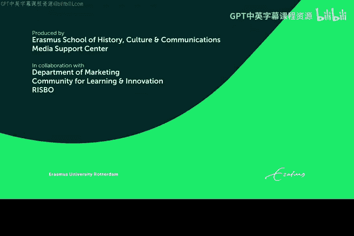

# 004：《优步游戏》

在本节课中，我们将一起分析一个具体的严肃游戏案例——《优步游戏》。我们将探讨它如何通过游戏的形式，让玩家亲身体验“零工经济”中网约车司机的生存状况，并反思其作为严肃游戏的特征与目的。

## 案例介绍

每周，我们都会与您讨论一个有趣的严肃游戏案例。我们称这些案例为“案例研究”，因为它们可以用来阐释本课程中讨论的部分理论。

第一个案例研究是由《金融时报》开发的《优步游戏》。我们将探究这个游戏是否以及为何可以被视为一款严肃游戏。

在继续之前，您亲自体验一下这个游戏非常重要，我们稍后会提供游戏链接。

## 游戏体验

在游戏中，您是一名全职的优步司机，需要在一周内赚取1000美元来支付抵押贷款并抚养两个孩子。因此，赚取足够的车费来支付账单非常紧迫。我们建议您在游戏中选择较简单的难度。

现在，请开始接载您的第一位乘客。

您成功赚到足够的钱了吗？您是否还有时间陪伴家人？

## 游戏背景与目的

您刚才玩的游戏名为《优步游戏》，副标题是“你能在零工经济中生存吗？”。它由《金融时报》的内部团队于2018年开发。

这款游戏基于新闻报道和对数十名优步司机的采访。玩游戏能让您代入全职优步司机的角色，让您更深入地理解在共享或零工经济中谋生是怎样的体验。

2018年5月，《优步游戏》在美国年度严肃游戏大赛中获得了金奖。

## 游戏特征分析

我们选择这款游戏，是因为它是一个绝佳的案例，可以用来反思我们之前讨论过的五个游戏特征：**目标性、规则性、反馈性、竞争性、自愿性**。

《优步游戏》是否符合这些特征？您怎么看？

以下是具体分析：

*   **目标性**：游戏的目标很明确：您需要赚取足够的车费来支付抵押贷款并养活孩子。
*   **规则性**：游戏在规则框架内进行，它会指示您该做什么。例如，您只有对后续行动做出选择，才能推进游戏。
*   **反馈性**：您的行动会定期收到反馈，以便您判断是否接近目标。每天结束时，您会收到一份进度概览。例如，如果您没有花钱购买手机支架，游戏会告诉您乘客注意到您把智能手机放在腿上，并向优步投诉您危险驾驶，导致您被停用四小时。这很糟糕，因为您赚的钱更少了。
*   **竞争性**：游戏包含两个竞争层面。游戏结束时，您的表现会与您的个人目标（赚取1000美元）相关联。同时，游戏也会向您展示其他玩家的表现。
*   **自愿性**：自愿性方面是显而易见的，人们可以自行决定是否玩游戏，尽管我知道我实际上要求您玩了。

## 为何是严肃游戏？

这让我们回到最初的问题：为什么这款游戏是一款严肃游戏？

请记住严肃游戏的定义：**严肃游戏是主要出于非娱乐目的而使用计算机游戏和/或模拟方法及技术的游戏。**

通常，严肃游戏的开发者会运用娱乐游戏的激励原则，并以引人入胜的方式教育玩家。

在《优步游戏》中，您被置于数百万试图在所谓“零工经济”中谋生的优步司机之一的处境中。“零工”指的是自由职业或短期合同工作，与永久性工作相对。

尽管在许多描述中，零工经济被赞誉为一件好事（例如，我们可以用比传统出租车更少的钱打到车，并且它应该能给予人们工作时间和方式的灵活性），但您可能在游戏中体验到，对于优步司机而言，这也意味着他们无法确定一周能赚多少钱，并导致一种被“最后一刻”安排所主导的生活。

也许零工经济并不像我们想象的那么积极。

## 游戏的教育意义

《金融时报》的开发者称其为“新闻游戏”，强调该游戏特别旨在告知我们玩家。

在这里，**提高意识**似乎是一个严肃的目标。他们希望受众能更好地理解优步司机面临的问题，因为玩家已经亲身体验过了。

游戏结束时，您还可以通过点击链接获取更多信息，该链接会将您引导至一篇关于同一主题的文章。其他一些严肃游戏会将信息与行动号召（例如捐款或与他人分享特定信息）联系起来，我们将在本慕课后续内容中看到。

## 总结

总而言之，《优步游戏》的目的不是提供娱乐，而是分享关于当前一种社会现象的信息。尽管如此，它是以一种游戏化的方式做到这一点的。

本节课中，我们一起学习了如何通过《优步游戏》这个案例来分析严肃游戏的特征与目的。我们看到了它如何将现实问题融入游戏机制，让玩家在体验中形成认知，这正是严肃游戏的核心价值所在。