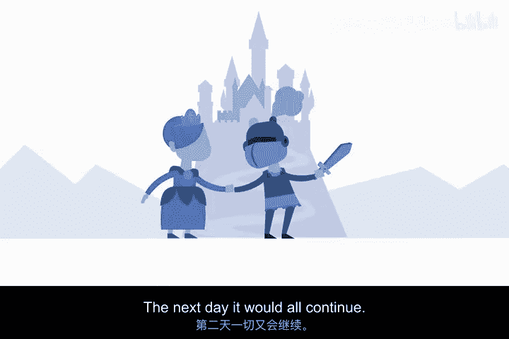

# 006：玩耍理论的起源、定义与功能 🎮

在本节课中，我们将要学习玩耍理论的起源、核心定义及其在人类文化中的功能。我们将从历史背景开始，然后深入探讨玩耍的六个关键特征，最后分析玩耍在个人发展和社会适应中的重要作用。

---

## 玩耍理论的起源 📜

上一节我们介绍了玩耍是人类生活的基本组成部分。本节中，我们来看看玩耍理论是如何发展起来的。

玩耍理论有着悠久的历史。大约25个世纪前，古希腊哲学家赫拉克利特就已经思考过宇宙的玩耍特性。然而，尤其是在20世纪下半叶，玩耍成为了生物学、心理学和动物行为学等学科的重要研究对象。近几十年来，我们见证了玩耍理论作为一个独立学科的发展。

玩耍理论的奠基性研究之一是荷兰文化历史学家约翰·赫伊津哈于1936年出版的著作《游戏的人》。根据赫伊津哈的观点，玩耍并非只是一种轻浮的活动。它是生活的一个基本范畴，并且是文化本身的构成要素。这意味着玩耍与文化紧密相连。用赫伊津哈自己的话说：“文化以玩耍的形式出现，并且从未离开过它。”

---

## 玩耍的定义与六个特征 🔍

了解了玩耍理论的起源后，本节我们将深入探讨赫伊津哈对玩耍的正式定义，该定义包含了六个核心特征。

在《游戏的人》中，赫伊津哈总结了玩耍的形式特征，给出了一个定义。我们可以将其称为一种自由的活动，有意识地置身于“平常”生活之外，不被认为是“严肃的”，但同时又能彻底且强烈地吸引参与者。它是一种与物质利益无关的活动，无法从中获利。它在自身特定的时空界限内进行，遵循固定的规则，并以有序的方式进行。它促进社会群体的形成，这些群体倾向于用秘密包裹自己，并通过伪装或其他方式强调与普通世界的不同。

这个定义包含了六个特征，让我们逐一仔细审视。

以下是玩耍的六个核心特征：

1.  **自由与无功利性**：玩耍是人类自由的表达。与美类似，玩耍是“无功利性”的。它包含自身的意义和目的，是我们日常生活中的一个插曲。这并不意味着它只带来乐趣，因为当我们沉浸于玩耍时，常常是带着“神圣的认真”。
2.  **“非严肃”的假装**：玩耍是“非严肃”的，它指的是一种“假装”的活动。玩耍就是假装，是“表现得好像”。
3.  **沉浸感**：玩耍具有沉浸性，它能强烈地吸引参与者。它伴随着兴奋和紧张的感觉，并随之带来欢乐和放松。
4.  **时空界限（魔法圈）**：玩耍在场所和持续时间上都与普通生活不同。它的特点是具有特定的时空界限。这个所谓的“魔法圈”不仅是空间上的，也是时间上的。
5.  **规则至上**：构成玩耍世界的规则至关重要。所有玩耍都有其自身的规则。它们决定了在玩耍所限定的临时世界中什么才是有效的。一旦规则被破坏，整个玩耍世界就会崩溃。作弊者仍然假装在玩，因此仍然承认魔法圈，而违反或无视规则的玩家则是“扫兴者”。
6.  **创造秩序**：玩耍创造秩序。它将秩序带入一个不完美的世界和生活的混乱中，带来一种暂时的、有限的完美。

---

## 玩耍的功能 🧠

上一节我们详细分析了玩耍的六个特征，这自然引出了一个重要问题：玩耍的功能是什么？

为了能够有意义地度过我们的人生，我们必须理解我们的世界、我们的同伴以及我们自己。玩耍可以帮助我们发展必要的技能和见解，以成功地玩好“人生”这场游戏。自19世纪以来，生物学家和发展心理学家就开始研究玩耍的这种认知功能。

玩耍可以为人类青少年步入成年生活做准备。不同形式的玩耍在培养成年生活不同领域的能力方面具有不同的功能，范围从练习运动技能和竞争到锻炼想象力。此外，玩耍既帮助我们获得特定的技能和见解，也增强了行为的灵活性。因为它帮助我们学会在各种行为之间切换并进行即兴发挥，并为我们应对意外情况做好准备。

总而言之，我们可以说，玩耍增强了我们的**适应性变异能力**。从这个意义上说，玩耍是一件极其严肃的事情。

尽管玩耍可能从一开始就是人类生活和玩耍的特征，但在我们这个以快速变化、日益复杂和反思性不确定性为特征的时代，对它的需求似乎更加迫切。锻炼世界的开放性、发展玩耍性的身份认同，并在成年后继续保持玩耍，现在看来比以往任何时候都更为关键。幸运的是，在我们的时代，数字媒体为严肃的玩耍提供了各种可能性，这可以归因于其多媒体、交互性、虚拟性和连接性的特点。我们不应只想到玩电脑游戏，还应包括例如互联网和智能手机的玩耍性使用。简而言之，数字媒体开辟了一个严肃玩耍的全新领域。

---

## 总结 📝

本节课中，我们一起学习了玩耍理论的起源、赫伊津哈对玩耍的经典定义及其六个特征（自由性、假装性、沉浸性、时空界限、规则性和秩序创造性），并探讨了玩耍在个人认知发展、技能培养和社会适应中的关键功能。我们认识到，玩耍远非儿戏，而是人类理解世界、发展自我和适应变化的一种根本而严肃的方式，尤其在当今数字时代，其重要性愈发凸显。