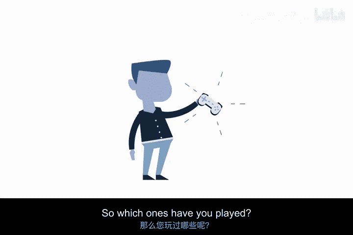

**严肃游戏：P10：9_严肃游戏的分类图谱：从仿真模拟到游戏化设计**

在本节课中，我们将要学习严肃游戏的多样性，了解其从高度仿真的模拟训练到轻量级的游戏化设计之间的广阔光谱。

---

你看到的是对鹿特丹港一名拖船船长如何系泊船舶的模拟。这个模拟由VSTEP公司制作。该公司运用游戏技术来制作模拟器，这是一种特定类型的严肃游戏，用于帮助专业人员训练复杂行为。在这个案例中，就是训练如何妥善处理停靠鹿特丹港的大型船只。本周晚些时候，我们将通过一个案例研究来深入探讨模拟器。

然而，模拟器远非严肃游戏的唯一类型。当我向学生们介绍严肃游戏时，他们首先想到的往往是他们在学校玩过的教育游戏。例如，他们的数学老师曾让他们通过玩游戏来记忆乘法表。我也记得那些游戏，尤其是在小学时，我们玩过一个驾驶直升机飞往地图上某个地点的游戏。我们非常喜欢它，并且在游戏过程中学习了地理知识。

但我们需要认识到，严肃游戏并非只供儿童玩耍，也并非只在学校环境中使用。本周，我们希望你能理解市面上存在的广泛类型的严肃游戏。这很重要，因为它将帮助你理解游戏可以应用的各种场景。

为了初步了解这些不同类型的游戏，让我们看看下面的动画。

**你是否玩过严肃游戏？**

你很可能玩过，因为严肃游戏种类繁多。在学校，你可能玩过教育游戏。它们被用来激励学生学习。健康游戏也是如此，例如，它们激励你进行锻炼。干得漂亮。然后是广告游戏，它们通常很有趣，同时向你介绍产品。快抓住那个能量饮料道具！军事游戏则更为严肃，士兵们学习如何射击以及何时交战。这些游戏也被用来吸引新兵。接下来是政治游戏，它们试图改变玩家对贫困或不公等议题的看法。最后是模拟游戏，用于为你执行高风险任务（如驾驶飞机）做准备。

**你玩过哪些呢？**

---

在下一个视频中，我们将更深入地讨论不同类型的严肃游戏。本周剩余时间将专注于三个非常有趣的案例，它们代表了严肃游戏光谱的不同端点。

我们将探索两个模拟游戏的例子：一个发生在急诊室，另一个将你带到鹿特丹港的拖船船长岗位上。模拟是一种将玩家沉浸在对现实生活情境复刻中的严肃游戏。模拟的目的通常是某种形式的专业培训。这类严肃游戏通常非常详细和真实。

在光谱的另一端，我们将探索一个关于游戏化的案例研究。**游戏化是在非游戏情境中使用游戏元素**。例如，一个允许你创建自己虚拟形象的电子商务网站，或者一位使用排行榜来追踪团队销售业绩的雇主。我们将看到这个游戏化原则如何在鹿特丹的钢铁行业中应用。

首先，我们将在下一个视频中对严肃游戏进行更广泛的概述。

---

本节课中，我们一起学习了严肃游戏的分类图谱。我们了解到严肃游戏不仅限于学校里的教育游戏，其范围从高度逼真、用于专业训练的**模拟**，到将游戏元素融入非游戏场景的**游戏化**设计，涵盖了教育、健康、广告、军事、政治等多个领域。理解这个光谱有助于我们认识游戏技术在不同情境下的应用潜力。