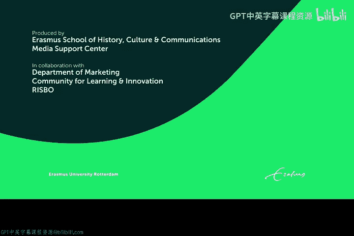

# 011：10_严肃游戏的分类体系

在本节课中，我们将学习如何对严肃游戏进行系统性的分类。我们将介绍一个基本的分类体系，涵盖教育、医疗、军事、政治和广告等主要应用领域，并了解每个领域内游戏的不同形式和目的。

当学者们想要对某事物进行系统性概述或分类时，他们会称之为**分类学**。例如，生物学家对各类生物物种进行分类。

我们同样可以对严肃游戏进行分类。之前已经讨论过在学校环境中使用的游戏，这些游戏利用游戏元素来激发学生的学习动机。

除了教育领域，严肃游戏大致还有四个重要的应用领域。我将逐一简要介绍。它们分别是：健康游戏、军事游戏、政治游戏和广告游戏。

当然，严肃游戏在其他领域也可能有用，但为了保持清晰的概览，我们将专注于这四个主要领域。

## 🏥 健康游戏

第一个领域是医疗保健。该领域的严肃游戏也被称为**健康游戏**。这里可以想到各种例子。

一些游戏面向患有特定疾病的患者。例如，可以设计游戏来鼓励糖尿病患者按时服药，或者为患有癌症的儿童设计游戏，教导他们治疗的价值，即使治疗过程可能痛苦或不适。

因此，这些游戏帮助患者更好地应对自身状况，或协助他们采取必要步骤以真正改善感受。

健康游戏也包括那些旨在改善大众整体健康的严肃游戏或游戏化应用。例如，整合了游戏原则的健身应用，通过挑战来激励人们锻炼。

游戏中的**竞争**特性在这里非常有用。如果能在排行榜上获得高分，你可能会决定跑得更久或更快。

本周，我们将探讨另一种类型的健康游戏，它是为医学生和急诊室工作人员开发的培训模拟游戏。我们将把它作为本周的案例研究之一进行讨论。

## 🎖️ 军事游戏

严肃游戏被开发和投入实践的第二个领域是军事领域。与医疗领域类似，这里的严肃游戏也有不同用途。

首先，模拟游戏可以训练士兵处理特定情况或操作设备。在现实生活中组织这类训练可能成本高昂或危险。因此，数字替代品是一种安全且经济高效的训练方式。

另一种类型的严肃游戏面向可能对该领域感兴趣的人群。一个非常著名的例子是网络游戏《美国陆军》。

这款游戏最初由美国陆军开发，目的是向军队以外的人介绍在军队工作的意义。从这个意义上说，它是一种公关和招募工具。

## 🗳️ 政治游戏

第三个领域是政治游戏。在这里，我们可以找到许多**说服性游戏**的例子，这些游戏试图告知人们某个社会问题，旨在鼓励人们采取行动。

这些游戏也被称为**变革游戏**。它们通常由怀有特定目标的组织开发，例如提高人们对奴隶制、移民或污染问题的认识。

这些组织相信，游戏将有助于他们提升政治和公民参与度的追求。一个例子是《我的小小塑料足迹》。

这款由阿姆斯特丹的非政府组织“塑料汤基金会”开发的应用程序于2017年发布。通过玩游戏，你会更加意识到塑料的社会影响，游戏设计师试图以有趣的方式教你如何减少自己的塑料足迹。

在本慕课期间，你将看到许多其他这类政治游戏的例子。

## 📢 广告游戏

我们要讨论的最后一个严肃游戏领域是广告。品牌发起营销活动，是为了让他们的品牌名称或产品在消费者中更广为人知。他们希望人们购买其产品或使用其服务。

除了电视广告等更传统的广告形式外，品牌也可以为此目的开发严肃游戏，我们称这些游戏为**广告游戏**。

广告游戏可以简单到在常规游戏中放置带有商业广告的数字广告牌，或进行数字产品植入。

在我们的严肃游戏语境中，更有趣的例子是那些完全以营销为目标开发的游戏。一个例子是墨西哥风味连锁餐厅 Chipotle 的《稻草人》游戏。

Chipotle 于2013年9月发起了一场“稻草人”营销活动，包括一部简短的动画视频和一款手机游戏，以推广其“诚信食品”活动。在游戏中，你扮演一个稻草人，试图通过击败大规模生产，将真正的食物带回给人们。

由于严肃游戏更具互动性，以及游戏激励人们玩更长时间的原则，像 Chipotle 这样的品牌可以尝试以更具说服力的方式传达他们的信息。

## 📚 总结与展望

这四个领域，加上在学校教育环境中使用的严肃游戏，可以构成一个严肃游戏的基本分类体系。

你可能已经注意到，在这些领域中，严肃游戏可以呈现不同的形态和形式，从模拟现实生活情境的完整模拟游戏，到说服性游戏、应用程序，再到游戏化。

在接下来的案例研究中，我们将进一步探讨游戏元素和特性被使用的这些不同方式。特别是，你将更详细地了解模拟游戏和游戏化是如何运作的。

