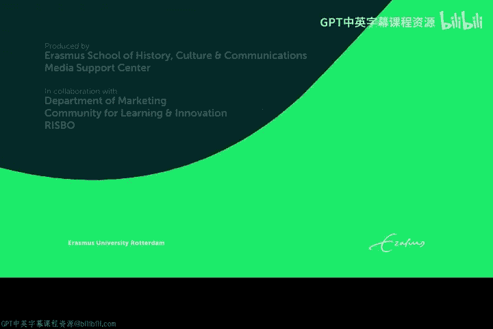

# 013：VSTEP仿真平台实践 🎮

在本节课中，我们将学习专业仿真训练平台的实际应用。我们将以VSTEP公司为例，了解他们为海事和消防部门开发的专业训练模拟器，并探讨这些专业模拟器与家用电脑上的模拟游戏之间的异同。

---

## 仿真器概述

上一节我们介绍了严肃游戏的基本概念，本节中我们来看看一个具体的专业应用案例。VSTEP公司开发用于海事和消防指挥训练的专业仿真器。

仿真器是一个在受控条件下复制现实片段的系统。它通常模拟复杂的机器、环境、流程或它们的组合。仿真器的主要目标是提供一个**成本效益高、结构化且安全**的训练或实验环境。

---

## 仿真器类型与应用

以下是VSTEP公司开发的两类主要仿真器及其应用场景。

*   **海事仿真器**：类似于飞行模拟器，它复制了船舶的驾驶台，用于在受控学习环境中训练未来的船长和高级船员。
*   **事件指挥仿真器**：这是一种虚拟训练系统，让消防指挥官能够体验逼真的事件，并在没有时间压力、危险和传统实战训练成本的情况下练习响应行动。

我们的客户包括海事或事件指挥员培训学校，既有公立的，也有企业内部培训中心。

---

## 专业仿真器示例

为了更直观地理解，让我们看两个具体的仿真器应用实例。

*   **全任务船舶驾驶台仿真器**：用于训练驾驶台团队在港口接近、恶劣天气或发动机故障响应等压力情况下，如何进行有效的合作与沟通。
*   **消防指挥仿真器**：受训者被置于一个事件情境中，需要做出正确的决策和行动。例如，需要什么车辆、从哪里取水、人员应优先采取什么行动、是否有受害者、是否存在爆炸风险、是否需要疏散周边居民等。

---

## 专业仿真器与家用模拟游戏的区别

了解了专业仿真器的用途后，本节我们来分析它与家用模拟游戏的关键区别。以下是几个主要的不同点。

1.  **硬件设置**：用于专业训练中心的仿真器通常需要庞大的硬件设置。例如，船舶驾驶台仿真器需要作为真实船舶的低成本等效物，因此其驾驶台的外观和功能必须与真实船舶一致。大型平板屏幕模拟船舶窗户，并显示实践中会遇到的情景。
2.  **指导与控制**：专业环境中的仿真器通常由幕后的指导员控制。指导员准备训练场景，并可在练习中扮演各种角色。他可以根据学员的行为调整训练，在训练过程中与学员互动，并在事后进行结果汇报。而家用模拟游戏则将指导角色内置在软件中，这意味着软件充当指导员，你只能在电脑屏幕上获得一些基本反馈，这在范围和价值上比人类指导员所能实现的要有限得多。
3.  **复盘与学习重点**：在专业仿真器中训练后，总会有一个行动后复盘环节，分析用户的行为并在小组中讨论学习要点。而在模拟游戏中，重点更多地放在即时的个人体验上，而非更深层次的学习价值。

---

## 共同特征

尽管存在差异，但专业训练仿真器和家用模拟游戏确实有一些共同点。它们都提供了一个**安全且成本效益高的学习环境**。观察、解读和互动速度在两种模拟中都扮演着重要角色。它们都需要**可信且具有说服力**，能将用户吸引到虚拟环境中。它们都具有游戏化的特征，特别是计分和进度机制。它们的设计都能创造出符合用户学习能力的挑战。两者都提供了竞争和协作游戏的机会。最后但同样重要的是，两者都**有趣易用**，尽管这并不一定是专业训练仿真器的设计目标。

---

本节课中，我们一起学习了VSTEP专业仿真平台的实际案例。我们了解了海事和消防指挥仿真器的具体应用，并重点分析了专业训练仿真器与家用模拟游戏在硬件、指导方式和学习深度上的核心区别，同时也认识到了它们作为有效学习工具所共享的一些重要特征。