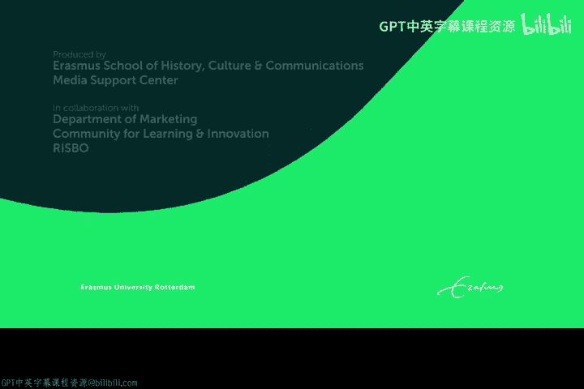

# 014：《RANJ认知训练系统》


## 概述
在本节课中，我们将学习本周的第三个，也是最后一个案例研究。我们将通过一个具体的项目，了解如何将游戏化原则应用于非游戏环境，以改善生产流程和员工行为。

---

## 游戏形式的连续体

上一节我们介绍了严肃游戏可以有不同的形式和目标。本节中，我们来看看游戏设计原则是如何根据严肃游戏的目的被不同程度地嵌入的。

在我们的分类中，模拟游戏位于连续体的一端。它们提供沉浸式和真实的体验，例如将你传送到急诊室或鹿特丹港的拖船驾驶室，让你做出决策。模拟游戏帮助你为现实生活情境进行训练，例如拯救病人或将船只安全引导入港。

**公式：模拟游戏 ≈ 高沉浸感 + 高真实性**

另一方面，在连续体的另一端，我们定位了游戏化。游戏化是指提取游戏设计原则，并将其嵌入到一个学习或工作环境中，而这个环境本身不一定是一个游戏。

**公式：游戏化 = 游戏原则 + 非游戏环境**

---

## 案例引入：钢铁生产中的游戏化

基于鹿特丹的游戏公司RANJ正是将游戏化原则应用到了钢铁生产中。RANJ的设计师们有意跳出了传统严肃游戏的封闭环境，将游戏原则实施在真实的钢铁生产世界里，旨在改进生产流程。RANJ的联合创始人Michael Boss将为我们介绍这个有趣的项目。

---

## 项目背景与目标

在RANJ的项目中，我们几乎总是体验到“玩”能够带来积极的行为改变。当我们将游戏原则应用于Wermans Steel Nederland的钢铁生产时，这种情况再次发生了。

他们的超现代化生产设施位于荷兰穆尔代克，拥有133名员工。他们生产钢卷，这些钢卷在大型机器中焊接，并由操作员团队运行。实际的焊接是一项精密且要求高的任务，过程中的任何错误都会导致严重后果，并且代价高昂。

Wermans公司显然希望通过改进生产流程来减少错误发生的频率，因此他们联系了我们。这最终促成了一个我们称之为“迭代式改进”的方法：实施小的改进，监控这些改进，并在必要时进行调整。

---

## 游戏化解决方案的设计

在与Wermans的会议中，我们基于游戏化原则设计了一个互动解决方案。这个游戏化方案既关注技术层面，也关注社交层面，例如如何提升员工的参与度。

我们游戏化项目的基石是一个40英寸的交互式触摸屏。它实时显示关于产量、质量和安全的数据。

**代码示例（概念性）：**
```
屏幕显示内容：
- 本班次生产单元数量
- 最高质量（首次合格）单元数量
- 是否达成目标
- 错误或事故是否发生
```

---

## 实施细节与设计考量

以下是该解决方案的关键设计特点：

该屏幕的视觉和交互方面由一个员工参考小组进行了测试，以确保这个应用能很好地融入他们的日常工作流程。

屏幕被特意放置在一个易于访问的区域，以便员工在班次中或班次后可以轻松查看。

最重要的信息以醒目的颜色和大字体呈现，这样工人们在经过时就能看到。

获取更详细的信息需要与屏幕进行一些交互，这通常发生在班次结束后。

---

## 项目成果与影响

该项目的成果非常积极。触摸屏已成为一个促进趣味互动的场所。

通过提供即时且相关的反馈，它清晰地传达了生产目标。

其互动功能使工人们能够非正式地讨论细节。

对实时数据的即时访问增加了工人对生产流程的洞察力。

各个班次可以看到自己的表现，进行讨论，并且非常重要的一点是，可以与其他班次的表现进行比较。

此外，与屏幕的互动产生了积极的社交影响。例如，通过填写工作档案等方式进行社交，意味着同事们比以前更加了解彼此。

简而言之，我们确信我们在Wermans实施的游戏化应用促进了员工之间更多的社交互动，同时增强了他们对生产流程的参与度。

**公式：成功游戏化 = 行为改变 + 流程洞察 + 社交互动**

---



## 总结
本节课中，我们一起学习了游戏化在工业环境中的一个实际应用案例。通过将游戏原则（如即时反馈、可视化数据和社交比较）嵌入到钢铁生产车间，RANJ公司成功地提升了员工的参与度、促进了积极的行为改变，并优化了生产流程。这个案例表明，严肃游戏和游戏化的核心在于运用游戏的力量来实现特定的、严肃的目标。