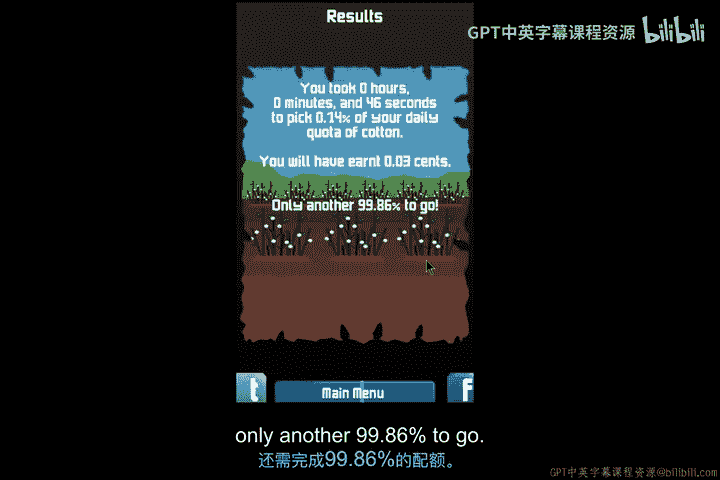

# 015：说服性游戏设计

在本节课中，我们将要学习说服性游戏设计。我们将通过一个具体的游戏案例，探讨游戏如何被设计来改变玩家的态度和看法，并介绍评估游戏说服力的关键标准。

## 游戏案例：《我的采棉生活》

你是否曾在棉花田里工作过？体验过整日辛苦劳作却几乎没有休息，报酬也微乎其微的感觉？

很可能没有。然而，在乌兹别克斯坦，许多人确实如此。严肃游戏《我的采棉生活》正是针对这一情况而设计的。

每年，包括儿童在内的许多人，在乌兹别克斯坦被迫采摘棉花。我们随后穿着的衣物中可能就含有这些棉花。

这项工作有多辛苦？让我们来玩一下这个游戏。你需要采摘50公斤棉花来完成每日配额。

填满进度条以完成50公斤棉花的采摘。要采摘棉花，请按下“采摘”按钮。

如果你受够了，可以使用这个按钮结束游戏。好的，那么我开始采摘。右手，左手，右手，左手，然后我继续，不停地采摘。

但正如你所见，在这个虚拟世界中采摘棉花是一项相当艰巨的任务，实际上它非常枯燥，所以我可能需要一些时间休息。那么，让我看看接下来能做什么……哦。

“继续干活，不然有你受的！”这是监工的声音。“继续干活，不然有你受的！”所以我应该继续采摘，于是我继续，摘，摘，摘，摘，摘，摘，我可以一直摘下去，但是好吧，这太无聊了，我停止。

这对你来说没问题。但退出对这些孩子来说并非一种奢侈。

你花了零小时零分钟46秒，只采摘了你每日棉花配额的一小部分，你将获得极少量的美分。距离完成还有99.86%。

## 发生了什么？游戏的说服意图

刚才发生了什么？我玩了一个简单的在线游戏，当我停止时，游戏向我提供了它所涉及主题的信息。

实际上，游戏希望我停止游玩，以此来让我面对童工在棉花田劳作时所面临的选择匮乏。他们被剥削，无法停止。《我的采棉生活》是说服性游戏的一个例子。

这就是本模块的主题。说服性游戏的制作意图是改变玩家的态度。也就是说，游戏设计师希望改变一个人对游戏所涉及主题的想法和感受。

## 说服性游戏的研究框架

本模块将介绍一个游戏被称为具有说服力所必须满足的标准。我们将从游戏的修辞及其说服属性开始，但会立即补充说明：理解说服需要同时关注游戏和玩家，因为说服过程正是在游戏与玩家的互动关系中展开的。

我们在本模块中分享的见解主要来源于我们的国家研究项目“情境中的说服性游戏”。该项目是伊拉斯姆斯大学、乌得勒支大学、埃因霍温理工大学以及两家荷兰游戏开发商（Ax Ftang和Submarine）之间的合作。这保证了研究与实际应用之间富有成效的对话。

该项目建立在三个支柱之上。第一个是关于说服力的游戏理论。第二个是关于设计。在伊拉斯姆斯大学，我们主要关注第三个支柱：验证说服性游戏的影响力。

## 课程内容预告

但在讨论说服性游戏的影响力之前，我们需要先探讨说服性游戏的修辞与属性，以及说服性传播的过程。本模块有很多内容要讨论。

请继续观看下一个视频。

---

本节课中，我们一起学习了说服性游戏的基本概念。我们通过《我的采棉生活》这个案例，看到了游戏如何通过模拟枯燥的体验来引发玩家对现实社会问题（如童工）的共情与反思，从而试图改变玩家的态度。我们还了解到，评估游戏的说服力是一个涉及游戏设计、玩家心理和实际影响验证的综合性研究领域。下一节，我们将深入探讨说服性游戏的具体设计标准。