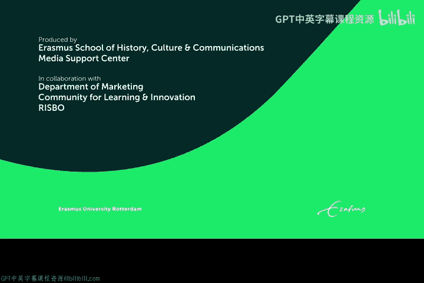

# 020：影响力评估的难点解析 🎯

在本节课中，我们将探讨如何评估严肃游戏的影响力。这是一个复杂但至关重要的议题，我们将解析研究人员在衡量游戏效果时面临的几个核心挑战。

---

上一节我们介绍了严肃游戏的目标，本节中我们来看看如何评估这些目标是否达成。当人们将“游戏”和“影响力”这两个词放在一起时，许多人会联想到暴力娱乐游戏对行为的影响。特别是公共场所发生的个别暴力事件，例如学校、商场或教堂的枪击案，常常会引发关于娱乐游戏对社会和行为影响的辩论。在新闻或社交媒体评论中，人们很容易将玩射击游戏与现实生活中的暴力行为联系起来。

但是，玩暴力游戏真的会导致暴力行为吗？要确立因果关系，我们需要进行严谨的研究。因此，暴力与娱乐游戏之间的联系成为科学辩论的热点话题也就不足为奇了。两者之间的潜在关系已在许多学术研究中得到探讨，并催生了各种关于游戏如何影响我们的、有时相互矛盾的理论。

以下是关于娱乐游戏影响的主要学术观点：
*   **直接效应理论**：一组研究人员主张此理论，他们认为玩暴力游戏对玩家构成风险，特别是对于那些因年龄等因素而较为脆弱的玩家。
*   **无影响论**：另一组研究人员则持相反立场，他们认为暴力游戏没有任何影响。
*   **证据不足论**：实际上，许多研究人员持中间立场，他们认为显示游戏有影响的研究证据在很大程度上是不确定的。他们指出，显示因果关系的研究往往存在缺陷，例如，没有考虑导致玩家产生攻击性的其他因素。

我们在此不深入细节。暴力娱乐游戏显然超出了本课程的范畴。但严肃游戏开发者也需要回答一个问题：严肃游戏是否有助于学习某些知识或理解某个议题。最大的区别在于，该领域的研究人员主要关注研究严肃游戏的潜在**积极影响**。你可能注意到，这与研究娱乐游戏的负面影响角度截然不同。

尽管如此，研究人员在衡量影响力时面临着类似的困难，这是一个复杂的问题。让我在此概述三个基本难点。需要明确的是，我们更倾向于使用“影响力”而非“效应”这个词。措辞很重要：如果我们使用“效应”一词，会暗示一个简单的直接效应模型；而现实中，游戏可能产生直接和间接的后果，“影响力”一词则两者都涵盖。

---

第一个难点是，你需要确定严肃游戏旨在产生何种影响力。改变行为是一些游戏的宏伟目标，例如那些劝说你戒烟的游戏。然而，研究表明改变行为是困难的。因此，大多数严肃游戏旨在提高认知或改变态度。回想一下《优步游戏》，我们可以想象创作者旨在提高玩家对共享经济及优步等服务负面影响的认知。他们会在游戏中加入一些说服性设计，以期实现这一目标。

实际上，衡量态度或行为的改变伴随着各种复杂问题。例如，你如何知道玩家的态度或行为是否朝着预期的方向改变了？研究人员还需要调整他们的研究设计，以考虑玩家在玩游戏之前的态度或行为。当一个不吸烟的人玩戒烟游戏时，你可以想象游戏不会产生太大影响，即使游戏的说服性设计和机制是有效的。

---

上一节我们讨论了确定影响力目标的复杂性，接下来我们看看第二个难点：确定短期和长期影响的复杂性。像《我的摘棉生活》这样的说服性游戏，很可能在游玩后立即改变你对童工的态度，但一周后当你急切地想买那条非常实惠又时髦的牛仔裤时，这种改变还能持续吗？当研究人员在游戏结束后立即发现玩家产生了影响时，这可能意义不大。这种效果可能在游玩一小时后便消失了。一种包含了严肃游戏长期影响的研究设计被称为**纵向研究设计**。当你阅读有关游戏影响力的文章时，请注意这个术语。

---

第三个，也是最后一个我们要讨论的难点，是外部因素的复杂性。当我们测量时，可能认为游戏产生了某种影响，但这真的是游戏导致的，还是其他因素造成的？例如，在玩过《我的难民生活》后出现的积极态度转变，也可能是由当前欧洲关于难民的政治局势，或是因为某人在同一时间观看了一部纪录片所导致的。

当研究人员试图确定游戏内容与行为态度之间是否存在因果关系时，他们很可能会在实验室环境中进行实验。这使他们能够控制外部因素——只要你在受控环境中，你就不能在家看电视或与他人交谈。此外，在实验中加入对照组也有帮助：一组玩游戏，另一组看电影或读杂志。如果实验组显示出游戏产生了效果，而对照组没有发生变化，我们就可以相当确定该效果是玩游戏的结果，而非外部因素所致。

实验室实验的缺点是，与在家里的沙发上玩游戏相比，在实验室里玩严肃游戏是不自然的。在实验室中玩游戏可能的人为性，凸显了游戏研究中的一个重要总体问题：即没有一种放之四海而皆准的最佳研究方法。每种方法都有其优点和缺点，某些方法论工具在回答特定的影响力问题上比其他工具更有效。记住这一点很重要。对于关于严肃游戏影响力的说法，要对其使用的方法持批判态度。

---

本节课中，我们一起学习了评估严肃游戏影响力的三大核心难点：**确定影响力目标**、**区分短期与长期影响**，以及**控制外部因素的干扰**。理解这些难点有助于我们更客观地看待关于游戏效果的研究和结论。如果你想回顾本视频讨论的难点概要，可以点击下一个动画视频。如果你对实际研究关于影响力的发现更感兴趣，我邀请你开始一轮圆桌访谈。