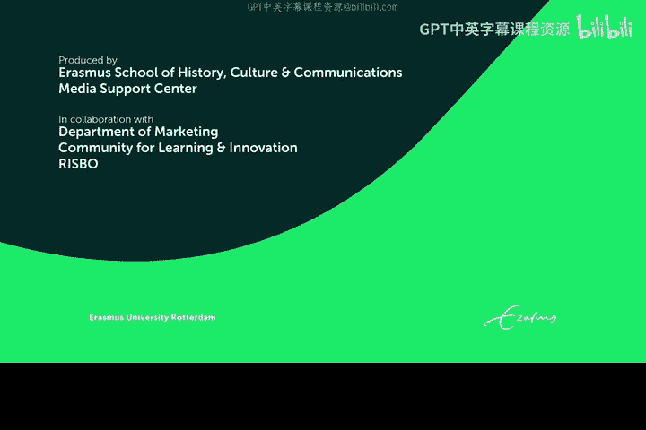

# 025：建立系统性认知框架 🎮

在本节课中，我们将回顾整个课程的核心内容，并建立关于严肃游戏的系统性认知框架。我们将串联起定义、特征、说服性属性与影响力评估等关键知识点，为理解严肃游戏提供一个完整的视角。

---

经过五周的讲座、讨论、作业和案例研究，我们来到了严肃游戏课程的最后一个阶段。到目前为止，你已经训练了知识储备和分析能力，并且通过体验我们介绍的一些游戏，希望你的游戏技能也有所提升。最重要的是，我们希望你喜欢这段学习旅程。

无论你是完整学习了所有章节，还是挑选了感兴趣的主题进行学习，现在都有必要退后一步，回顾本课程为你提供的不同贡献。

在最后一周，我们将介绍一些可能影响严肃游戏未来发展的技术。但在此之前，让我们先串联起所有的知识点。

---

## 回顾起点：定义与特征

上一节我们介绍了课程的整体结构，本节中我们来看看课程的起点。我们通过邀请每位学员在纸上写下自己对严肃游戏的定义来开启这门课程。这在我们论坛上引发了许多有趣的回答，有些甚至比我们自己的定义更具诗意。

许多学习者强调了严肃游戏的教学属性，这确实是将其与普通游戏区分开来的最重要元素之一。游戏的设计目的不同：通过玩游戏，你应该学到一些东西。这也体现在我们自己的定义中：**严肃游戏是主要出于非娱乐目的而使用电子游戏和/或模拟方法及技术的游戏**。

为什么在课程开始时让每个人都拥有相似的定义很重要？我们想确保每个人都清楚什么是严肃游戏，什么不是。通过补充游戏的五个特征，学习者可以区分普通模拟和模拟游戏。这也有助于理解为什么严肃游戏应该比观看视频或阅读书籍产生更好的学习效果。

以下是游戏的五个核心特征：
1.  **规则**：游戏由明确的规则系统定义。
2.  **目标**：游戏为玩家提供了要达成的目标。
3.  **反馈系统**：游戏提供即时反馈，告知玩家距离目标还有多远。
4.  **自愿参与**：玩家自愿接受游戏的规则和目标。
5.  **冲突/挑战**：游戏包含阻碍玩家轻松达成目标的障碍。

游戏中的竞争元素是解释之一：玩家被挑战在学习过程和理解中采取进一步行动，并直接获得关于其行为的反馈。因此，通过游戏进行学习的过程比仅仅阅读教科书更具吸引力。这为课程后续内容奠定了共同的知识基础。

---

## 深入理论：游戏吸引力与设计原则

在建立了共同的定义基础后，我们进入了更具理论性的模块。我们深入探讨了“玩”的定义，以及“玩”如何成为塑造文化的一部分。

我们解释了诸如“心流”以及“使用与满足理论”、“自我决定理论”等概念，以更深入地理解为什么玩游戏对如此多的人具有吸引力，以及为什么即使我们在某个关卡受挫，仍想继续玩下去。

这些理论在分析特定游戏或亲自玩游戏时很有帮助，但在更实际的层面上，例如当你自己设计游戏时，理论如何发挥作用？理论指出了如果你想保持玩家参与度，游戏中应包含的基本要素。当他们持续玩你的游戏时，你传递信息的可能性就更大。

严肃游戏公司“Or”通过他们的移动游戏《从五到四》实际演示了这一点。来自“Or”的“Fols”也解释说，游戏应该具有挑战性，但对玩家来说总是可以完成的。尤其是在开始时，因为如果游戏太简单或太难，玩家会失去动力。一个好的游戏能让玩家产生**能力感**，即能够取得成就并征服挑战的感觉。

《从五到四》是一个很好的案例研究，因为它将理论与实践结合在一起，并且表明有时使用不同的定义也可能是有用的。本课程中的案例研究是重要的环节，因为作为学习者，你可以将知识与现实生活中的例子联系起来。

这些案例研究有不同的目的。在第一周和第二周，它们被用来阐明某些定义或特征。在第三周，它们被用来表明严肃游戏本身不是一个游戏类型，而是可以包含许多不同类型、应用于许多不同专业背景的游戏。

模拟可以用来训练复杂行为。你看到了模拟如何在鹿特丹港口和医院急诊室中用于训练行为。游戏化意味着不同的方法，但它仍然属于严肃游戏的范畴。因此，在课程过半时，我们已经涵盖了相当多的内容。

---

## 核心属性：说服力与影响力

在第四周，我们专注于许多严肃游戏试图融入的一个特定特性：**说服力**。如果游戏设计师想要影响一个人对某个主题的看法或感受，严肃游戏需要具备某些属性。

这是一个困难的章节，但也非常重要。到第四周，我们知道许多学习者已经准备好进入下一个理论难度级别。基础知识已经具备，因此我们探讨了修辞学（古典的说服艺术）和更心理学化的说服过程。

诸如**精细加工可能性模型**和**勒赫塔的劝说维度概念模型**等理论，不仅告诉你如何激励人们玩游戏，还告诉你如何使用游戏元素来提供信息、提高意识，甚至推动人们改变对某事物的态度。

这里也有更实际的教训。如果你想开发一款具有说服力的严肃游戏，你可以选择各种途径来实现。你可以向一个人提供信息，但将你的信息以有趣和吸引人的方式包装起来，也许是同样重要的一个方面。即使你不想自己设计游戏，理解我们都可以被事物的设计或呈现方式所说服也很重要。

设计当然很重要，但我们不能仅凭封面判断一本书。一个设计精美的游戏是否比一个看起来不那么精致的游戏具有更大的影响力，这并非泾渭分明。游戏玩法和其他说服性方面需要与其美学效果相匹配。

因此，第五周专门讨论**影响力**。从学术角度来看，这是一个需要解决的重要问题，因为我们想知道游戏作为学习工具的有效性。从更实际的角度来看，它可能甚至更重要，因为大多数严肃游戏需要大量投资，如果未能达到预期效果，不能简单地退还给开发者。思考影响力至关重要。这样，作为一个组织，你可以做出基于证据的决定，是否投资于一个游戏项目。

对于游戏设计师来说，重要的是要理解当他们希望自己的游戏产生尽可能大的影响时，需要考虑哪些要素。不幸的是，影响力问题并不简单。游戏研究者以复杂的方式理解严肃游戏可能产生的影响。他们试图确定游戏对玩家的想法、意图或行为可能产生的影响，无论是在游戏结束后立即，还是在更长一段时间后。他们使用各种研究方法来分析这些形式的影响。

在本模块中，你对这些方法及其优缺点有了更多的了解。对于非学术界人士来说，方法论输入的价值在于，它同样重要。我坚信，对于专业人士和学生来说，至少理解研究原则的基础知识也很重要。当你想对某事形成意见或必须做出决定时，例如是否投资于一款严肃游戏，如果你能批判性地评估你所阅读的研究，那将是有益的。

例如，能够区分游戏的长期和短期影响，或者理解当一项实验研究没有对照组时其可靠性较低，或者当一项研究基于问卷调查时，通常只能告诉你一些关于自我报告行为的信息，这些都是有用的。我们在第五周组织的圆桌讨论很好地总结了这些问题。

---

## 课程总结与未来展望

理论、方法和实践案例是支撑本课程的三大支柱。我们汇集了非常实用的基本信息，无论你是想分析严肃游戏、考虑使用严肃游戏，还是甚至着手创建自己的严肃游戏。

我希望你能继续深入探索知识。本课程为你提供了一个基本的起点。请继续研究这个主题。这个领域变化很快，有趣的新发展总是即将到来。我希望你能受到启发去了解更多。如果在未来，你自己开始从事有趣的游戏相关项目，请告诉我们。

这门课程的游戏尚未结束。在这最后一周，我们敢于踏入未来。这是一个真正的挑战，因为游戏领域非常动态且变化迅速。我们将讨论两种可能影响严肃游戏未来的技术发展：**虚拟现实**和**增强现实**。

---

本节课中我们一起学习了如何系统地回顾和串联严肃游戏课程的核心内容，从定义与特征出发，深入探讨了游戏吸引力背后的理论、说服力的设计原则，以及评估游戏影响力的重要性。最后，我们展望了虚拟现实和增强现实技术对严肃游戏未来的潜在影响。希望这门课程为你提供了坚实的知识基础，并激发你在这个快速发展的领域中继续探索。