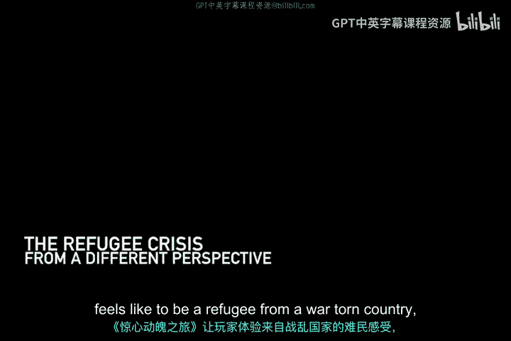
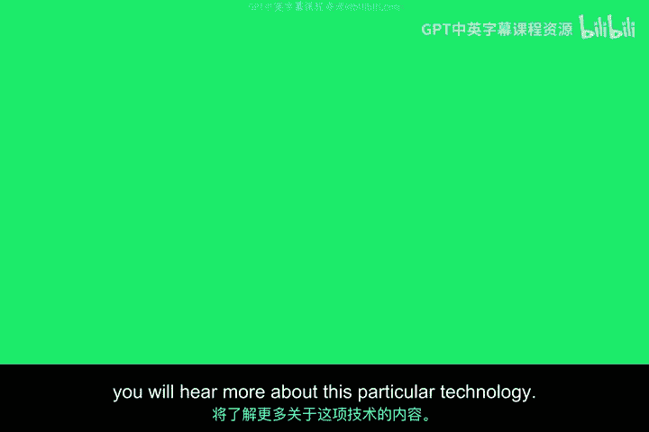

# 026：虚拟现实技术的应用 🎮

在本节课中，我们将要学习虚拟现实技术在严肃游戏领域的应用。我们将探讨VR的基本概念、核心要素，并通过具体案例了解其如何在不同领域（如社会议题和医疗康复）中创造沉浸式体验。

***

如果你看过由沃卓斯基姐妹创作、于1999年作为《黑客帝国》系列首部上映的科幻电影，你可能对虚拟现实已有概念。

对于不了解《黑客帝国》的人，这里简要回顾一下。该片讲述了黑客尼奥的故事，他被招募来对抗一群有自我意识的机器。这些机器创造了一个模拟世界——一种人工现实，它们将人类意识囚禁其中，同时依赖人类身体生存。包括尼奥在内的大多数人类，起初甚至不知道他们感知的现实是虚假的。在电影中，尼奥将投身于将人类从机器统治下解放出来的战斗。

与许多其他技术一样，虚拟现实的发展也受到科幻作品的启发。许多科幻故事都探讨了替代现实的概念。甚至可以说，所有虚构故事在某种程度上都为我们呈现了一种虚拟现实。然而，当我们阅读书籍、观看电视节目或电影时，我们仍然意识到自己是在消费某种内容，并且正坐在现实生活的沙发或电影院里。

***

VR试图将这种沉浸式体验向前推进一步。在VR中，我们不仅仅是体验故事，我们是在“生活”其中。

VR技术将用户沉浸于一种有响应且感觉真实的体验中，但这种体验并不存在于我们的模拟世界。在一本关于VR神话与现实的书中，Arnaldi、Gitten和Morro指出，VR的目标是：“允许用户在虚拟环境中执行一项任务，同时让他们相信自己是在真实世界中执行它。”

VR技术本身大约在1965年发展起来，当时计算机科学家兼互联网先驱伊万·萨瑟兰对VR可能是什么样有着清晰的愿景。他称之为“终极显示”，一扇踏入爱丽丝仙境之窗。

VR技术真正普及到大众市场花费了一段时间。直到2016年，VR头显才以合理的消费价格在商店中大规模销售。

***

VR被应用于许多不同领域，从艺术项目到工业设计和电影，再到培训和医疗保健。在严肃游戏领域，VR技术也展现出巨大潜力。

根据Sherman和Craig在2018年出版的关于理解VR的书籍，VR体验包含五个要素。以下是这些要素：

1.  **虚拟世界**
2.  **沉浸感**
3.  **交互性**
4.  **内容创作者**
5.  **身处虚拟世界的人**

你可能会注意到，其中许多要素也存在于我们迄今讨论过的游戏中。然而，在手机、平板电脑或电脑上玩的严肃游戏是在平面屏幕上呈现游戏玩法，而虚拟现实则让你以360度和三维方式体验游戏玩法。屏幕仍然被使用，但它们通常被集成在某种头盔或眼镜中。有时玩家还会佩戴特殊手套或使用连接到VR体验的设备。

通过添加传感器，软件可以计算玩家在游戏世界中的位置以及他/她如何在其中移动。玩家还可以操纵游戏环境中的物体。与在平面屏幕上玩的严肃游戏相比，所有这些特性使得体验更加身临其境。感觉就像你真的身在其中。

***

总而言之，VR与在常规屏幕上显示的严肃游戏的区别在于：**VR屏蔽了真实世界**，它以**真实尺寸呈现虚拟世界中的物体**，这可能导致更具说服力的沉浸感错觉。

有许多针对娱乐市场的VR游戏例子。你可以探索太空、与外星人作战或解决谜题。但VR为严肃游戏市场带来了什么？让我们看两个VR如何在该领域应用的例子。

***

第一个例子是名为《惊心动魄的旅程》的VR体验，它出色地展示了VR能达到的效果。它由荷兰埃因霍温理工大学的Marjolijn Ruyg及其游戏设计师团队开发。《惊心动魄的旅程》希望玩家体验来自战乱国家的难民，在卡车后车厢秘密穿越边境的感受。VR在物理上重现了卡车，包括里面的橘子。游戏元素涉及，例如，尽可能好地隐藏自己，以及在海关检查卡车时控制呼吸。Ruyg和“说服性游戏与情境”团队研究了这种游戏化互动对难民同理心的影响。可以想象，这类VR需要相当多的设备。

***

第二个例子将我们带到医疗领域。在这里，游戏对患者的附加价值在许多不同领域得到探索。VR游戏被用于帮助培训医生、康复患者，或帮助他们管理疼痛或焦虑障碍。可以理解，游戏越沉浸，其效果就越好。虽然并非所有医疗VR体验都是游戏——许多只是提供培训或体验——但也有一些整合了游戏元素。我相信你可以想象，我们之前讨论过的ABCDE模拟训练也可以作为一种VR体验。对于正在接受急诊室工作培训的医生来说，这将更加身临其境。

荷兰专注于运动康复的圣马丁医院，领导了一个开发用于患者康复的VR的欧洲项目。他们的项目之一是《环游世界之手》，这是一个带有游戏元素的VR体验，用于训练因脑损伤而导致手部活动困难的儿童的手部功能。该项目的目标是开发一种儿童可以在家中使用的VR体验。

***

我想与大家讨论的最后一个与VR相关的发展是**脑控游戏玩法**，也称为**脑机接口游戏**。与使用特殊手套和设备来移动和操纵物体不同，你可以通过思考来完成所有这些操作。一个有趣的原型是《看好羊》，由荷兰特文特大学的Hewrittentan Gek及其同事开发和研究的。游戏目标是通过用牧羊犬驱赶，将一群自由漫游的羊圈起来。牧羊犬由一个脑机接口控制，该接口希望玩家将视觉注意力集中在代表牧羊犬的闪烁圆圈上。玩家注意力越集中，产生的脑电反应就越强。一旦注意力建立，就可以使用普通光标来引导牧羊犬。这项开创性研究的结果表明，由于强烈的认知投入，玩家感受到了沉浸感。

***

《惊心动魄的旅程》、《环游世界之手》和《看好羊》说明，这类游戏或游戏化互动虽然脱离了普通的电脑、平板或手机，但仍然是在一个有限的空间内进行游戏。增强现实游戏是我们接下来要讨论的技术，它将玩家带入真实世界。当你开始下一个视频时，你将听到更多关于这项特定技术的内容。

***

在本节课中，我们一起学习了虚拟现实技术及其在严肃游戏中的应用。我们了解了VR的核心要素——虚拟世界、沉浸感、交互性、创作者和参与者，并看到它如何通过完全屏蔽现实、提供真实尺寸的体验来创造更强的沉浸感。通过社会议题和医疗康复等具体案例，我们看到了VR在激发同理心、提供专业培训和辅助康复治疗方面的巨大潜力。最后，我们还简要了解了脑机接口这一前沿方向。下一节，我们将探讨将虚拟元素叠加到现实世界的增强现实技术。