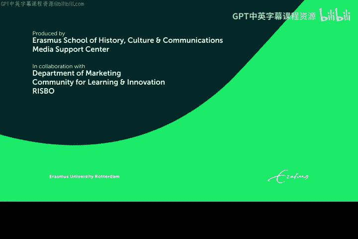

# 027：增强现实技术的演进 🕶️

在本节课中，我们将学习增强现实（AR）技术的核心概念、关键特征、应用领域，并探讨其在严肃游戏中的具体应用案例及其未来发展趋势。

你是否玩过《Pokemon Go》？或许你听说过它。这款游戏由Niantic于2016年开发，并在同年夏天引发了全球性的《Pokemon Go》热潮。这款智能手机游戏应用利用GPS和增强现实技术，将虚拟生物（宝可梦）投射到玩家所处的真实世界环境中，玩家需要捕捉它们。根据《华盛顿邮报》的报道，《Pokemon Go》是通过融合现实世界与虚拟世界而取得的首批增强现实技术成功案例之一，数百万人为此走到户外，前往各种不同寻常的地点进行探索。

上一节我们介绍了虚拟现实（VR），本节中我们来看看增强现实（AR）。Jenkins及其同事将增强现实定义为：在真实生活情境上叠加数据和体验的虚拟覆盖层。这与我们上一视频中讨论的虚拟现实技术有所不同。虚拟现实与增强现实最显著的区别在于，VR技术完全屏蔽了真实世界，所有环境和物体均由计算机生成。而增强现实（AR）则以真实世界为基础进行构建。换句话说，在虚拟现实中，玩家（一个真实世界对象）被置于虚拟世界里；在增强现实中，虚拟对象被置于真实世界中。大多数使用增强现实的应用都通过智能手机或平板电脑的摄像头来显示真实环境，并为其叠加一个额外的信息层。

在《理解增强现实：概念与应用》一书中，Ellen Gake指出，AR体验的核心思想不仅是将数字信息置于物理世界，还在于你可以与之互动。我们在上一视频中介绍过的VR与AR书籍的作者Arnaldi、Giton和Emorro，将AR的目标描述如下：AR的目标是通过添加与此环境相关的数字信息，来丰富对真实环境的感知和认知。大多数情况下，这些数字信息是视觉化的，有时也是听觉的。

尽管人类一直有改变周围环境的愿望，但直到数字化和先进的计算机技术出现，这些改变才能以虚拟方式实现。借助AR技术，我们可以在地理位置和数字信息之间建立实际联系。

以下是增强现实的四个关键特征：
1.  物理世界通过数字信息（例如叠加在物理世界视图上的图像或声音）得到增强。
2.  信息显示与物理世界对齐。
3.  所显示的信息取决于在真实世界中的位置以及位于该位置的人的物理视角。
4.  增强现实体验是交互式的。

AR应用可以在许多不同领域中找到。一个常用的应用是移动出行。战斗机飞行员使用AR导航空域已有相当长的时间，如今汽车也在驾驶侧的挡风玻璃上显示额外信息，以帮助驾驶员以最安全的方式驾驶。旅游业也是AR已证明其效用的领域。例如，在城市游览时，一款应用可以为你提供公共空间中所有雕像的额外信息。在零售业，家具店可以让你在自己的客厅里看到新沙发如何与你已有的家具搭配。或者想象一下，某个鞋类品牌让你能在自己的脚上体验其最新款运动鞋。可能性是无穷无尽的。

在游戏产业，AR为基于位置的游戏打开了大门，例如本视频开头提到的《Pokemon Go》。基于位置的游戏利用手机上的GPS和无线接入，在普通的现实世界中展开。荷兰莱顿大学的研究员Cb Las认为，基于位置的游戏改变了城市景观的意义，普通的街道、长椅或斜坡变成了趣味社交互动的场所。因此，手机上的数字地图也被赋予了额外的意义，被重新定义为趣味性的来源。当然，这类游戏也存在争议。例如，当《Pokemon Go》玩家冒险进入现实世界中可能危险（如铁路轨道和道路）或存在道德争议（如战争纪念馆）的地点时。

严肃游戏开发者同样利用增强现实来增强玩家的体验，这里我举两个例子。第一个要讨论的严肃AR游戏由En Ranch及其合作伙伴于2016年为荷兰超市开发。游戏以一个小机器人Tackie为特色，旨在激发儿童对技术的兴趣，并引导他们迈出编程的第一步。通过在超市购物收集卡片，孩子们可以在应用中获得构建模块来编码自己的机器人，并教它特定的动作。通过组合不同的代码块，机器人会在孩子们的家中虚拟地“活”起来。例如，孩子们可以让机器人跳舞。他们可以个性化自己的机器人，并向朋友和家人发送视频和图片。正如你所理解的，这款游戏不仅具有教育意义，也是一个巧妙的广告游戏范例。第二个例子可以在健康领域找到，即健身应用《Zs Run》。这款游戏将你的位置与一个僵尸入侵地球的虚构故事结合起来，你需要跑到人类最后的避难所。在你跑步时，你会听到僵尸越来越近的声音。跑步的真实体验被追逐你的僵尸声音所增强，这通常会导致人们在这项健康运动上花费的时间增加。因此，这款增强现实应用使用音频而非视觉叠加作为数字信息。

预测未来是学者们通常谨慎对待的事情。我们没有水晶球。然而，我们可以相当自信地说，VR和AR并非未来唯一会影响严肃游戏发展的技术。例如，想想人脸识别和3D扫描技术，未来在游戏中拥有一个与你本人一模一样的虚拟形象将变得更加容易。你可能能够通过语音或脑控来玩游戏。手势控制将得到进一步发展。图形技术也在持续改进，使游戏更加逼真。一种趋势是可行的：严肃游戏似乎正在部分且缓慢地脱离固定屏幕的游戏方式，扩展了你与游戏技术的互动方式。因此，玩家、游戏、现实世界和虚拟世界之间的界限变得模糊。这将引发更多有趣的问题等待研究者解答，例如，未来我们是否还能维持现实世界与虚拟世界之间的区分。

我们将持续关注体验严肃游戏的新颖有趣方式，并希望我们也激发了您保持兴趣。

本节课中我们一起学习了增强现实（AR）的定义、其与虚拟现实（VR）的区别、核心特征、在各领域的广泛应用，以及它在严肃游戏中的具体实践案例。我们还展望了AR与其他新兴技术结合可能塑造的未来游戏体验。