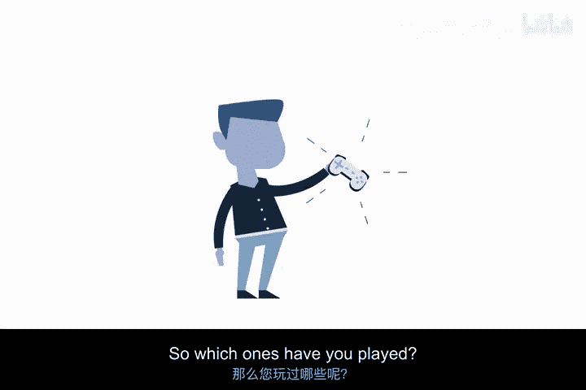

# 鹿特丹伊拉斯姆斯大学《严肃游戏｜Serious Gaming》中英字幕 - P10：9_严肃游戏的分类图谱：从仿真模拟到游戏化设计.zh_en - GPT中英字幕课程资源 - BV1axeUzbE3D

You are looking at the simulation of what a tuckmaster in the Rotterdam Harbor needs to do to mo a ship。

The simulation is made by V step。This company employs game technology to produce simulations。

 a specific type of serious game that helps professionals to train complex behavior。In this case。

 the proper handling of the huge vessels calling on the port of Rotterdam。Later in this week。

 we will address the simulation in a case study。Simulations， however。

 are by no means the only type of serious game。When I tell my students about series games。

 the first things they often think about are the educational games they played at school。

 how their math teacher asked them to play a game to memorize their multiplication tables。

 for example。I also remember those games， especially when in primary school。

 we played a game in which would steer a helicopter to a place on the map， we liked it a lot。

 and while playing it taught us geography。What we need to realize， though。

 is that series games are not only played by children and not only in a school setting。This week。

 we want you to understand the broad range of series games that are out there。

 It's important because it will help you to understand the variety of situations that games can be put to use。

😊，To already get an idea about these different types of games。

 let's have a look at the following animation Have you ever played a serious game。

 The chances are high because there are a lot of different ones at school you might have played an educational game They are used to motivate students to learn The shame goes for health games They motivate you to do your exercises。

 for example， Way to go。Then there are advert games most of the time they are fun to play and at the same time introduce you to the product Quick grab that power up soda can a bit more serious are the military game soldiersold learn how to shoot and when to engage Those games are also used to attract new recruits。

Next political games， they try to change the players' views on topics like poverty or injustice。

 and finally there are simulation games used to prepare you for risky tasks like flying an airplane。

Which ones have you played？

In the next video， the different types of series gains that are out there will be discussed in more depth。

The rest of this week is dedicated to three very interesting cases that present different ends of the series gaming spectrum。

 We'll explore two examples of simulation games， one that takes place in the emergency room and one that brings you on board a tugmaster in the port of Rotterdam。

😊，Simulations are series games that immer the player in a copy of a real life situation。

 The purpose of simulations is often some form of professional training。

 These series games are often very detailed and realistic。😊，On the other end of the spectrum。

 we'll explore a case study of gamification。Gammification is the use of gaming elements in a nonga context。

 think， for example， about an e-commer website that allows you to create your own avatar or an employer that uses a leaderboard to keep track of the sales of his team。

We'll see how this gamification principle plays out in the steel industry in Rotterdam。First。

 we will present a broader overview of serious games in the next video。

