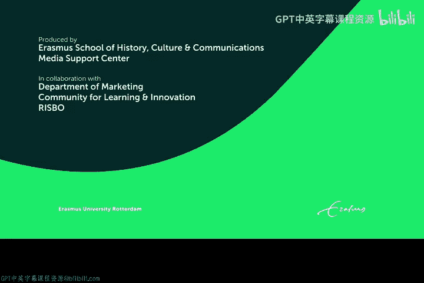

# 鹿特丹伊拉斯姆斯大学《严肃游戏｜Serious Gaming》中英字幕 - P11：10_严肃游戏的分类体系.zh_en - GPT中英字幕课程资源 - BV1axeUzbE3D

When academics want to create a systematic overview or a classification of something。

 they call this a taxonomy。Think， for example， about a biologist who wants to classify various birth species。

We can do the same with serious games。I already addressed games played in school settings in which game elements are used to stimulate students motivation to learn。

There are roughly four other important domains where serious games are used。

 I will address them all shortly。Health games。Military games， political games， and at games。

There are of course， also other areas that series games can be useful。

 but we will stick to these four to keep a clear overview。The first domain is healthcare。

Serious games in this area are also called Games for Health。We can think of various examples here。

 Some games are directed as patients who have a certain medical condition。

 You can think of a game to stimulate diabetes patients to take their medicinein on time。

 or games for children with cancer to teach them the value of their treatment。

 even though this treatment might be painful or unpleasant。

These games thuss help patients to deal with their condition better or to help them take necessary steps to actually feel better。

Games for health also includes serious games or gamification apps that are used by people who want to improve their general health。

 I'm sure you know an example of this， think for example about fitness apps that integrate gaming principles to challenge people to exercise。

The game characteristic competition is very useful here。

 You might decide yourself to run a little bit longer or faster if that will give you a top score on the leaderboard。

😊，This week， we will explore another type of healthcare game。

 one that is developed as a training simulation for medical students and staff working in the emergency room。

We will discuss it as one of the case studies this week。

The next domain where serious games are developed and put into practice is the military。

Just as in the healthcare domain， there are different uses for serious games here。First of all。

 simulation games can train soldiers to deal with specific situations or equipment。

These trainings can be expensive or dangerous to organize in real life。

A digital replacementist thus a great way to train in a safe and cost effective way。

Another type of series game is directed at people that might have an interest in this domain。

 One very well known example is the online game， America's Army。

This game was originally developed by the United States Army with the purpose to inform people outside of the army what working for the army meant。

In that sense， it was a tool for PR and recruitment。The third domain are political games。

Here we find many examples of persuasive games， games that attempt to inform people about a certain societal issue with the intent to encourage action。

These games are also known as Game for Change。They're often developed organizations that have a particular goal in mind。

 for example， to raise awareness about slavery or migration or pollution。

These organizations believe that games will help in their quest to increase political and civic engagement。

One example is my little plastic footprint。This app developed by the Plastic Soup Foundation。

 an NGO from Amsterdam， is released in 2017。By playing the game you will become more aware of the societal impact of plastic。

 the game designers try to teach you how to reduce your own plastic footprint in a playful manner。

During this MOOC， you will see many other examples of these political games。

The last serious games domain we discuss is advertising。

Brands launch marketing campaigns to make their brand name or their products more well known among consumers。

 They want people to buy their products or to use their servicess。

In addition to more traditional forms of advertising， such as television commercials。

 brands can also develop serious games for this purpose， we call these games a for games。

Ad for gaming can be as simple as placing digital billboards with commercials in a regular game or digital product placement。

In our serious gaming context， more interesting examples are games that are fully developed with a marketing goal in mind。

An example is the Scrow game of Chipotle， the American Cha of Mexican restaurants。

 Chipotle launched a scarecrow campaign， a short animation video and a mobile game in September 2013 to promote their food with integrity campaign。

In the game， you play a scarecrow that is trying to bring real food back to the people by defeating mass production。

Because of the more interactive nature of serious games and the motivating principles of games that make people play longer。

 brands such as Chipotli can try to get their message across in a more persuasive way。

These four domains， in addition to the serious games used in an educational context in schools。

 can serve as a basic taxonomy of serious games。As you have probably noticed。

 serious games can take different shapes and forms within these domains from full flged simulations。

Mimicking real life situations， to persuasive games， two apps， or to gamification。

These different ways in which game elements and characteristics are used are further explored in the following case studies in particular you will see in more detail how simulation games and gamification works。

