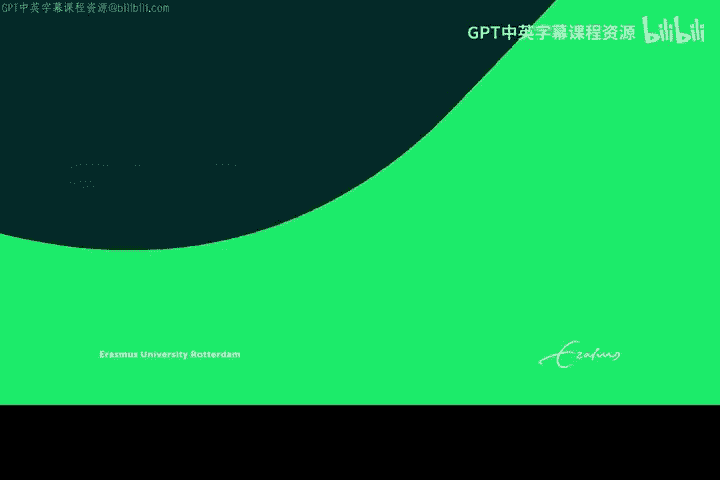

# 鹿特丹伊拉斯姆斯大学《严肃游戏｜Serious Gaming》中英字幕 - P12：11_案例研究：《ABCDE模拟训练系统》.zh_en - GPT中英字幕课程资源 - BV1axeUzbE3D

This week we'll discuss not one but three different case studies， two of them are simulations。

 and the last one is an example of gamification。For the first case study of this week we focus on healthcare。

 a professional domain where we can find some very interesting examples of simulation games we've chosen one that is developed in Rotterdam The ABCD E Sim of the Erestmus medical center prepares medical students and doctors for their work in the emergency room The simulation trains the behavior step by step it might not be as romantic compared to the hospital shows we see on television such as ER or greys anatomy the game provide a much more realistic image patients in the game are in need of immediate medical tensions since they are in critical condition by playing students and professionals have to make choices treat their patients and are confronted with the consequences of their actions if they fail no worries they will lose points but will not hurt any real patient。

😊，Doctors Stephanie， Klein Nafortzch and her team have developed this simulation for students and ER doctors only because of the technical detail and difficulty of the game。

 you cannot play the game at home， but we will provide you with some visuals of what the game looks like。

Dr。 Klein Nahalford is in the studio with us to explain why she initiated the ABCD EC。

 how the simulation game works in medical education。

 and why it's so important to study the effects of using a simulation game。

Much has changed since I first started at medical school 20 years ago， while we learned from books。

 students today no longer read from paper， but use online learning materials such as websites。

 applications and ebooks。They're also avid game players。

 and research has already shown that doctors who play video games are technically better at surgeries。

So why not use the technology of series gaming to teach one of the most important aspects of medical education。

 emergency medicine？Training in emergency medicine is an essential part of medical education around the world。

 every doctor or nurse working in a hospital or in primary care is required to be trained in emergency skills。

Expertise usually comes with experience。 However， doctors and nurses must be prepared for all types of medical emergencies。

 even when they lack experience。We also know from experience that skills cannot be taught from books or elening alone。

 you must be able to practice the skills to become proficient。

This is especially true in emergency medicine， where time and stress are important factors。

 While a skill， a specific skill may seem easy to grasp when reading in a quiet setting。

 They're very different in a hectic and stressful environment of the emergency department。

This gap between knowledge and practical skills is encountered daily in clinical practice。

 but how do you allow healthcare professionals to practice before they're actually being on the job。

In the aviation industry， flight simulators are a standard part of training， why not in medicine？

Three years ago， we set out to create the online flight simulator for emergency medicine。

 Let's have a look at how it turned out。ABCD ESIM is an online simulated emergency department with virtual patients。

In a realistic and immersive emergency room， doctors and nurses are challenged to care for the sickest patients。

The goal of the sameim is to keep the patients alive。

Doctors learn to accurately assess the medical condition of each patient。

Recognize life threatening illnesses and injuries and resuscitate and stabilized in order priority。

ABCD ECM includes a model of bodily functions that contains more than 200 parameters for circulation。

 respiration and consciousness。Because of this model。

 players can see the direct results of their chosen diagnostics and treatment。

They get instant feedback on what they do。Mistakes made in online patients are not fatal as in real life。

 but important learning points， thereby improving everyday patient care。

The game also simulates the time pressure that is common in the emergency room。Consequently。

Players experience the necessity to act adequately yet quickly。

Doctors and nurses can practice whenever and wherever they want。

 just like flight simulators having increased airline safety。

 ABCD ECIM aims to cost effectively increase patient safety。

Because series gaming can only be cost effective if it really improves the emergency skills in its users。

 we also spent the last two years studying the effects of ABCDE SIim on doctors。

Our research has shown that doctors who are taught in the virtual emergency department are better at emergency skills than those who only read about emergency skills to make sure that the skills learned online can be adequately used in actual patient care。

 We recommend that a serious game is embedded in a three step program。

 Step1 is an e-lening program that includes background knowledge to learn the skills。

Step 2 is a serious game， R ABC to E Sim， where the skills are practiced。

 The final step3 is a face to face training course where the skills must be performed and evaluated by a trained instructor。

Students at a Romus Medical Center now profit from this fruitful combination of simulation。

 gaming and other kinds of training。

