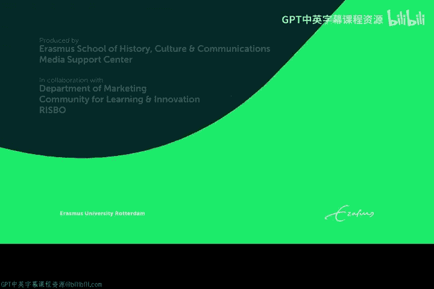

# 鹿特丹伊拉斯姆斯大学《严肃游戏｜Serious Gaming》中英字幕 - P13：12_案例研究：VSTEP仿真平台实践.zh_en - GPT中英字幕课程资源 - BV1axeUzbE3D

If you ever plan to visit Rotterdam in the future， I can definitely recommend that you include the port。

 It's a city in itself to give you an idea of the work in the harbour。

 our second case of this week will take you on board a tug masterster。

 The simulation game is developed by Festep a Rotterdam based company。😊。

VTEP's CEO Pioter Fhotorst will introduce a shoe to the professional training simulators that build for the maritime industry as well as for fire departments。

Just like the ABCD IM， the Tumaster simulation cannot be played at home。

 the series game requires a professional hardware setup， in this case。

 a huge one as you will see in the video。We want you to keep in mind， however。

 that professional training simulators and simulation games you play at home do have some things in common。

 they provide a safe and cost effective learning environment。Observation， interpretation。

 and interaction speed play an important part in both kind of simulations。

They need to be believable and convincing drawing the user into the virtual environment。

 they have game like features in particular a scoring and progression mechanism。

 and their design is such that it creates challenges that fit the learning ability of the user。

They both offer opportunities for competition in collaborative play and last but not least they are both fun to use。

 even though it's not necessarily a design objective of the professional training simulator。

Pter will explain how simulators are used in training and show you how these rather huge training simulators differ from simulation games you may play at home on your PC。

When people ask me about simulators， they often assume that they involve a large heart re receptor。

 like the one you see behind me。In this video， I will show you that this is not always necessary。

 we'll go through a definition of simulators and show you how they are used by our clients。Moreover。

 we'll show you the differences between the simulation games that you can play at home on your own PC and the professional simulators that are used in training centers。

At VTP， we develop maritime and incident command simulators。

Aritime simulators are similar to flight simulators。

 they consist of a replica of a shipbri used to train prospective captains and officers for their future job in a controlled learning environment。

Incident command simulators are virtual training systems that allow firefighting commanders to experience lifelike incidents and practice response actions without the time。

 dangers， and cost of traditional practical training。

Our client base includes schools for maritime or incident commander training。

 both public and company in house。A simulator is a system that replicates a piece of reality under controlled conditions。

Usually a complex machine， condition or process， or a combination of these。

The primary goal of a simulator is to provide a cost effective。

 structured and safe training or experimentation environment。Let me show you an example here。

 we see a so called full mission bridge chaimulator for a ship where bridge teams learn to cooperate and communicate effectively in stressful situations like port approach and or bad weather conditions or response actions to engine failures。

And here we see a simulator for firefighting commanders where a trainee is placed in an incident situation and needs to take the right decisions and actions。

 for example， what vehicles are needed， where do they get the water from。

 what actions should these men give priority， are there any victims， is there a risk of explosions。

 should the neighborhood be evacuated， etc？The first difference between the simulator games that you can play at home for fun and the professional simulators that are used for training centers in a professional setting is that the latter usually require big hardware setup。

A ship bridge simulator is used as a lower cost equivalent of a real ship。

So the simulator's bridge needs to look and function the same way as the one on a real ship。

Large flat panel screens mimic the ship's windows and show a situation that will be experienced in practice。

Secondly， a simulator in a professional setting is usually controlled behind the scenes by an instructor。

 He prepares the scenarios that will be trained， and he can play various roles during the exercise。

This instructor can adapt the training in response to the behavior of the trainees。

 He interacts with the trainees during the training and provides debriefing of the results afterwards。

A simulator game that you can play at home has the instruction role built in。

 This means that the software functions as the instructor。

 and you receive some basic feedback only on the PC screen。

This is much more limited in scope and value than what a human instructor can achieve。Also。

 when training in a professional simulator， there is always an after action review in which the actions of the users are analyzed and learning points are discussed in the group。

In a simulation game， the focus is more on the immediate personal experience than on the deeper learning value。

