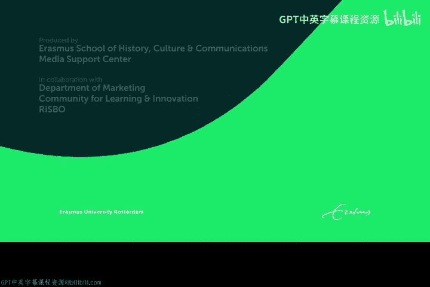

# 鹿特丹伊拉斯姆斯大学《严肃游戏｜Serious Gaming》中英字幕 - P14：13_案例研究：《RANJ认知训练系统》.zh_en - GPT中英字幕课程资源 - BV1axeUzbE3D

It's time to introduce you to this week's third and final case study。

We showed you that series games can have various forms and goals and that the game characteristics that we discussed earlier are all differently embedded to suit the purpose of the series game the best。

In our classification， simulation games can be found on one end of the spectrum。

 They provide an immersive and realistic experience you are transported to the emergency room or on board a tugmaster in the port of Rotterdam where you need to make decisions simulations help you trained for real life situations Will you be able to save your patients or guide a ship safely to the harbor。

😊，On the other hand of the spectrum， we've positioned gaification。

 this is Lucy taking gaming principles and embedding those in a learning environment。

 not necessarily a game。😊，This is how Rotterdam based game company NHnch applied gaming principles to steel production。

The game designers at EnHch deliberately stepped outside the confined environment of a series game by implementing gaming principles in the real world of steel production in order to improve the production process。

And Rach co owner Michael Boss is here in the studio and will present how they developed this interesting gamification project。

In our project at EnRnch， we almost always experience that play can achieve positive behavioral change。

This also happened when we started applying game principles to the steel production at Wermon St。

 Neland。Their ultra modern production facility is based in Murdch， the Netherlands。

 and has 133 employees。They produce steel coils that are welded in huge machines and run by teams of operators。

The actual welding is a precise and demanding task。

 Any mistake in the process has drastic consequences and is very expensive。

 Vperman was obviously keen to reduce the frequency of mistakes by improving their production process。

 so they got in touch with us。And it resulted in what we'd like to call an iterative approach of implementing small improvements。

 monitoring these improvements， and if necessary， adjusting them。In our meetings with Vuman。

 we designed an interactive solution based on gamification principles。

The gamification was as much concerned with the technical aspect as with the social ones。For example。

 how the employee' engagements could be improved。The cornerstone of our gamification project is the 40 inch interactive touch screen。

 it shows real time data about volume， quality and safety。😊。

Each shift of operators can see how many units they produced。

 how many of these units were of the highest quality， first time rides， and whether they met targets。

 and if any mistakes or accidents occurred。The visual and interactive aspects of the screen were tested by a reference group of employees to make sure this application would land well in their daily work routines。

The screen is on purpose located at an accessible area so that employees can check it out easily during or after the shift。

😊，The most important information is presented in bold colors and large font so that workers can see it when they walk by。

Getting more detailed information requires some interaction with the screen。

 which generally happens after a shift。The results of this project are very positive。

 The touchscreen has become a place for playful interaction。😊。

By giving immediate and relevant feedback， it clearly communicates superdion targets。

Its interactive features enable workers to discuss details informally。

The immediate access to real time data increases to workers insight in the production process。

The shifts can see the performance， discuss it， and very important。

 compare it with how other shifts have been doing。Additionally。

 the interactions with the screen has positive social consequences。Supplying， for example。

 by means of completing the work profile implies that colleagues get to know each other far better than before。

In short， we are confident that our gamification application at Wermans leads to more social interaction among employees。

 while at the same time increasing their engagement with the production process。

