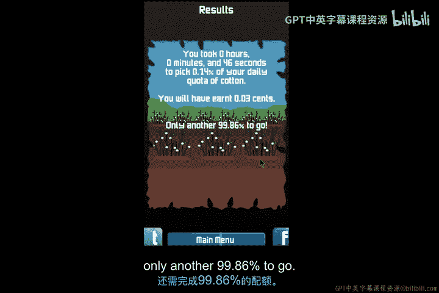

# 鹿特丹伊拉斯姆斯大学《严肃游戏｜Serious Gaming》中英字幕 - P15：14_玩家态度转变：说服性游戏设计.zh_en - GPT中英字幕课程资源 - BV1axeUzbE3D

Have you ever worked on a cotton picking field？Experiencing full days of hard work without any relaxation for very little money。

Probably not。In Uzbekistan， however， many people do。This situation is addressed in the serious game。

 my cotton picking life。Every year， people， including kids。

 are forced into picking cotton in Uzbekistan。We' then' wear that coffin in our clothes。

How hard is to work？Well， let's play。You need to pick 50 kilos of cotton to fill your daily quota。

Filled his bar to complete his 50 kilos of cotton。To pick some cotton， press the pick button。

And if you've had enough， you can end it by using this button。Okay， then I start picking。Right arm。

 left arm， right arm， left arm， then I go on， I pick and pick。But as you can see。

 picking cotton in this virtual world is quite a daunting task， actually it's quite boring。

 so I may need some time to relax。So let's see what I can do next oh。

 get on with it or you're in for a beating that's the voice of the bus coming in get on with it or you're in for a beating so I'm supposed to continue picking and here I go。

 pick， pick， pick， pick， pick， pick and I can go on and on and on on。

 but okay it's too boring I stop。It's okay for you。Quitting isn't a luxury these kids have。

You took zero hours， zero minutes and 46 seconds to pick a little bit of your daily quote off cotton。

 you will have earned a minimal amount of cents。Only another 99。86% to go。

What happened？I played a simple online game and when I stopped。

 I was given information about the topic addressed in the game。Actually。

 the game wanted me to stop playing to confront me with the lack of choice the child laborers face when they work on the cotton fields。

They are exploited and cannot stop。My cotton picking life is an example of a persuasive game。

The topic of this module。Persuasive games are made with the intention to change the player's attitude。

That is， the game designer wants to change how a person thinks and feels about the topic addressed in the game。

This module will present criteria that must be fulfilled in order to call a game persuasive。

We start with the game's rhetoric and its persuasive properties。

 but we will immediately add that understanding persuasion requires a focus on both the game and the player because the persuasive process unfolds exactly in the relation between game and player。

The insights we will share with you in this module are largely drawn from our National research project。

 Peruasive Gaing In contextext。The project is a collaboration between Erasmus University。

 Uret University， Anghoven University of Technology and two Dutch game developers。

 Ax Ftang and submarine， this guarantees a productive conversation between research and application。

The project is built on three pillars。The first one being gained theory about persuasiveness。

The second one being about design。At Ereromus University。

 we are mostly concerned with the third pillar， validating the impact of persuasive gangs。

But before we can address the impact of persuasive games。

 we need to discuss the rhetoric and properties of persuasive games and the process of persuasive communication。

A lot to discuss this module。Please。Move on to the next video。

