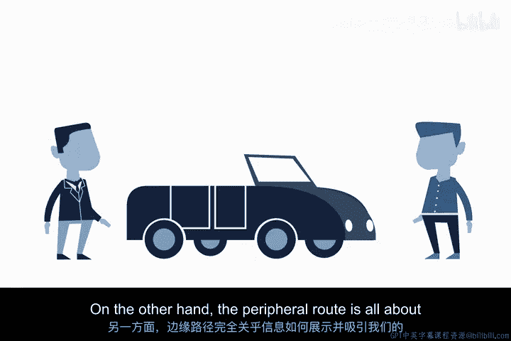
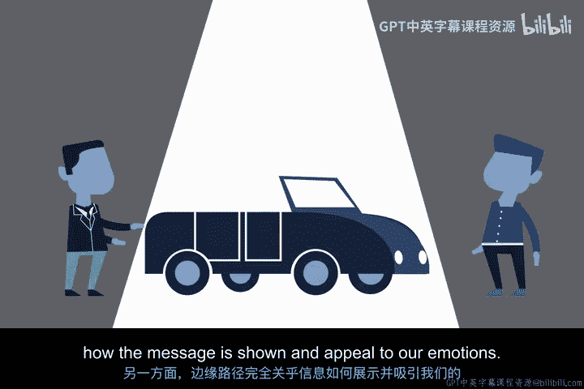
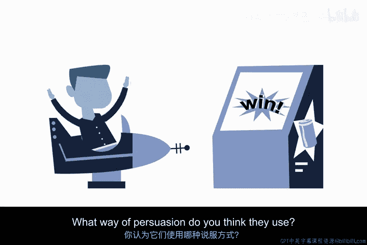
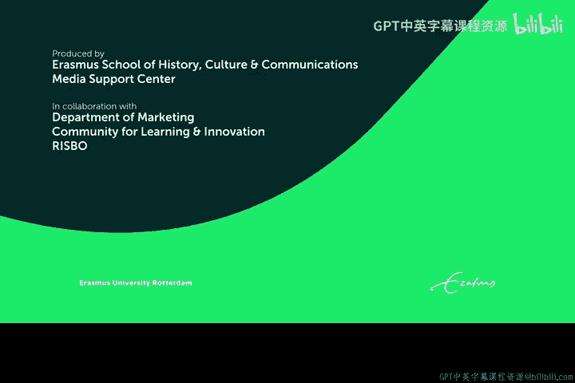

# 鹿特丹伊拉斯姆斯大学《严肃游戏｜Serious Gaming》中英字幕 - P17：16_说服的心理过程.zh_en - GPT中英字幕课程资源 - BV1axeUzbE3D

Welcome to our second lecture about persuasion。Now that we know how to define persuasion。

 we can concentrate on the communicative process。First， I will address the theory。Next。

 my colleague Ru Jacobs will translate the theory to persuasive gaming。

Different theories of persuasive communication have been proposed。We decided to focus on one。

Ptti and Cachopo's Elaboration likelihood model。ELM， in short。

It is a classical influential theory that also provides the framework for the research on persuasive gaming we are doing at the Erasmus University。

We will explain the ELM step by step。Elaboration likelihood refers to whether it is likely that a person exps on her thinking about an issue。

More precisely， to what extent she will elaborate on arguings regarding the issue。

Thinking about the issue might result in developing or changing her attitude。

ELM research has shown that there are two different routes through which a persuasive message can result in attitude to change。

A central one。And a peripheral one。The central route involves focused thinking about the issue。

It comes with a high level of elaboration resulting in a critical evaluation of the issue related information。

This central kind of thinking typically results in a well articulated attitude。

Persuasion via the peripheral route is far less profound。

It is rather concerned with the form of the message than with its issue related content。Hence。

 attitudes formed through the peripheral route are often superficial。

The next animation presents the two roots in a specific context of persuasion。

So imagine being a car salesman， you know selling cars Now。

 according to a scientific theory called the Elaboration likelihood model。

 there are two different ways to persuade a customer A whole hi the most obvious way is the so-called central route here we really think about the information were given take this car for example。

 six cylinders and over 600 horsepower for only Yep that is something right on the other hand the peripheral route is all about how the message is shown and appeal to our emotions So ladies and please get in the car this makes you feel like the king of the road doesn't it not only car salesmen but also serious games often try to persuade us Of course they give us a lot of information but at the same time they are also fun to play So what way of persuasion do you think they use。

So the question is clear， what way of persuasion do you think persuasive games use？Yes。

 this is a difficult question， we will develop our answer step by step。

Playing the game or more precisely its procedural rhetoric inites players to elaborate on their thinking about the issue addressed in the game。

Highly intense games that are fast pace and difficult may require so much thinking capacity for completing the game that players have few cognitive resources left to elaborate on the issue addressed in the game。

On the other hand， slow and pensive games that often come without time restrictions are for players ample time to concentrate on the message。

 thus increasing the opportunities for elaboration。However。

 this kind of persuasive game could become so boring that players are not motivated at all to start thinking about the message in the first place。

What about the peripheral route？In the animation， the car was presented in an attractive light to incite positive feelings in the client。

Research has shown that a good mood increases people's openness to new messages。

 it was also found that it might result in an intention to buy stuff。

Persuasive games offer ample opportunities to present the message in an attractive way。

It is not a coincidence that persuasive games often have funny characters。

 bright and colorful graphics， and joyful music。These elements all appeal to peripheral processing and are meant to result in a positive feeling with respect to the game and its message。

One could even argue that the creativity of designing persuasive games is all about packaging serious information in a playful manner。

In short， we argued that persuasive games youth boast both the central and peripheral route to realize their goal。

 that is inciting or changing an attitude regarding the issue addressed in the game。As a final note。

 we would like to stress two things。First， that the distinction between the central and peripheral routes is an analytical one。

This means that we can tear them apart in the analyses。

 but we should keep in mind that the roots are merged when the game is played。

Because all information in the game emerges through playing with the funny characters in the bright and colorful game environment。

Next， we must keep in mind that research applying the elaboration likelihood model to persuasive gaming is in its infancy。

Now we would like to invite you to our next lecture that presents an analysis of three cases。

