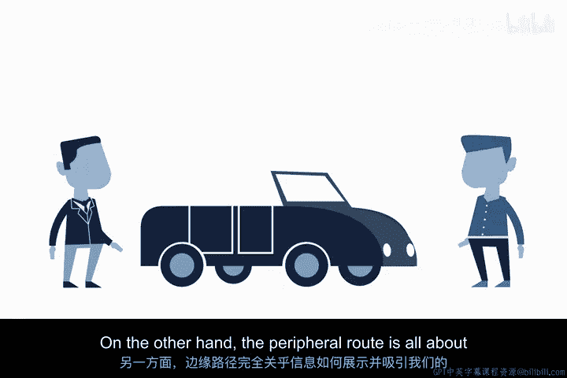
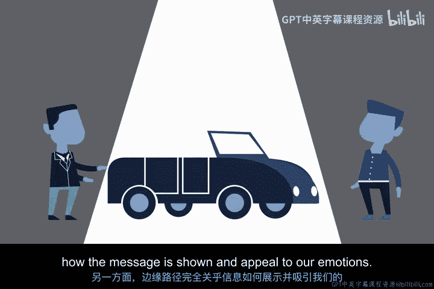
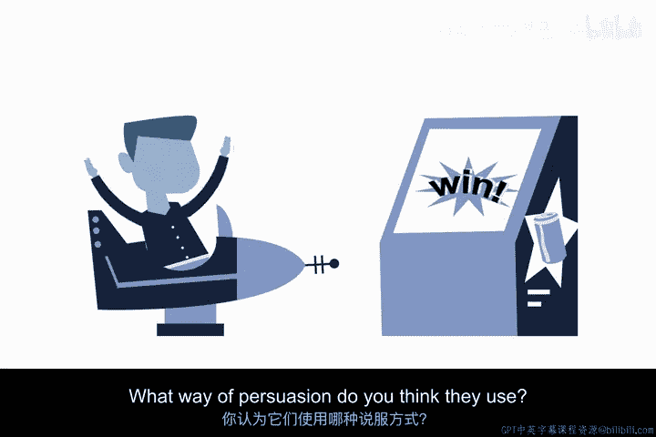
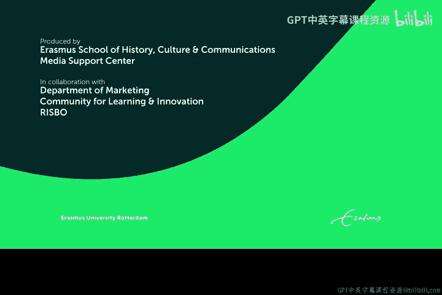

# 严肃游戏：P17：说服的心理过程

在本节课中，我们将要学习说服性沟通的核心理论——精细加工可能性模型（ELM），并探讨它如何应用于严肃游戏的设计与分析。我们将了解说服发生的两种不同路径，以及游戏如何巧妙地结合这两种路径来影响玩家的态度。

## 理论介绍：精细加工可能性模型（ELM）

欢迎来到关于说服的第二讲。既然我们已经知道如何定义说服，现在可以专注于沟通的过程。首先，我将介绍理论。接下来，我的同事Ru Jacobs将把这一理论转化到说服性游戏的应用中。

关于说服性沟通的理论有很多。我们决定聚焦于其中一个：佩蒂和卡乔波提出的**精细加工可能性模型**（Elaboration Likelihood Model，简称 **ELM**）。

这是一个经典且具有影响力的理论，它也为我们在伊拉斯姆斯大学进行的说服性游戏研究提供了框架。

我们将逐步解释ELM。“精细加工可能性”指的是一个人是否可能对其思考的议题进行深入加工。更准确地说，是指她将在多大程度上对与议题相关的论点进行精细思考。对议题的思考可能导致她形成或改变态度。

## 说服的两条路径

ELM研究表明，说服性信息可以通过两条不同的路径导致态度改变：一条是**中心路径**，另一条是**外围路径**。

*   **中心路径**涉及对议题的集中思考。它伴随着高水平的精细加工，导致对议题相关信息进行批判性评估。这种中心化的思考通常会产生一个阐述清晰、根基牢固的态度。
*   通过**外围路径**进行的说服则远没有那么深刻。它更关注信息的形式，而非其与议题相关的内容。因此，通过外围路径形成的态度往往是肤浅的。

下面的动画在一个特定的说服情境中展示了这两条路径。

> （动画内容：想象你是一名汽车销售员。根据精细加工可能性模型，有两种不同的方式来说服顾客。最明显的方式是所谓的“中心路径”，我们真正思考所给的信息，例如“这辆车有六个气缸，超过600马力，价格仅需……”。另一方面，“外围路径”则完全关乎信息如何呈现并诉诸我们的情感，例如“女士们先生们，请上车，这让你感觉像公路之王，不是吗？”不仅汽车销售员，严肃游戏也常常试图说服我们。它们当然会提供大量信息，但同时它们也很有趣。那么你认为它们使用哪种说服方式呢？）

## 严肃游戏如何运用说服路径？

问题很明确：你认为说服性游戏使用哪种说服方式？是的，这是一个难题，我们将逐步展开我们的答案。

上一节我们介绍了说服的两条路径，本节中我们来看看严肃游戏如何运用它们。

玩游戏，更准确地说，是游戏的**程序性修辞**（procedural rhetoric），会促使玩家对他们所思考的游戏议题进行精细加工。

*   高强度的游戏，节奏快、难度大，可能需要玩家投入大量思考能力来完成游戏任务，以至于玩家几乎没有剩余的认知资源来对游戏中的议题进行精细思考。
*   另一方面，缓慢而需要深思的游戏通常没有时间限制，这为玩家提供了充足的时间来专注于信息，从而增加了精细加工的机会。然而，这类说服性游戏可能会变得非常无聊，以至于玩家从一开始就没有动力去思考其中的信息。

那么外围路径呢？在动画中，汽车被置于诱人的灯光下展示，以激发客户的积极情感。研究表明，好心情能增加人们对新信息的接受度，也可能导致购买意向。

说服性游戏提供了大量机会，以有吸引力的方式呈现信息。说服性游戏通常拥有有趣的角色、明亮多彩的图像和欢快的音乐，这并非巧合。这些元素都诉诸外围加工，旨在让玩家对游戏及其信息产生积极感受。甚至可以说，设计说服性游戏的创造力，就在于以游戏化的方式包装严肃的信息。

## 总结与注意事项

总而言之，我们认为说服性游戏同时运用了中心路径和外围路径来实现其目标，即激发或改变玩家对游戏所涉议题的态度。

作为最后的说明，我们想强调两点：

1.  中心路径与外围路径的区分是分析性的。这意味着我们可以在分析中将它们分开，但应记住，在游戏实际被游玩时，这两条路径是融合的。因为游戏中的所有信息都是通过在与有趣角色互动、在明亮多彩的游戏环境中游玩而呈现的。
2.  我们必须记住，将精细加工可能性模型应用于说服性游戏的研究尚处于起步阶段。

本节课中，我们一起学习了说服性沟通的精细加工可能性模型（ELM），理解了中心路径与外围路径的区别，并探讨了严肃游戏如何综合运用这两条路径来影响玩家。现在，我们邀请您进入下一讲，那里将对三个案例进行分析。

