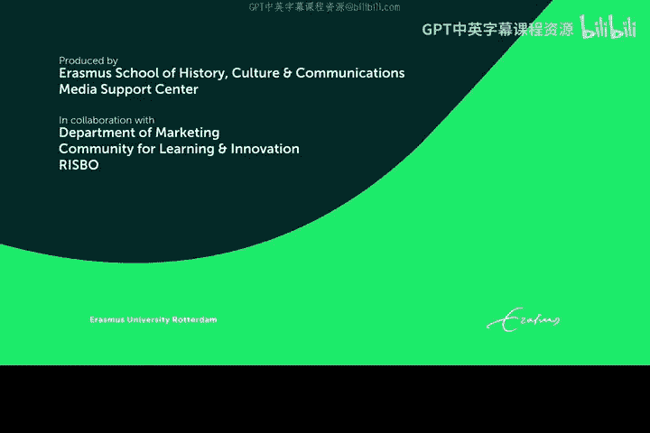

# 鹿特丹伊拉斯姆斯大学《严肃游戏｜Serious Gaming》中英字幕 - P18：17_案例研究：三类说服性游戏解析.zh_en - GPT中英字幕课程资源 - BV1axeUzbE3D

This week has been quite heavy in theory。So far， you've learned that series games require specific features to become persuasive。

We also argued that persuasion is a communicative process unfolding in the act of play。Again。

 can teach you something by providing direct information about something。

 the central root of persuasion or persuade you to change your behavior by adding emotional music or attractive or relatable characters。

 The peripheral route of persuasion。 Now， we return to the features of persuasive games。

 Their procedural rhetoric is concerned with rules enabling the player to experience the real world issues addressed in the game。

😊，One could argue that the rules are the backbone of the game。

 but to understand an nuances of how a game can persuade its players better。

 we will provide you with three different cases this week。😊，Our former colleague Ruth Jacobs。

 currently working at University of Tina， wrote his PhD about persuasive games and knows all about this topic。

 he'll present a model to analyze persuasive features and apply this model to 3K studies。

 a game about poverty， a game about autism， and a game about gun control。

I'm sure these cases will help you to understand the theory better。

As you start playing a persuasive game in your browser。

 you will immediately experience how the designer decided to present the game's content。

You'll see graphics， hear music， and read pieces of text while playing。

 you are generally drawn into a story。Graphics， music。

 text and story are a few examples of game fieds， but there are more。

The range of persuasive game features is rich and can be analyzed at different levels。Therefore。

 we need a model to grasp the feature's complexity。In our persuasive Ga in contexttext project。

 we employed Thereesa D Laherra's conceptual model of persuasive dimensions。

The model distinguishes persuasive features across three levels， signs， systems， and contexts。

The level of signs at the inner ring covers the visual， linguistic， auditory。

 and even tactile stimuli， incorporating all of the information that reaches the players across the sensory modalities of seeing。

 hearing， and touching。On the system level， persuasive strategies establish meaningful ties between the signs and are divided into narrative。

 cinematic and procedural persuasion in the model's middle ring。

These dimensions cover the way a game's interplay of signs and structure can create a persuasive argument based on the story of the game。

Persuasion might also be used in the game's cinematic features。

 that is the player's perspective in the game。For example。

 the difference between a first person perspective or a bird's eye view。

The game's procedural rhetoric is also part of this level。

The third level context focuses on how players experience the game。

 so this level of persuasion occurs when the game is actually played。

Social persuasion describes to what extent players are triggered to play with others or to talk to others。

Effective persuasion is concerned with the emotions a gay may have O players， for example。

 when they identify with a character。Since oral persuasion is about the sensory experience。

 the game aims to trigger in players tactical persuasion finally is related to the game's challenges。

When players need to invest more effort in completing the game。

 we may assume that this goes hand in hand with a focus on the game's message。

The differentiation between the levels of sign， system。

 and context underlines the holistic nature of the model as it represents both the game's features and how these are experienced in play。

The model aims to be comprehensive， highlighting the different ways a game can attempt to persuade players In practice。

 games employ several methods simultaneously。To show you how this works。

 I will analyze the most important features of three persuasive games using the Laherras model。

Poverty is not a game， in short， ping is our first case to discuss。

Ping is a 3D role playing game about individual poverty。

 wherein players guide a poverty stricken teen boy or girl through the process of finding a job。

 a house， and getting education。At the level of sign and system。

 linguistic and narrative persuasion are prominent。

 which is understandable because ping's backst is communicated only in text。

Visual persuasion is interesting in Ping。 The game's message is definitely not communicated through how the characters look。

 they are cool kids， not looking tired， grimy or even unhappy while the game is being played。

The second case is Asim。 The game aims to give players a sense of what autism feels like。

 The message is forcefully communicated at the sign level by using sounds and visual effects to control what players do by blurring the screen and using overly loud noise。

These effects show the character's internal state at the system level。

 its procedural persuasion amounts to keeping players from approaching other people in the game。

In this way， the game makes players act like an autistic childm in an over a crowdrowed playground。

 either feeling very uncomfortable from the overstimulation or seeking out quiet areas。

 freely from others。The best Amendment is concerned with gun violence in the United States。

At the sign level， linguistic persuasion is used by interspersing combat scenes with quotes from program activists in the National Rifle Association。

Visually and orally， the best amendment seems to be designed for shock value。

 characters bleed after being shot， for instance。The player's character is a conical white figure invoking images of Ku Klux Klan robes。

This racist connotation is actually made explicit as the enemies the player shoots are black cones。

 and the game's music consists of frantic banjo riffs。Procedural persuasion is well developed。

 showing that acting violently only makes situations worse。However。

 by making the behavior that they want players to reflect on， so engaging and so much fun。

 this game's message might go over people's heads。Comparing our three cases。

 we see that Ping's emphasis on narrative persuasion is close to traditional persuasion。

 much like a documentary。Artan's mimicking of the autism experience is procedural rhetoric at its purest。

 even leaving out goals and other really gamelike elements。

The best amendment then acts as a sort of warning that it's easy to make players miss the message if you do not balance our presentation and procedural rhetoric。

Of course， in this case， this is mostly because the creator intended the game to be satire。

With this lecture， we completed the module in which we explained and illustrated how persuasive games could fulfill their function。

 In the next module， we discussed the complex issue of the game's impact。

