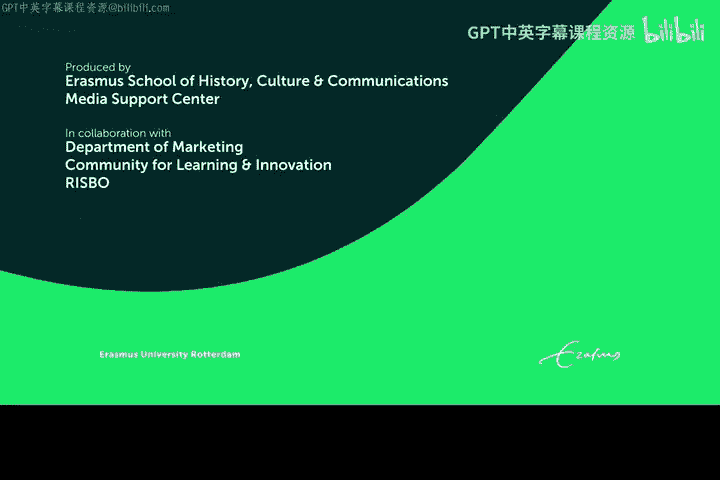

# 鹿特丹伊拉斯姆斯大学《严肃游戏｜Serious Gaming》中英字幕 - P19：18_严肃游戏的实际影响力.zh_en - GPT中英字幕课程资源 - BV1axeUzbE3D

Have you ever lost a video game and felt frustrated about it。

Or did you feel very happy when you beat your brother， a sister or friend in a board game。😊。

This can be seen as a simple form of impact that playing games can have on us。

 They can have an effect on our mood and usually for a short period of time。

Game researchers understand impact in a more complex way。

 They try to determine the effects games can have on the ideas， intentions or behavior of players。

 both immediately after playing， but also after a longer period of time。

In previous modules of this MOoc， we talked about the goals developers of series games have。

They use simulation games to train complex behaviors and persuasive games to get a message across。

Developers of a for games want players to buy their products or think in a more positive way about a brand。

😊，But do these serious games actually have the intended effect。 For example。

 does the inclusion of the ABC D Sim in medical training result in more accurate behavior in the emergency room。

Or does playing the Uber game increase awareness of the dark side of the sharing economy。

In this module， we'll discuss the impact of games with you and address the difficulties of actually measuring this impact。

Now， why is it important that you understand something about these impact issues？ Well。

 Sears games are designed to bring about a certain learning outcome。

 but are relatively new and still require a pretty big investment in development costs。

Many organizations thus want some proof of the effectiveness of serious games。

If you want to show the effectiveness of games， you need research。

 And if you want to interpret these research results。

 you need to understand the underlying methods and complexities to be able to put things into perspective。

That's why we have two videos and one short animation lined up for you。In the next。

 we'll briefly go over some of the difficulties when it comes to measuring the impact of games。

This is necessary to get you up to steam about more practical issues of doing game impact research and understand the context of these types of studies when you hear or read about research results。

The animation video will sum up these issues for you。

 and then we'll get more practical and address some real results of impact studies that we have conducted at our Department of Media and Communication at the Erasmus University of Rotterdam。

😊，Several of my colleagues will join us in a roundtable discussion on the topic。That way。

 you'll get some more practical insights into the impact of series games。One tip。

If you're very interested in the methods of games research。

 we can offer you two additional videos in which Professor Y Youngs， Dr。 Rich Jacobcos， Dr。 Rons Ris。

 and Joyce Ns will explain the complexities of experimental and survey research in more detail。😊。

We recommend them， if you are， for example， interested in doing your own research。

 and you'll find them at the end of this module now。😊，Let's move on to the next video。

