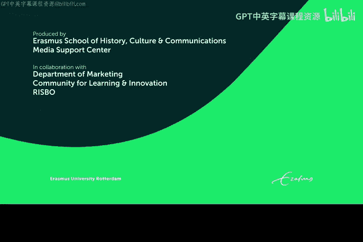

# 严肃游戏：P19：18_严肃游戏的实际影响力

## 概述

在本节课中，我们将要学习严肃游戏的实际影响力。我们将探讨游戏如何影响玩家，以及研究人员如何衡量这种影响。理解这些内容对于评估严肃游戏的有效性至关重要。

你是否曾在输掉电子游戏后感到沮丧？或者，当你在棋盘游戏中击败了你的兄弟、姐妹或朋友时，是否感到非常开心？😊

这可以被视为玩游戏对我们产生的一种简单形式的影响。游戏可以影响我们的情绪，并且这种影响通常是短期的。

游戏研究者以更复杂的方式理解“影响力”。他们试图确定游戏对玩家的想法、意图或行为可能产生的影响，这种影响既可能在游戏结束后立即显现，也可能在更长的时间后出现。

在之前的MOOC模块中，我们讨论了严肃游戏开发者的目标。他们使用模拟游戏来训练复杂行为，使用说服性游戏来传递信息。广告游戏的开发者则希望玩家购买他们的产品，或者对某个品牌产生更积极的看法。

😊，但是，这些严肃游戏是否真的产生了预期的效果？例如，在医学培训中加入ABCD模拟器，是否会导致急诊室中更准确的行为？或者，玩《优步游戏》是否会增加人们对共享经济阴暗面的认识？

在本模块中，我们将与您一起讨论游戏的影响力，并探讨实际衡量这种影响力的困难。

## 理解影响力研究的重要性

现在，为什么理解这些影响力问题很重要？严肃游戏旨在带来特定的学习成果，但它们相对较新，并且仍然需要相当大的开发成本投入。因此，许多组织希望获得严肃游戏有效性的证明。

如果你想展示游戏的有效性，就需要进行研究。如果你想解读这些研究结果，就需要理解其背后的方法和复杂性，以便能够客观地看待问题。

这就是为什么我们为您准备了两段视频和一个简短的动画。在接下来的内容中，我们将简要介绍衡量游戏影响力时遇到的一些困难。这对于让您了解进行游戏影响力研究的实际问题，以及在听到或读到相关研究结果时理解这类研究的背景是必要的。

动画视频将为您总结这些问题。然后，我们将更实际地探讨我们在鹿特丹伊拉斯姆斯大学媒体与传播系进行的一些影响力研究的真实结果。

😊，我的几位同事将加入我们，就这一主题进行圆桌讨论。这样，您将对严肃游戏的影响力获得一些更实际的见解。

**一个提示**：如果您对游戏研究方法非常感兴趣，我们可以为您提供两个额外的视频。在这些视频中，Y Youngs教授、Rich Jacobcos博士、Rons Ris博士和Joyce Ns将更详细地解释实验和调查研究中的复杂性。😊

如果您有兴趣进行自己的研究，我们推荐您观看这些视频。您可以在本模块的末尾找到它们。

现在，让我们进入下一个视频。

## 总结

本节课中，我们一起学习了严肃游戏影响力的概念、研究其重要性的原因，以及衡量影响力所面临的挑战。我们了解到，游戏不仅能短暂影响情绪，还可能对玩家的认知和行为产生长期影响。为了证明严肃游戏的有效性，需要进行严谨的研究。在接下来的内容中，我们将深入探讨这些研究的具体方法和发现。