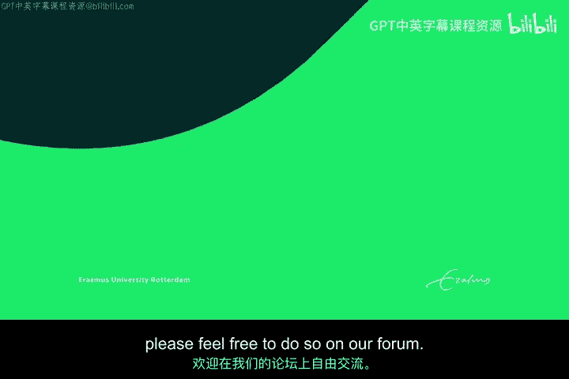

# 鹿特丹伊拉斯姆斯大学《严肃游戏｜Serious Gaming》中英字幕 - P1：0_对本课程的预期学习成果.zh_en - GPT中英字幕课程资源 - BV1axeUzbE3D

What do you think when I say game。Maybe you remember the fun and relaxation of playing outside when you were a kid。

 or maybe the pleasure of playing a board game with your family。😊。

Or the excitement and frustration of playing video games with your friends。Games can be all that。

 fun， relaxing， pleasurable， exciting or frustrating。😊。

Games are not only there to pass our time in a pleasant way。Games can also teach us certain things。

 For example， when you play a video game， you train your hand， eye coordination。😊。

A game of chess helps you develop your strategic abilities。

 Since you're having fun or are being challenged， maybe you won't even notice that you're actually in the process of learning。

😊，Some gains are deliberately designed with an educational goal of mind。 For example。

 there games informing you about environmental issues or confronting you with the dangers of texting while driving or teaching you how to deal with a particular disease。

 such as diabetes。😊，We call those games serious games。

Although it's a great idea to learn something about playing a game。

 there are also still a lot of unanswered questions。What exactly are these games？

Why do we enjoy playing them and how exactly do they affect our behavior。

An increasing number of researchers are analyzing serious games。

 they try to uncover what characteristics they have and how and why people play them。

They also attempt to uncover the impact of serious games， which is a complex issue。In this course。

 you'll learn the ins and outs on a topic of serious games。Let's get things straight。

 We will not instruct you how to design a game。 We are not game designers。

But you will increase your expertise on the underlying mechanisms of series games and encounter some of the latest theories and research on。

 for example， the enjoyment of playing the persuasive properties of series games and impact issues the coming weeks。

 you will become more knowledgeable in this area， which might help you， if you are， for example。

 a professional interested in the possibilities these game offer。

 or if you want to know more about the impact series games can have。😊。

Maybe you're thinking about implementing a serious game yourself。

And if you are a student and you're considering to study media such as series games。

 this will be an interesting introductory course for you。In any case。

 we will be happy to share our knowledge with you。Our chorus is divided into six weeks。Each week。

 we offer you theory about series games in short video lectures。

 You'll see us in these videos and also some of our colleagues from Erasmus University， Rotterdam。

 they are doing research on the topic of series games and all have their own expertise。😊。

At the end of each week， we also offer you additional sources so you can deepen your knowledge if you wish by reading articles and books on the topic。

 but this is of course voluntary， you will not be tested on that knowledge to help you understand the content of this course better every week we show you a practical case study in which the theory is applied。

😊，We have some very interesting examples lined up for you。 Some international games。

 Some games developed by game developers in Rotterdam。 Of course。

 will also invite you to play some serious games yourself。

 It will be easier to grasp the ideas that we discuss。 If you have some experience playing。

 and let's not forget that it's also fun。 On a more serious note。

 we will test your knowledge throughout the weeks by offering assignments。

 These are good ways for you to check if you have mastered the most important concepts and theories。

 We know from experience that we have many different types of learners in this course。

 Some of you will go through the whole course step by step and complete all assignments。

 Much like games completing all levels of a game。 And， of course， we think that's great。

 But that's not the only way。 Some of you will be more casual learners。 In that case。

 you just cherry pick the topics that you're interested in。 such as persuasiveness or。😊。

Or impact issues or maybe you only want to check the case studies。In that case。

 use our course as a restaurant menu that you choose from。

We will now show you the most important topics that we discussed throughout the weeks。

 So you're better informed when you want to select particular topics from our menu。

If you are interested in what series games are， how you define them。

 and what sets them apart from automedia products， check the first week。

We recommend everybody to use this week as a starting point because it provides a solid base for understanding the rest of the correspond content。

We also have an interesting case study that week discussing a serious game that you can also easily check out yourself。

After this introductory week， we will dive deeper in the psychology of play and games in week 2。

So if you're interested in the answer to the question， why we like to play games。

 check out that week。😊，We take both a philosophical and a psychological perspective。

The case study this week is a game that is developed by a game company from Rotterdam。

 convincing people to leave their cars at home when they commute。 As you can imagine。

 there are many different types of series games。😊，Do you want to understand the variety of the field and the possibilities that series Game offer in these different sectors？

Take a look at our third week。 We will explain that are many different types of series games。

From very simple elements of gaming in an educational context to full fledged simulations of professional trainings in durations。

And they all require different skills from game developers as well as from gamers。To illustrate this。

 we do not offer you only one case study， but three In the first three weeks。

 this course offers you basic knowledge of what series games are， their characteristics。

 some game theory and the different types of series games that are out there。

If you want more in depthth understanding， are not afraid of theory and are interested in how games actually convince us to change what we think or do。

 week 4 is the week for you。We dedicate this week to the persuasiveness of serious games and also in this week we offer you plenty of case studies to make it easier to understand the theory After four course weeks。

 you will probably wonder what impact series games can have。Do they actually work。

 Do they convince us to change our mind about something， And how can we actually research that。

This is one of the more complex topics of this course， and we will address it in week five。

To help you grasp the difficulties that researchers face when studying an impact and to show you what we actually know about impact。

 we have asked our colleagues working in game studies to come to the studio。In a talk show setting。

 they will explain the most pressing issues to you。In the final module。

 it's time to look back and forward。 we will connect all the dos of the previous weeks and go over the lessons learned with you。

 We will close this course with a sneak peek into the possible future of serious games by telling you something about two newer technologies that are used for games。

 augmented reality and virtual reality This was our serious games menu。😊，Hopefully。

 this video has given you enough insights to make your personal choices。

 which weeks to dive into have a great time， and if you have any questions or issues you want to discuss。

 please feel free to do so on our forum。😊。

