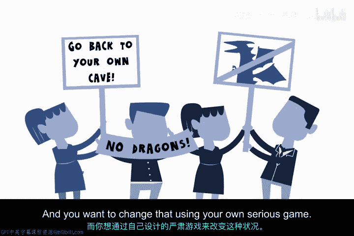
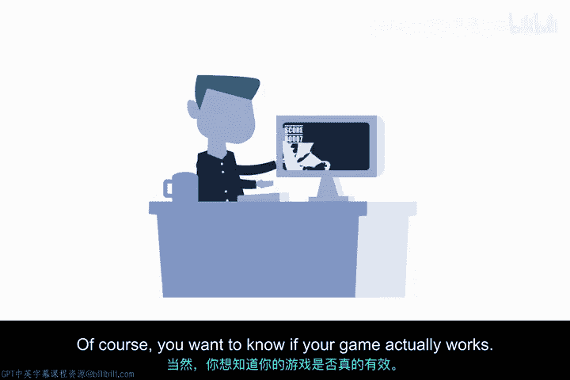
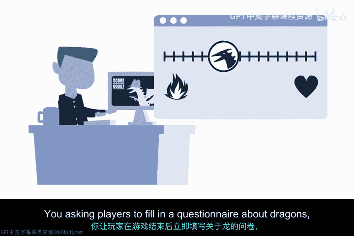
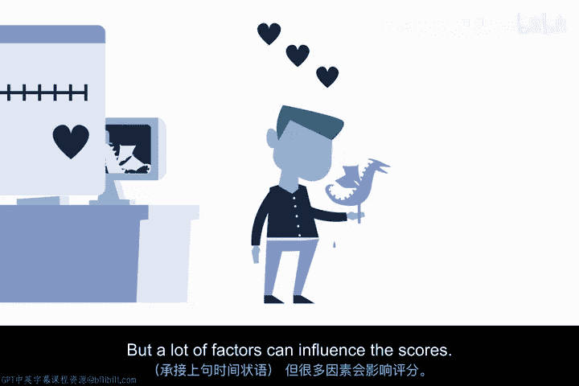
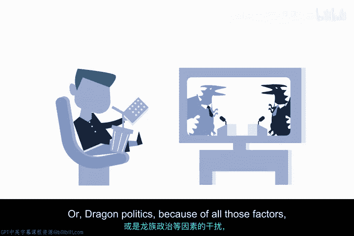
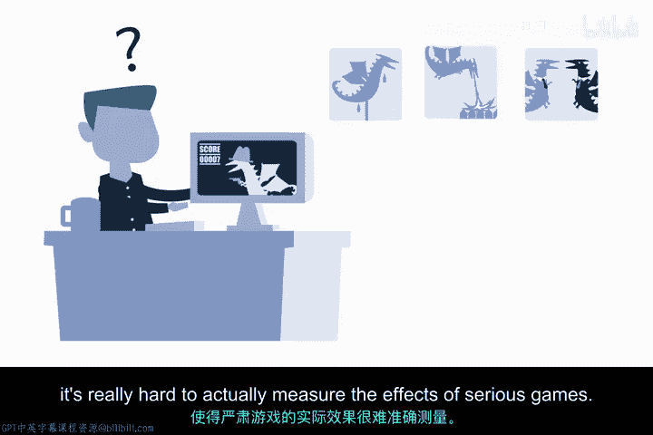

# 鹿特丹伊拉斯姆斯大学《严肃游戏｜Serious Gaming》中英字幕 - P21：20_动画演示：严肃游戏影响力度量的复杂性.zh_en - GPT中英字幕课程资源 - BV1axeUzbE3D

Unfortunately， not everyone likes dragons and you want to change that using your own serious game Of course you want to know if your game actually works First。

 the effects in the short term you ask players to fill in a questionnaire about dragons right after playing。

 but a lot of factors can influence the scores Dr ice cream measuringas long term effects is even harder people。

 their opinions are changed by， for example， different messages or dragon politics because of all those factors。

 it's really hard to actually measure the effects of serious games。

