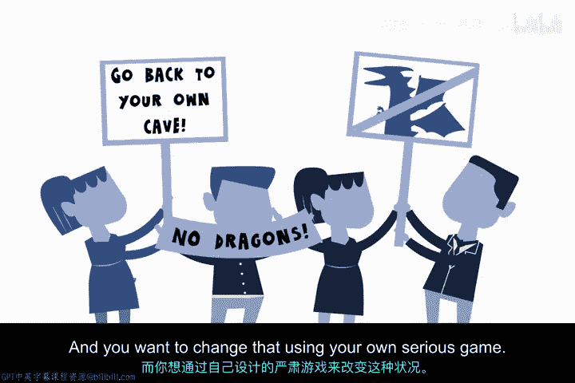
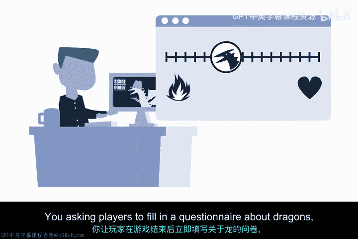
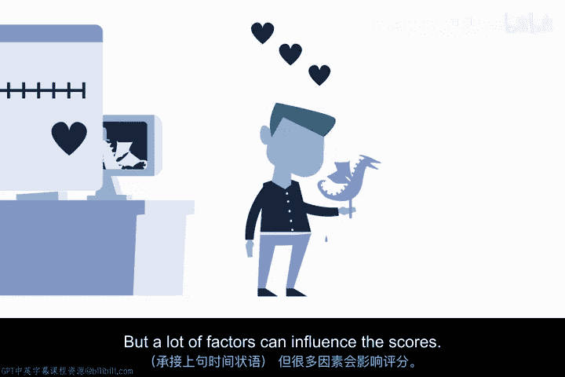
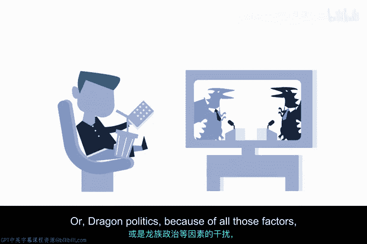
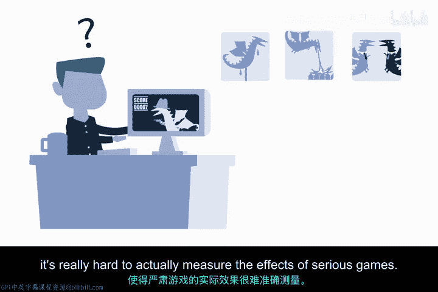

# 严肃游戏：P21：动画演示：严肃游戏影响力度量的复杂性 🐉📊

在本节课中，我们将通过一个关于“龙”的案例，探讨评估严肃游戏实际效果的复杂性。我们将了解为何准确衡量游戏对玩家的短期和长期影响是一项充满挑战的任务。

---

并非所有人都喜欢龙，而你希望通过自己设计的严肃游戏来改变这一现状。当然，你需要知道你的游戏是否真的有效。

首先，为了评估**短期效果**，你可以在游戏结束后立即请玩家填写一份关于龙的问卷。然而，许多因素都可能影响问卷的得分。

**测量长期效果则更加困难**。人们的观点会随时间改变，例如，受到不同信息或“龙类政治”等因素的影响。

正是由于这些复杂因素，准确衡量严肃游戏的真正效果变得极具挑战性。

---

上一节我们介绍了影响力度量面临的基本挑战，本节中我们来看看具体有哪些因素在起作用。以下是可能影响测量结果的几个关键因素：

1.  **即时反应偏差**：玩家在游戏刚结束时的情绪或新鲜感可能影响问卷回答，这未必反映其真实、稳定的态度变化。
2.  **外部信息干扰**：在测量长期效果时，玩家可能接触到游戏之外关于“龙”的正面或负面信息，从而混淆了游戏本身的效应。
3.  **社会与政治背景**：如同案例中提到的“龙政治”，现实世界的社会讨论、舆论风向等宏观因素会持续塑造玩家的观点。

---

本节课中我们一起学习了评估严肃游戏影响力的核心难点。我们了解到，由于存在即时反应偏差、外部信息干扰以及复杂的社会背景等多重因素，要清晰、准确地分离出严肃游戏对玩家态度和行为的**因果效应**（`Causal Effect`）是非常困难的。这要求研究者和设计者在评估时需采用更严谨的方法（如控制组对比、长期追踪等），并谨慎解读结果。