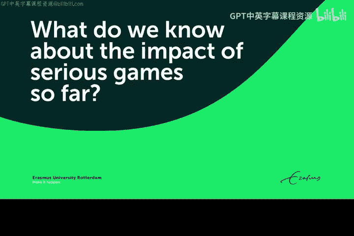
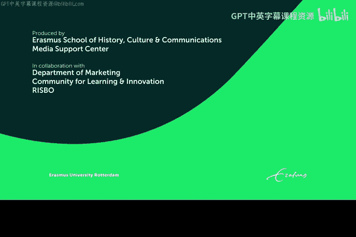

# 鹿特丹伊拉斯姆斯大学《严肃游戏｜Serious Gaming》中英字幕 - P22：21_圆桌讨论：当前严肃游戏影响力研究的共识.zh_en - GPT中英字幕课程资源 - BV1axeUzbE3D

Serious game developers try to teach players something。 They want to have an impact on the knowledge。

 attitude or behavior of people。 But why is it so difficult to study this impact。

 And what can state of the art research tell us about it With me in the studio， Doctor Julia Neer。

 Doctor Thereesa de La Era from Erosmus University and Doctor Ho Jacobs of the University of Tina。

 They're all game researchers， but working from different scientific perspectives。

 This is the roundtable on the impact of serious games。😊，あ好好好。

Thereesa and Julia， welcome to the studio。 Let's start by addressing an issue that many of our learners have when it comes to the impact of games。

 As we've seen this week， there's a lot of research about the impact of violent entertainment games and how they affect behavior。

 But there are lots of contradicting theories there。 The results are inconclusive。😊。

We could actually only conclude that we don't know what the impact actually is。Now。

 also serious game developers， they need to answer these questions。 You know。

 they need to see what impact their games have， whether they contribute to learning something to understanding an issue。

 So they're concerned with a potential positive impact that our games have。

 Can we conclude from entertainment game research that also in the serious games domain impact is not proven。

Well， first of all we need to differentiate a little bit about these nonpro and effects。

 this is absolutely true for violent games and the question， however。

 for entertainment games and positive effects such as recovery from stress or becoming coming into a better mood。

 these effects are given， and that is the interesting part and this is also really important for serious games。

But of course， entertainment games have the goal to entertain and serious games have a different goal。

 they need to teach or change attitude， change even behavior。

 And this becomes more interesting and more pressing When we think about that many of the serious games are commissioned by third parties such as Ngos like Greenpeace。

 and they， of course， have a different goal like， for example。

 to change attitude towards climate change。 All right serious games are absolutely in a better position to talk about impact because of the intent behind their design。

 to answer your question in a different way， make I would say that the evidence for the impact of serious games。

 it looks a lot healthier than the evidence for the impact of violent games。

 It's true that some serious games do not really work as they are intended。 But over time。

 we've seen that many of my colleagues are finding consistent but small effects of serious games on players attitudes and our behaviors and on knowledge。

For example， the game spent， which was tested by Dana Rojiro。 It's a game about homelessness。

 And when comparing this game to a text， Dana Rojiro found that the game was way more effective in changing attitudes towards the homeless than the text did。

 and this effect was also there even after three weeks。 So after three weeks。

 people were still thinking about the homelessness issue because of this game。

 and the people who read the text did not。So I would even say that we're at a stage where we can move away from testing individual games and start thinking about testing persuasive strategies to be used within games and other kinds of series game design strategies so that we can give concrete advice to game designers so that they can make a game that fits with the message that they want to bring out All right。

 so Sierras games are actually designed for impact that's the main difference with entertainment games。

And if I understand you correctly correctly， research can actually help designers in this。

 in this process， right。Well， we already discussed persuasiveness previous week。 Thereesa。

 you just published a book， the digital gaming and the advertising landscape。

 It's about the potential of games as media for persuasion。

 Can you tell us something about how they are actually designed to achieve this serious goals that they have。

 Yeah， what I explain in my book is that there are multiple elements in the game。

 I call them persuasive dimensions that we can use to persuade players to achieve a specific series goal。

 So my claim is that all these elements in the game。 for example。

 the visual design of the characters， the sound or the music that we select the storyline or the rules。

 everything is something that we can use to convey information to the player。

 So how exactly we combine all these elements to achieve a specific serious goal。

 This is what I call a persuasive strategy。 So there there's the strategy。

 the persuasive strategy that's very important。Con of different elements that you can use。

But how can we identify what is actually a good， persuasive strategy。That is a good question。 Well。

 I could say that a good persuasive strategy is a strategy in which all the elements in the game where design thinking or having the serious goal in mind because serious games have an engagement goal and a serious goal we want to make sure that the serious message get through。

 but we also want to make sure our players are engaged right and sometimes what happens is that we introduce an element in the game only thinking about the engagement purposes。

 but we forget about the serious purposes a good example is， for example。

 a game in which we have a text that players have to read in order to get the serious message but also is there is a time limitation that is introduced in order to increase engagement the chances are high that our players are not going to read the text because they are feeling the time pressure。

Right， and this is because the time limitation was introducing there only having the。

 the engagement goals in mind。 and they completely forgot about the serious goals in that case。

 Alright， so the impact not only it depends on the persuasive elements， right。

 but it also really depends on engagement， you need to be into the game to actually make it work。

It seems from what you're telling me that games are more suitable than other media products I to achieve impact。

 maybe they even have more impact。 why do players experience serious games so much differently than just watching。

 for example， a YouTube video。I wouldn't say that this is the same for the entire medium， right。

 So my answer only reflects the kind of games that I've studied。 But in those games。

 what I really saw is that it's the player choice， It's the player agency that sets it apart from any other experience because you are doing something in the game。

 you see the results of your behavior。 And that's very important。

 So I think about my cotton picking life， which is a game where you're picking cotton And I tested this game against a YouTube clip about the same topic。

 And the YouTube clip。 and the game they had the same effect on whether people felt empowered to stop cotton picking and whether people recognize it as slavery。

 which it is。 But the game was slightly different in because it let players experience。

 what it was like。 they suddenly felt that the work was a lot harder than the people who watched the clip did。

 And it's this effect。 they felt it was hard and tedious。

 even though it was just a virtual experience。 that makes the game more。

Impactful because of their own choices， because of their own behavior and in a later study we changed this gameplay aspect。

 we made it easier to pick cotton and we noticed just by making the gameplay a little bit easier the entire persuasive message of the game was cut in half so it was half as persuasive just because of the procedural rhetoric。

 the gameplay message being removed from the game All right so the engagement can also be that it's a little bit challenging to actually play the game right Now let's take a look at a practical example of a series game。

 its design and its impact Julia you created your own game called Foland in which the positive effects of smoking are criticized。

We have a video for you in which you can see what the game is about。

 And I think that we're going to hear your voice because I've been informed that you did the voice over here。

Let's have a look。Do you know someone who smokes。Or are you even a smoker yourself。

Do you really think that anyone one smokes with the aim to get sick。Why do you think people smoke。

The two most common motivations for smoking are still social interaction and stress reduction。

So let's think about how we can use this knowledge to help people to reduce or to even stop smoking。

At Erasmus University， Rotterdam， Department of Media and Communication， Yuliakia and Iunance。

 together with Michel Bas， from the game's developer Enrj， developed a new game called Farggland。

This game addresses the two reasons for smoking。The first goal is to help game characters to quit smoking。

 by offering them alternatives。So， Dgmar， let's do some gardening and try some yoga so you can quit smoking now。

The second goal is to raise awareness and sensitivity towards situations that are likely to result in relapse。

So Dgmar， Im sorry， but now you have some loves sickness， and he will start smoking again， sorry。

Each round is played within 7 minutes。 The time that is usually needed to smoke a cigarette。

The effect of fogland was tested in laboratory studies。Indeed。

 it was found that playing fogland reduced feelings of sadness。Players felt more awake。

 and their mood was improved in general。And most importantly。

 the more players felt autonomy and got immersed into fogland。

The less cigarettes they smoked during the next day。I hope we convinced you about her idea。

Don't smoke。Play Farland。Julia， how did you design this game Well this game。

 the game idea came from my own research on smoking and this research showed mainly two things First one。

 not surprisingly no one smokes to get sick and the second one that's really an interesting one if you attack a smoker directly by showing him hey your behavior is not the smartest one this person becomes very protective because no one wants to be judged so what we figured out is and that it is better not to really address the person himself but give the person a chance to be responsible for someone else like you saw in the smoke William。

So then we started developing the game together with Michael Bas from Ed Ranch from the game developer at Ranch in Rotterdam。

 I designed a structure and the rules for F for。So you cannot attack smokers that smoking is bad for them。

 you'll have to find other ways to persuade them， actually。

But how do you establish then the impact that your game has？

Together with my colleaguesleague Sani Ge， we developed a lot of methods concerning underlying processes if a smoker is attacked of their behavior and these methods。

 these measurements they were adapted to be used for the research on Falkland So what we mainly found is that also other measurements that are used in the entertainment games area are useful to investigate also the serious game Falkland and we saw that the more immersed the person was in this game。

 the less the person smoked within the next 24 hours what is quite interesting All right so you measured actually the effects in 24 hours or the impact of the game。

As we know this is quite a short term， 24 hours were there also any any research project about the long term effects so far we do not have any results for long term effects as Falkland is a board game we want to develop a digital version and then we are also able to investigate if it has long term。

Alright， so that's work in progress。 work in progress。 Well， as we know。

 there are different methods to actually establish whether or not a game has impact。 we've。

 we've learned about this in this course。 You have quantitative methods。

 You have qualitative methods。 Each method has its own benefits and its own challenges。Thereeresa。

 can you tell us something about what you think is the most useful method to actually establish the impact of series games。

Well， from my perspective， all methods help us to understand a little bit better the impact of of series games and the game against all odds is a good example。

 This was a game that was designed to put players in the shoes of refugees in order to increase empathy and quantitative studies on this game showed that there were no long lasting effects and no substantial value of identification and immersion if we compared it to other media forms and a complementary qualitative study showed that players actually were able to understand the narrative of the game。

 they were able to understand that it was about empathy but they personally did not agree with the narrative and this was the main reason they did not empathize mainly because they thought that the narrative was not realistic enough。

This is a good example。 how qualitative study can explain or help to explain a little bit the results of a quantitative study。

 So， yeah， so actually the， they， they both need each other， to a certain extent。

What do you think is the biggest challenge for game researchers who really want to know about the impact of series games。

 What， what is， what is the most difficult thing， I think the challenge is linked to the fact that the impact of serious games is not only。

R to the design of the game itself， but also to the performances of the players and the context in which the game is played。

 So the game is interactive by nature。 so players are going to somehow have impact on the final experience and interpretation and also the context So for example。

 we could be distracted while playing the game or maybe there is extra information that is provided at the beginning。

 and all of this is going to somehow influence the impact right So but these challenges are not from my perspective are common to media studies in general。

 So not only linked to to serious games。 So still the results of all the studies that we have so far give us a good indication on the value and the impact of these games。

 So as research we've sort of learned also to deal with with these challenges along the way。Well。

 I think we can conclude that doing research about impact is not easy。

 right you will experience that in practice。What might be a more joyful part of the game is that you're probably also allowed to play a lot of games yourself while doing your your research。

😊，What is your personal favorite when it comes to series games and maybe an example that also shows the impact that a game can have I would say it's not one game that is my favorite but it's a whole genre of them so every year there' is a design challenge for people around the world to design a game about abuse in relationships among teenagers and this is not a joyful topic and these games are actually quite tragic to play as well but they're also very impactful and you see a very solemn kind of treatment of these games I tested two of these games in my own studies one game is called Another chance it's a narrativeoriented game and it's linear so you only see what happens to your protagonist as you go through the game when she realizes that her boyfriends and behaviors are very abusive。

I compare this to another game called Power and control， which was a game about the gameplay。

 And in the gameplay， you were avoiding someone who is abusing you。 It sounds like a horrible game。

 But it's actually a very powerful experience to play。

 and when I tested these games against the control game。

 I found that these games had an impact on of course。

 the acceptance of abusive behaviors that went down。

 but I also saw that self-effacy of people to deal with abusive behaviors。 that also went down。

 people felt less powerful in stopping or detecting abuse。 And it sounds like a negative effect。

 But I interpret this as meaning that people realized that the scope is larger than they thought it's a bigger problem than they thought It's actually a conversation starter in that way。

 What's more， when I tested these games against each other。

 I noticed that they had the exact same effect。 So even though one of them was very gameplay oriented。

 the other one is very narrative oriented， one was very much longer to play。

 They had the same effect。 which means designers have some free。😊，Creativity。

 they can approach it in any way they want as long as they focus on fitting the message to the kind of gameplay strategy that they're thinking about。

 All right， so we also learned that there's not just one recipe for impact。

 but there might be multiple ways in which you can achieve the same goal with with your game。Now。

 I have the last question to close off this round table for all of you， actually。

 which is a little bit more practical， right， So if you have to give one advice to gain designers。

 people are really in the process of， of making their own serious game。 What would that be。Well。

 based on my insights and that is pretty much in line what the entertainment games research shows us。

 a game has to be immersive to be effective， that means people need to dive into it and maybe even get a little bit addicted。

A little bit of addiction is okay here at the same time though I would say that engagement can be operationalized in very different ways designers should not only focus on making games fun in this very traditional sense like they're laughing they should focus on a kind of emotional response instead do you want players to get angry about your message do you want players to feel empowered do you want them to reflect that's what a game designer should focus on the kind of emotional experience they're going for Okay so series games should not only be informative but it should also be engaging and emotional people should feel something when they actually play All right Theresa are your last。

Advice， my advice would be to pay attention to serious goals and engagement goals and make sure that they are aligned that there are no inconsistencies because that can prevent the。

 the serious message to get through。 alright。I want to thank all three of you for coming to the studio and sharing all your expertise and knowledge with us that was very。

 very insightful。And to our learners， if you have any questions left about what we've been talking about today。

 please feel free to post your questions or your remarks on our forum。😊。

Next week is already the last week of this course in which we will take you back and we will show you the lessons learned during this whole MOOC and give you a sneak peek into the future of series games。

 See you there。

