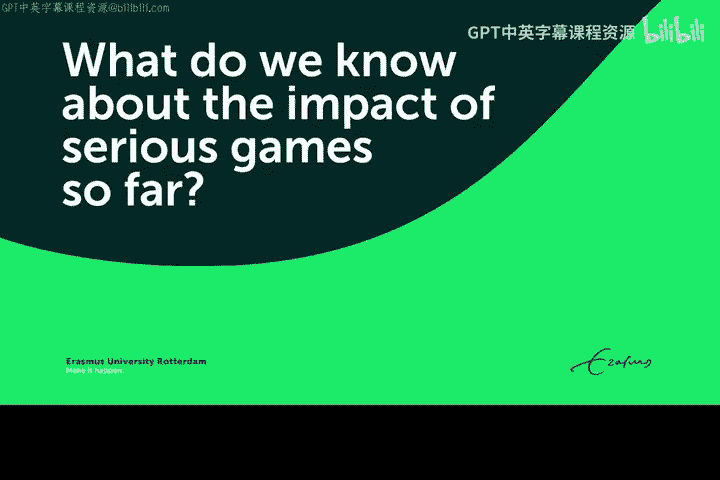

# 严肃游戏：P22：圆桌讨论：当前严肃游戏影响力研究的共识 🎮

在本节课中，我们将探讨严肃游戏如何影响玩家，以及研究这种影响力为何充满挑战。我们将通过三位游戏研究专家的讨论，了解当前研究的共识、设计策略以及评估方法。

---

## 严肃游戏的影响力挑战

严肃游戏开发者试图教授玩家某些知识、态度或行为。然而，研究这种影响力为何如此困难？当前的前沿研究能告诉我们什么？

在演播室中，我们有来自伊拉斯姆斯大学的Julia Neer博士和Theresa de La Era博士，以及来自蒂尔堡大学的Hajo Jacobs博士。他们从不同的科学视角进行游戏研究。本次圆桌讨论的主题是严肃游戏的影响力。

## 娱乐游戏与严肃游戏的影响力差异

许多学习者对游戏影响力存在疑问。本周我们看到，关于暴力娱乐游戏及其对行为影响的研究很多，但存在许多相互矛盾的理论，结论并不明确。

我们实际上只能得出结论：我们并不确切知道其影响力是什么。现在，严肃游戏开发者也需要回答这些问题。他们需要了解其游戏的影响力，是否有助于学习或理解某个议题。因此，他们关注的是游戏可能产生的积极影响。

那么，我们能否从娱乐游戏研究中得出结论，认为严肃游戏领域的影响力也未得到证实？

首先，我们需要区分不同类型的效应。对于暴力游戏及其影响的问题，确实如此。然而，对于娱乐游戏的积极效应，如缓解压力或改善情绪，这些效应是存在的。这部分很有趣，对严肃游戏也非常重要。

当然，娱乐游戏的目标是娱乐，而严肃游戏则有不同的目标：它们需要教授知识、改变态度，甚至改变行为。当我们考虑到许多严肃游戏是由第三方（如绿色和平组织等非政府组织）委托制作时，这一点变得更有趣、更紧迫。这些组织当然有不同的目标，例如改变人们对气候变化的态度。

## 严肃游戏在证明影响力方面的优势

严肃游戏在设计意图上更有利于讨论影响力。换个角度回答你的问题，我会说，严肃游戏影响力的证据看起来比暴力游戏影响力的证据要健康得多。

确实，一些严肃游戏并未完全达到预期效果。但随着时间的推移，我们看到许多同行发现，严肃游戏对玩家的态度、行为和知识产生了持续但较小的影响。

例如，Dana Rojjro测试了一款关于无家可归者的游戏《Spent》。与文本材料相比，该游戏在改变人们对无家可归者态度方面效果更佳，且这种效应在三周后依然存在。三周后，人们仍因这款游戏而思考无家可归问题，而阅读文本的人则没有。

我甚至可以说，我们现在已经可以不再局限于测试单个游戏，而是开始思考测试游戏内的说服策略以及其他严肃游戏设计策略。这样，我们可以为游戏设计师提供具体建议，帮助他们制作出符合其传播信息的游戏。

## 严肃游戏的设计与说服策略

所以，严肃游戏实际上是为影响力而设计的，这是它与娱乐游戏的主要区别。如果我的理解正确，研究实际上可以在这个过程中帮助设计师。

我们上周已经讨论过说服力。Theresa，你刚刚出版了一本书《数字游戏与广告格局》，探讨了游戏作为说服媒介的潜力。你能告诉我们，严肃游戏是如何设计以实现其严肃目标的吗？

我在书中解释的是，游戏中有多种元素，我称之为“说服维度”，我们可以利用它们来说服玩家，以实现特定的严肃目标。我的观点是，游戏中的所有元素，例如角色的视觉设计、选择的声音或音乐、故事情节或规则，都是我们可以用来向玩家传递信息的东西。

那么，我们如何精确地组合所有这些元素以实现特定的严肃目标？这就是我所说的“说服策略”。因此，策略——说服策略——非常重要。它涉及你可以使用的不同元素的组合。

但我们如何识别什么是好的说服策略呢？这是一个好问题。我可以说，一个好的说服策略是游戏中的所有元素在设计时都考虑到或牢记严肃目标的策略。因为严肃游戏有参与目标和严肃目标，我们既要确保严肃信息能够传达，也要确保玩家参与其中。

有时，我们引入游戏元素时只考虑了参与目的，却忘记了严肃目的。一个好的例子是，游戏中有一段文本，玩家需要阅读以获得严肃信息，但同时为了增加参与度，引入了时间限制。很可能玩家不会去阅读文本，因为他们感受到了时间压力。

这是因为引入时间限制时只考虑了参与目标，而完全忘记了严肃目标。所以，影响力不仅取决于说服元素，还确实取决于参与度。你需要投入游戏才能使其发挥作用。

## 游戏作为媒介的独特优势

从你所说的来看，游戏似乎比其他媒体产品更适合实现影响力，甚至可能具有更大的影响力。为什么玩家体验严肃游戏与仅仅观看（例如）YouTube视频如此不同？

我不会说这对整个媒介都是如此。所以我的答案仅反映了我所研究的那类游戏。但在那些游戏中，我真正看到的是玩家的选择、玩家的能动性使其与其他任何体验区分开来，因为你在游戏中做某事，你看到了自己行为的结果。这非常重要。

我想到我测试过的游戏《我的采棉生活》，你在游戏中采摘棉花。我将这款游戏与一个关于同一主题的YouTube视频进行了对比测试。YouTube视频和游戏在人们是否感到有能力停止采棉以及人们是否认识到这是奴隶制（事实如此）方面具有相同的效果。

但游戏略有不同，因为它让玩家体验了采棉的感受。他们突然觉得这项工作比观看视频的人所认为的要困难得多。正是这种效应——他们觉得工作艰难而乏味，尽管这只是一次虚拟体验——使得游戏更具影响力，因为他们自己的选择和行为。

在后续研究中，我们改变了这个游戏玩法方面，使采摘棉花变得更容易。我们注意到，仅仅让游戏玩法变得简单一点，整个游戏的说服力就减少了一半。仅仅因为程序修辞（游戏玩法信息）被从游戏中移除，说服力就减半了。所以，参与度也可能意味着游戏实际上有点挑战性。

## 实践案例：《Fogland》游戏的设计与影响

现在，让我们看一个严肃游戏的实践案例，包括其设计和影响力。Julia，你创建了自己的游戏《Fogland》，其中批评了吸烟的所谓“积极”效应。我们有一段视频，你可以看到游戏的内容。我想我们会听到你的声音，因为我被告知你做了旁白。

让我们看一下。

> **视频旁白：**
> 你认识吸烟的人吗？或者你自己就是吸烟者？你真的认为有人吸烟是为了生病吗？你认为人们为什么吸烟？吸烟最常见的两个动机仍然是社交互动和减压。那么，让我们思考如何利用这些知识来帮助人们减少甚至戒烟。
>
> 在鹿特丹伊拉斯姆斯大学媒体与传播系，Yuliakia、Iunance与游戏开发商Enrj的Michel Bas合作，开发了一款名为《Fogland》的新游戏。这款游戏针对吸烟的两个原因。第一个目标是帮助游戏角色通过提供替代方案来戒烟。第二个目标是提高对可能导致复吸情境的意识和敏感性。每轮游戏在7分钟内进行，这通常是吸一支烟所需的时间。
>
> 《Fogland》的效果在实验室研究中进行了测试。确实，研究发现玩《Fogland》减少了悲伤感。玩家感觉更清醒，情绪总体上有所改善。最重要的是，玩家在游戏中感受到的自主性和沉浸感越强，他们在第二天吸烟的数量就越少。我希望我们说服了你我们的想法。不要吸烟。玩《Fogland》。

Julia，你是如何设计这款游戏的？这个游戏的想法来自我自己关于吸烟的研究。这项研究主要显示了两点：第一点，毫不奇怪，没有人吸烟是为了生病；第二点，如果你直接攻击吸烟者，展示“嘿，你的行为不是最聪明的”，这个人会变得非常防御，因为没有人愿意被评判。

所以我们发现，最好不要直接针对本人，而是给这个人一个为他人负责的机会，就像你在《Fogland》中看到的那样。然后，我们开始与鹿特丹游戏开发商Ed Ranch的Michael Bas合作开发游戏。我设计了《Fogland》的结构和规则。所以你不能攻击吸烟者说吸烟对他们有害，你必须找到其他方式来说服他们。

## 如何评估游戏的影响力

那么，你如何确定你的游戏的影响力呢？我与我的同事Sani Ge一起开发了许多关于潜在过程的方法。如果一个吸烟者的行为受到攻击，这些方法和测量手段经过调整，可用于《Fogland》的研究。

我们主要发现，娱乐游戏领域使用的其他测量方法也有助于研究严肃游戏《Fogland》。我们看到，一个人沉浸在这个游戏中的程度越深，他在接下来24小时内吸烟的数量就越少，这相当有趣。所以你实际上测量了24小时内的效应或游戏的影响力。

我们知道这是相当短期的，24小时。是否有关于长期效应的研究项目？目前我们还没有关于长期效应的结果，因为《Fogland》是一款棋盘游戏。我们想开发一个数字版本，然后我们也能够研究它是否具有长期效应。所以这是正在进行的工作。

## 研究方法：定量与定性

正如我们所知，有不同的方法来确定游戏是否具有影响力。我们在本课程中已经学过。你有定量方法，也有定性方法。每种方法都有其自身的优点和挑战。

Theresa，你能告诉我们，你认为哪种方法对于确定严肃游戏的影响力最有用吗？从我的角度来看，所有方法都有助于我们更好地理解严肃游戏的影响力。《Against All Odds》游戏就是一个很好的例子。这款游戏旨在让玩家难民的处境，以增加同理心。

对该游戏的定量研究表明，与其他媒体形式相比，没有持久效应，认同感和沉浸感也没有实质性价值。而一项补充性的定性研究表明，玩家实际上能够理解游戏的叙事，他们能够理解这是关于同理心的，但他们个人并不认同这个叙事，这是他们未能产生同理心的主要原因，主要是因为他们认为叙事不够现实。

这是一个很好的例子，说明了定性研究如何能够解释或帮助解释定量研究的结果。所以，实际上，它们在某种程度上是相互需要的。

## 游戏研究者面临的最大挑战

你认为对于真正想了解严肃游戏影响力的游戏研究者来说，最大的挑战是什么？最困难的事情是什么？我认为挑战与一个事实相关，即严肃游戏的影响力不仅与游戏本身的设计有关，还与玩家的表现以及游戏进行的环境有关。

游戏本质上是互动的，因此玩家在某种程度上会影响最终的体验和解读，环境也是如此。例如，我们可能在玩游戏时分心，或者可能在开始时提供了额外信息，所有这些都会以某种方式影响影响力。

但从我的角度来看，这些挑战在媒体研究中是普遍存在的，不仅限于严肃游戏。因此，迄今为止我们所有研究的结果仍然为我们提供了关于这些游戏价值和影响力的良好指示。作为研究者，我们也逐渐学会了应对这些挑战。

## 个人喜爱的严肃游戏案例

我们可以得出结论，进行关于影响力的研究并不容易，你会在实践中体验到这一点。研究中可能更令人愉快的部分是，你在进行研究时可能也被允许玩很多游戏。在严肃游戏方面，你个人最喜欢的是什么？也许是一个也能展示游戏影响力的例子？

我会说，不是某一款游戏是我的最爱，而是整个类型。每年都有一个设计挑战，邀请世界各地的人们设计一款关于青少年关系中虐待行为的游戏。这不是一个愉快的话题，这些游戏玩起来也相当悲惨，但它们也非常有影响力。

你会看到对这些游戏非常严肃的处理方式。我在自己的研究中测试了其中两款游戏。一款游戏叫《Another Chance》，它是一款叙事导向的游戏，是线性的，所以你只能随着游戏进程看到主角身上发生的事情，当地意识到男友的行为非常具有虐待性时。

我将此与另一款名为《Power and Control》的游戏进行了比较，后者是一款关于游戏玩法的游戏。在游戏玩法中，你躲避一个虐待你的人。这听起来像是一个糟糕的游戏，但实际上玩起来是一种非常强大的体验。

当我将这些游戏与对照游戏进行测试时，我发现这些游戏对接受虐待行为产生了影响（当然，接受度下降了），但我也看到人们处理虐待行为的自我效能感也下降了，人们感觉在阻止或发现虐待行为方面能力减弱。这听起来像是一个负面效应，但我将其解释为人们意识到问题的范围比他们想象的要大，这是一个比他们想象中更大的问题。实际上，这可以成为一个开启对话的方式。

更重要的是，当我将这些游戏相互测试时，我注意到它们具有完全相同的效果。因此，尽管其中一款非常注重游戏玩法，另一款非常注重叙事，一款玩起来时间更长，但它们具有相同的效果。这意味着设计师有一定的创作自由，他们可以以任何他们想要的方式处理，只要他们专注于使信息与他们所考虑的游戏玩法策略相匹配。

## 给游戏设计师的最终建议

所以我们也了解到，并没有单一的影响力配方，但可能有多种方式可以用你的游戏实现相同的目标。现在，我有最后一个问题来结束这次圆桌讨论，实际上是针对你们所有人的，这个问题更实际一些。如果你必须给游戏设计师一条建议，他们真的正在制作自己的严肃游戏，那会是什么？

基于我的见解，这与娱乐游戏研究告诉我们的大体一致：游戏必须具有沉浸感才能有效，这意味着人们需要投入其中，甚至可能有点上瘾。在这里，一点点上瘾是可以的。

但同时，我会说参与度可以通过非常不同的方式来实现。设计师不应只专注于以非常传统的方式让游戏变得有趣（比如让他们大笑），而应专注于一种情感反应。你希望玩家对你的信息感到愤怒吗？你希望玩家感到被赋能吗？你希望他们反思吗？这就是游戏设计师应该关注的，他们想要营造的情感体验。

所以严肃游戏不仅应该提供信息，还应该具有吸引力和情感性，人们在玩的时候应该感受到一些东西。Theresa，你的最后一条建议是什么？我的建议是注意严肃目标和参与目标，并确保它们是一致的，没有不一致之处，因为这可能会阻碍严肃信息的传达。

---

在本节课中，我们一起探讨了严肃游戏影响力的复杂性、设计与评估方法。我们了解到，严肃游戏的影响力不仅取决于设计，还与玩家的参与度和情感体验密切相关。通过结合定量与定性研究，并确保游戏目标的一致性，设计师可以更有效地创造具有积极影响力的严肃游戏。